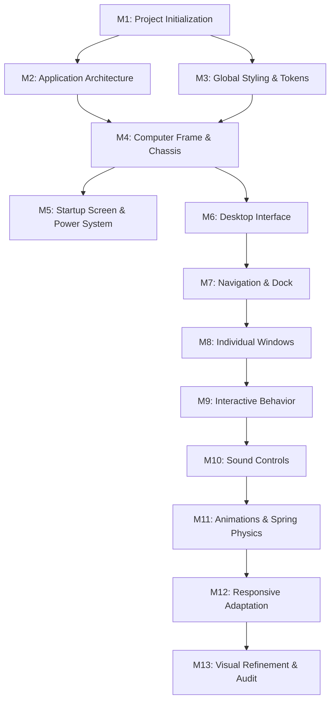

# Stage 1 Implementation Plan: Faithful Website Recreation (Refined)

**Project Name:** Retro PC Developer Portfolio (Milo Varga Recreation)  
**Reference Target:** [https://retro-pc.framer.website/](https://retro-pc.framer.website/)  
**Role:** Senior Software Architect & Frontend Development Project Planner  
**Methodology:** `clone-website` skill standard (Next.js 16 App Router, TypeScript strict, Tailwind CSS v4, Lucide React, Framer Motion)  
**Document Link:** [implementation-plan.md](file:///d:/portfolio/docs/implementation-plan.md)  
**Status:** Refined & Approved for Stage 1. No application code or dependencies have been generated.

---

## 1. Executive Architectural Overview

This implementation plan specifies the complete, faithful recreation of the reference website into a high-performance Next.js 16 application. The application models an amber-phosphor monochrome CRT personal computer with an authentic physical chassis, interactive scanline and glass glare shaders, tactile mechanical sound effects, a 24-hour synchronized clock, and an operating system windowing manager housing all 5 portfolio sections (`Work`, `About me`, `Services`, `Journal`, `Contact`) and a direct `CV` download.

### Core Technology Stack (Fixed Standards)
| Layer | Selected Technology | Architecture & Justification |
| :--- | :--- | :--- |
| **Framework** | Next.js 16 (App Router with `src/`) | Server-side rendering, static generation for case studies, optional catch-all routing. |
| **Language** | TypeScript (Strict mode) | Strict type contracts across window manager, domain entities, and Web Audio subsystems. |
| **Styling** | Tailwind CSS v4 + `@tailwindcss/postcss` | CSS-first architecture (`@import "tailwindcss";`), native `color-mix` tokens, no `tailwind.config.ts`. |
| **Motion** | Framer Motion | Physics-based spring animations for window spawning, maximize, and camera transitions. |
| **Audio** | HTML5 Audio / Web Audio API | Zero-dependency mechanical switch (`switch.mp3`) and POST chime (`beep.mp3`). |
| **Typography** | `Jersey 10` & `Chivo Mono` | Self-hosted WOFF2 web fonts for zero layout shift and authentic pixel/terminal typography. |
| **Icons** | Custom Inline SVG | 16×16 crisp pixel-art SVGs (`shape-rendering="crispEdges"`) matching reference artwork. |
| **Testing** | Vitest + React Testing Library + Playwright | Unit/component tests via Vitest; end-to-end multi-viewport browser testing via Playwright. |

---

## 2. Architectural Decisions & Technical Protocols

### A. URL Synchronization Architecture: Native History API vs. App Router Navigation
* **Architectural Decision:** **Native History API (`window.history.pushState` / `replaceState` + `popstate` listener) synchronized with React State and an optional catch-all route (`src/app/[[...window]]/page.tsx`).**
* **Technical Justification:**
  1. The application represents a unified, stateful retro computer workstation. The physical CRT monitor frame, power sequence state, 3D desk camera zoom position, and active Web Audio playback context reside in the root desktop workspace.
  2. Standard Next.js App Router navigations (`router.push` or `<Link>`) trigger React Server Component (RSC) network roundtrips and component tree re-evaluations. This can cause audio stuttering, subtle canvas flickers, or unwanted re-mounts of the 3D desk environment.
  3. By utilizing `window.history.pushState(null, '', '/work')` coordinated via `WindowManagerContext`:
     - Clicking a desktop icon updates `activeWindow` in React state with **0ms latency** and zero network overhead while keeping the browser address bar synchronized.
     - Native browser Back and Forward navigation is intercepted via `window.addEventListener('popstate')`, updating the active window state naturally.
     - Cold entry (e.g. directly loading `http://localhost:3000/work` or `/services`) is seamlessly resolved on the initial server render by `src/app/[[...window]]/page.tsx`, mounting the desktop with the target window immediately opened.

### B. Standardized Project Structure (`src/`)
All application source code is isolated inside `src/`. Path aliases are configured in `tsconfig.json` as `"@/*": ["./src/*"]`:
```
d:/portfolio/
├── docs/                               # Phase 1 Research & Architecture Specifications
│   ├── implementation-plan.md          # Master Implementation Plan (this document)
│   ├── testing/                        # Test reports and verification audits
│   └── research/                       # Research documentation and specifications
│       ├── reference-overview.md       # Comprehensive inspection findings
│       ├── responsive-analysis.md      # Viewport layout analysis
│       ├── design-system.md            # Visual design tokens and computed CSS
│       ├── components/                 # 11 individual component specifications
│       └── screenshots/                # Phase 1 captured visual evidence
├── public/                             # Static assets
│   ├── audio/                          # Sound effects (switch.mp3, beep.mp3)
│   ├── fonts/                          # Self-hosted WOFF2 web fonts
│   ├── images/                         # Project thumbnails, casing, and avatar
│   └── docs/                           # CV PDF document
├── src/                                # Application Source Root
│   ├── app/                            # Next.js App Router
│   │   ├── layout.tsx                  # Root layout & font variable providers
│   │   ├── globals.css                 # Tailwind v4 import & design system tokens
│   │   └── [[...window]]/page.tsx      # Unified desktop route & deep-link resolver
│   ├── components/                     # Modular React Components
│   │   ├── hardware/                   # MonitorBezel, CrtScreen, PowerSwitch, DeskScene
│   │   ├── startup/                    # StandbyPrompt, CrtPowerTransition
│   │   ├── desktop/                    # DesktopCanvas, HeroHeadline, AmbientBio, IconGrid
│   │   ├── dock/                       # DockBar, DockAppIcons, DigitalClock, SoundToggle
│   │   ├── windows/                    # WindowFrame, WorkWindow, AboutWindow, etc.
│   │   ├── work/                       # ProjectCard, ProjectDetailView
│   │   ├── services/                   # ServiceCard
│   │   ├── journal/                    # ArticleReader
│   │   ├── contact/                    # ContactForm
│   │   ├── icons/                      # 16x16 crisp pixel-art SVG primitives
│   │   ├── crt/                        # Scanlines, GlassGlare overlays
│   │   └── ui/                         # RetroButton, TerminalCursor primitives
│   ├── context/                        # React Context Stores (WindowManager, Sound)
│   ├── hooks/                          # Custom Hooks (useWindowManager, useSound, usePower)
│   ├── types/                          # Strict TypeScript Domain Interfaces
│   ├── data/                           # Static Content Data (projects, services, journal, bio)
│   └── lib/                            # Audio controllers, motion config, utility helpers
├── tests/                              # Unit, component, and E2E test suites
│   ├── unit/                           # Vitest component and logic tests
│   └── e2e/                            # Playwright multi-viewport tests
├── package.json
├── tsconfig.json
├── postcss.config.mjs                  # @tailwindcss/postcss
├── vitest.config.ts                    # Vitest configuration
└── playwright.config.ts                # Playwright configuration
```

### C. Tailwind CSS v4 CSS-First Configuration
Tailwind CSS v4 replaces legacy JavaScript configuration files with a modern CSS-first approach:
- **No `tailwind.config.ts`:** Tailwind v4 detects template sources automatically and defines theme extensions in CSS.
- **PostCSS Configuration (`postcss.config.mjs`):**
  ```javascript
  export default {
    plugins: {
      '@tailwindcss/postcss': {},
    },
  };
  ```
- **Entry Stylesheet (`src/app/globals.css`):**
  ```css
  @import "tailwindcss";

  @theme {
    --font-pixel: var(--font-jersey-10);
    --font-mono: var(--font-chivo-mono);
    --color-phosphor: #ffb648;
    --color-phosphor-glow: #ffdba4;
    --color-phosphor-dim: #74582b;
    --color-crt-void: #020b14;
    --color-casing-base: #d2c8b4;
    --color-casing-highlight: #e8e2d2;
    --color-casing-shadow: #8f8572;
  }
  ```

### D. Canonical Responsive Breakpoints
To align strictly with the reference website's layout shifts:
- **Mobile Viewport:** `< 768px` (Portrait smartphone layout; 3D room hidden; compact touch grid; full-bleed window modals).
- **Tablet Viewport:** `768px – 999px` (Portrait tablet display; 3D room hidden; CRT fills width; 3×2 top icon grid; stacked headline).
- **Desktop Viewport:** `>= 1000px` (Wide screen workstation; 3D desk scene active when aspect ratio `>= 1.2`; camera zoom controls enabled; 2×3 desktop icon grid).

### E. Accessible Viewport Configuration
To comply with WCAG 2.1 Success Criterion 1.4.4 (Resize Text) and avoid breaking assistive pinch-to-zoom:
- **Viewport Meta:** `<meta name="viewport" content="width=device-width, initial-scale=1" />`
- **Strict Prohibition:** `maximum-scale=1` and `user-scalable=no` are completely omitted.

### F. TypeScript Domain Type Corrections
- `WindowId`: Must strictly represent valid open window identifiers and **must not include `null`**:
  ```typescript
  export type WindowId = 'work' | 'about' | 'services' | 'journal' | 'contact';
  ```
- `activeWindow`: Declared as `WindowId | null` in the state layer:
  ```typescript
  export interface WindowManagerState {
    activeWindow: WindowId | null;
    isMaximized: boolean;
    powerState: 'off' | 'powering-on' | 'on' | 'powering-off';
  }
  ```

### G. Contact Form Local Demonstration Protocol
- In **Stage 1 (Faithful Recreation)**, the contact form functions strictly as an interactive **local demonstration**.
- **No external emails are sent or claimed to be delivered.**
- Client-side validation checks `Name`, `Email`, and `Message`.
- Upon submission, the 3D button enters a pressed state with a `"Sending..."` indicator, triggers a simulated 1.2s network delay, and displays an amber terminal confirmation banner:  
  `"Demo message received! (Stage 1 simulation — no external email dispatched)"`.
- Live email delivery (e.g. Resend, SendGrid, or Formspree) is deferred to Stage 2 personalization.

### H. Asset Provenance & Fair Use Protocol
- **Local Research Only:** All media assets extracted during Phase 1 (photography by Milo Varga, template layouts by Julian Romli, case study copy, and sound effects) are proprietary creative works.
- **Strict Boundary:** Stage 1 is an engineering exercise confined strictly to local development and private testing. **Stage 1 must never be published to a public production URL or repository.**
- **Stage 2 Handoff:** Prior to any public hosting, Stage 2 will replace all third-party case studies, project imagery, branding, and copy with original developer content.

### I. Current Core Web Vitals Performance Targets
Reflecting modern performance standards (Google officially deprecated First Input Delay in March 2024 in favor of Interaction to Next Paint):
- **LCP (Largest Contentful Paint):** `<= 2.5s`
- **INP (Interaction to Next Paint):** `<= 200ms`
- **CLS (Cumulative Layout Shift):** `<= 0.1`

### J. Testing Architecture & Tooling
Rather than assuming generic scripts exist, specific testing tools are defined:
- **Unit & Component Testing:**
  - Framework: **Vitest** + **@testing-library/react** + **jsdom** + **@vitejs/plugin-react**
  - Configuration: `vitest.config.ts`
  - Scripts: `"test": "vitest run"`, `"test:watch": "vitest"`
- **End-to-End Browser Automation Testing:**
  - Framework: **@playwright/test**
  - Configuration: `playwright.config.ts`
  - Scripts: `"test:e2e": "playwright test"`
  - Emulates 1440×900, 768×1024, and 390×844 viewports to verify visual parity and responsive behaviors.

---

## 3. Phase 1 Artifacts Verification Matrix

Every research specification and screenshot referenced by this plan has been verified to exist on disk:

| Artifact Path | Category | Status & Verified Contents |
| :--- | :--- | :--- |
| [`docs/research/reference-overview.md`](file:///d:/portfolio/docs/research/reference-overview.md) | Research Overview | Verified. Complete 12-section reference site audit. |
| [`docs/research/responsive-analysis.md`](file:///d:/portfolio/docs/research/responsive-analysis.md) | Responsive Analysis | Verified. Layout analysis for 1440×900, 768×1024, 390×844. |
| [`docs/research/design-system.md`](file:///d:/portfolio/docs/research/design-system.md) | Design System | Verified. Computed CSS tokens, colors, fonts, and CRT shaders. |
| [`docs/research/components/startup-screen.md`](file:///d:/portfolio/docs/research/components/startup-screen.md) | Component Spec | Verified. Power sequence, standby prompt, LED indicator. |
| [`docs/research/components/desktop-interface.md`](file:///d:/portfolio/docs/research/components/desktop-interface.md) | Component Spec | Verified. 3D desk view, monitor bezel, CRT container specs. |
| [`docs/research/components/navigation.md`](file:///d:/portfolio/docs/research/components/navigation.md) | Component Spec | Verified. 6 desktop icons, dock structure, active pills. |
| [`docs/research/components/hero-section.md`](file:///d:/portfolio/docs/research/components/hero-section.md) | Component Spec | Verified. Headline "Milo Varga", bio text, terminal cursor. |
| [`docs/research/components/work-section.md`](file:///d:/portfolio/docs/research/components/work-section.md) | Component Spec | Verified. 10 project cards grid, case study detail modal. |
| [`docs/research/components/about-section.md`](file:///d:/portfolio/docs/research/components/about-section.md) | Component Spec | Verified. Avatar, studio bio, clients, colophon. |
| [`docs/research/components/services-section.md`](file:///d:/portfolio/docs/research/components/services-section.md) | Component Spec | Verified. 4 packages, pricing, deliverables, 3D buttons. |
| [`docs/research/components/journal-section.md`](file:///d:/portfolio/docs/research/components/journal-section.md) | Component Spec | Verified. 5 essay rows, reader view, pull-quotes. |
| [`docs/research/components/contact-section.md`](file:///d:/portfolio/docs/research/components/contact-section.md) | Component Spec | Verified. Email composer window, form inputs, studio info. |
| [`docs/research/components/cv-interaction.md`](file:///d:/portfolio/docs/research/components/cv-interaction.md) | Component Spec | Verified. 3.5" floppy icon, direct PDF anchor link behavior. |
| [`docs/research/components/sound-controls.md`](file:///d:/portfolio/docs/research/components/sound-controls.md) | Component Spec | Verified. 3D speaker button, tooltip, live 24h tabular clock. |
| `docs/research/screenshots/01_initial_load.png` .. `25_mobile_...png` | Visual Evidence | Verified. 25 high-resolution numbered interaction screenshots. |
| `docs/research/screenshots/responsive/*` | Visual Evidence | Verified. 8 responsive viewport screenshots (desktop, tablet, mobile). |

---

## 4. Master Task Tracking & GitHub Branch Mapping Matrix

### Complete GitHub Branch Mapping
Every numbered task across all 13 milestones has a dedicated, unique Git branch cut from the latest `stage-1` integration branch (`task/TASK-NUMBER-short-description`). All task Pull Requests target `stage-1`. All 50 tasks are initially set to `NOT STARTED` with merge status `Unmerged`.

| Task number | Task description | Branch name | Status | Pull Request | Commit | Merge status |
| :--- | :--- | :--- | :--- | :--- | :--- | :--- |
| **M1** | **Milestone 1: Project Initialization** | | | | | |
| Task 1.1 | Next.js 16 Project Scaffold & Dependency Configuration | `task/1.1-nextjs-scaffold` | `NOT STARTED` | - | - | Unmerged |
| Task 1.2 | Static Asset Directory Structure & Ingestion | `task/1.2-static-assets` | `NOT STARTED` | - | - | Unmerged |
| Task 1.3 | Web Font Integration (`Jersey 10` & `Chivo Mono`) | `task/1.3-font-integration` | `NOT STARTED` | - | - | Unmerged |
| **M2** | **Milestone 2: Application Architecture** | | | | | |
| Task 2.1 | TypeScript Domain Types & Interfaces | `task/2.1-domain-types` | `NOT STARTED` | - | - | Unmerged |
| Task 2.2 | Mock Data Layer (Projects, Services, Journal, Bio) | `task/2.2-mock-data` | `NOT STARTED` | - | - | Unmerged |
| Task 2.3 | Audio Context & Sound State Store | `task/2.3-audio-context` | `NOT STARTED` | - | - | Unmerged |
| Task 2.4 | Window Manager & Desktop State Store | `task/2.4-window-manager` | `NOT STARTED` | - | - | Unmerged |
| **M3** | **Milestone 3: Global Styling & Design Tokens** | | | | | |
| Task 3.1 | CSS Custom Properties & Phosphor Color Tokens | `task/3.1-design-tokens` | `NOT STARTED` | - | - | Unmerged |
| Task 3.2 | CRT Scanline Raster & Phosphor Bloom Utilities | `task/3.2-crt-shaders` | `NOT STARTED` | - | - | Unmerged |
| Task 3.3 | Custom Retro Pixel Cursors & Interaction Styles | `task/3.3-custom-cursors` | `NOT STARTED` | - | - | Unmerged |
| **M4** | **Milestone 4: Computer Frame & Chassis** | | | | | |
| Task 4.1 | Bezel Enclosure & Outer Chassis Component | `task/4.1-bezel-enclosure` | `NOT STARTED` | - | - | Unmerged |
| Task 4.2 | CRT Tube Glass Display Container | `task/4.2-crt-tube-container` | `NOT STARTED` | - | - | Unmerged |
| Task 4.3 | Physical Rocker Power Switch & Hardware LED | `task/4.3-power-switch-led` | `NOT STARTED` | - | - | Unmerged |
| Task 4.4 | 3D Workstation Desk Scene & Camera Controls | `task/4.4-3d-desk-scene` | `NOT STARTED` | - | - | Unmerged |
| **M5** | **Milestone 5: Startup Screen & Power System** | | | | | |
| Task 5.1 | Power-Off State & Blinking Standby Prompt | `task/5.1-standby-prompt` | `NOT STARTED` | - | - | Unmerged |
| Task 5.2 | Keyboard Any-Key Listener & Power Wake Controller | `task/5.2-power-wake-controller` | `NOT STARTED` | - | - | Unmerged |
| Task 5.3 | CRT Power Collapse & Phosphor Warm-Up Keyframe Animations | `task/5.3-crt-power-animations` | `NOT STARTED` | - | - | Unmerged |
| **M6** | **Milestone 6: Desktop Interface** | | | | | |
| Task 6.1 | Desktop Operating System Canvas & Layout Shell | `task/6.1-desktop-shell` | `NOT STARTED` | - | - | Unmerged |
| Task 6.2 | Hero Section & Glowing Nameplate | `task/6.2-hero-nameplate` | `NOT STARTED` | - | - | Unmerged |
| Task 6.3 | Ambient Studio Bio Paragraph with Terminal Cursor | `task/6.3-ambient-bio` | `NOT STARTED` | - | - | Unmerged |
| Task 6.4 | Desktop Hint Prompt | `task/6.4-desktop-hint` | `NOT STARTED` | - | - | Unmerged |
| **M7** | **Milestone 7: Navigation & Taskbar Dock** | | | | | |
| Task 7.1 | Pixel-Art SVG Icon Primitives Library | `task/7.1-pixel-icons` | `NOT STARTED` | - | - | Unmerged |
| Task 7.2 | Desktop Icon Grid Component | `task/7.2-icon-grid` | `NOT STARTED` | - | - | Unmerged |
| Task 7.3 | Bottom Taskbar Dock Shell | `task/7.3-dock-shell` | `NOT STARTED` | - | - | Unmerged |
| Task 7.4 | Dock Quick-Launch Mini Icons & Active Window Tab | `task/7.4-dock-app-icons` | `NOT STARTED` | - | - | Unmerged |
| Task 7.5 | Studio Availability Status Badge | `task/7.5-availability-badge` | `NOT STARTED` | - | - | Unmerged |
| Task 7.6 | Live Tabular 24-Hour System Clock | `task/7.6-system-clock` | `NOT STARTED` | - | - | Unmerged |
| **M8** | **Milestone 8: Individual Windows** | | | | | |
| Task 8.1 | Generic Retro Window Shell Component | `task/8.1-window-shell` | `NOT STARTED` | - | - | Unmerged |
| Task 8.2 | Work / Projects Window & 10-Item Project Grid | `task/8.2-work-window` | `NOT STARTED` | - | - | Unmerged |
| Task 8.3 | Project Case Study Detail Reader View | `task/8.3-project-detail-view` | `NOT STARTED` | - | - | Unmerged |
| Task 8.4 | About Me Window & Studio Profile | `task/8.4-about-window` | `NOT STARTED` | - | - | Unmerged |
| Task 8.5 | Services & Pricing Window | `task/8.5-services-window` | `NOT STARTED` | - | - | Unmerged |
| Task 8.6 | Journal & Editorial Window | `task/8.6-journal-window` | `NOT STARTED` | - | - | Unmerged |
| Task 8.7 | Contact Email Composer Window | `task/8.7-contact-window` | `NOT STARTED` | - | - | Unmerged |
| **M9** | **Milestone 9: Interactive Behavior** | | | | | |
| Task 9.1 | Window Maximizing, Restoring, and Closing Logic | `task/9.1-window-sizing-controls` | `NOT STARTED` | - | - | Unmerged |
| Task 9.2 | Single-Click Navigation & Route Synchronization | `task/9.2-route-sync` | `NOT STARTED` | - | - | Unmerged |
| Task 9.3 | CV Floppy Disk External Navigation | `task/9.3-cv-navigation` | `NOT STARTED` | - | - | Unmerged |
| Task 9.4 | Contact Form Validation & Simulated Demonstration Submission | `task/9.4-contact-simulation` | `NOT STARTED` | - | - | Unmerged |
| **M10** | **Milestone 10: Sound Controls & Audio System** | | | | | |
| Task 10.1 | Mechanical Switch & Terminal Beep Audio Integration | `task/10.1-audio-integration` | `NOT STARTED` | - | - | Unmerged |
| Task 10.2 | Dock Sound Toggle Button & Hover Tooltip | `task/10.2-sound-toggle-ui` | `NOT STARTED` | - | - | Unmerged |
| Task 10.3 | Audio Preference Persistence | `task/10.3-sound-persistence` | `NOT STARTED` | - | - | Unmerged |
| **M11** | **Milestone 11: Animations & Spring Physics** | | | | | |
| Task 11.1 | Framer Motion Window Scale & Fade Springs | `task/11.1-window-spring-physics` | `NOT STARTED` | - | - | Unmerged |
| Task 11.2 | 3D Beveled Button Active Inset Micro-Interactions | `task/11.2-button-micro-interactions` | `NOT STARTED` | - | - | Unmerged |
| Task 11.3 | Terminal Cursor Blink & Typing Micro-Interactions | `task/11.3-cursor-micro-interactions` | `NOT STARTED` | - | - | Unmerged |
| **M12** | **Milestone 12: Responsive Behavior & Mobile Adaptation** | | | | | |
| Task 12.1 | Tablet Portrait Breakpoint Adaptation (`768px – 999px`) | `task/12.1-tablet-adaptation` | `NOT STARTED` | - | - | Unmerged |
| Task 12.2 | Mobile Smartphone Breakpoint Adaptation (`< 768px`) | `task/12.2-mobile-adaptation` | `NOT STARTED` | - | - | Unmerged |
| Task 12.3 | Mobile Touch Ergonomics & Viewport Overflow Constraints | `task/12.3-mobile-touch-ergonomics` | `NOT STARTED` | - | - | Unmerged |
| **M13** | **Milestone 13: Visual Refinement & Final Testing** | | | | | |
| Task 13.1 | Pixel-Perfect Visual Audit vs Phase 1 Screenshots | `task/13.1-visual-audit` | `NOT STARTED` | - | - | Unmerged |
| Task 13.2 | Cross-Browser & Viewport Verification | `task/13.2-cross-browser-testing` | `NOT STARTED` | - | - | Unmerged |
| Task 13.3 | Performance & Core Web Vitals Optimization | `task/13.3-core-web-vitals` | `NOT STARTED` | - | - | Unmerged |

### Master Implementation Checklist

- [ ] **Milestone 1: Project Initialization**
  - [ ] Task 1.1: Next.js 16 Project Scaffold & Dependency Configuration (`task/1.1-nextjs-scaffold`)
  - [ ] Task 1.2: Static Asset Directory Structure & Ingestion (`task/1.2-static-assets`)
  - [ ] Task 1.3: Web Font Integration (`Jersey 10` & `Chivo Mono`) (`task/1.3-font-integration`)
- [ ] **Milestone 2: Application Architecture**
  - [ ] Task 2.1: TypeScript Domain Types & Interfaces (`task/2.1-domain-types`)
  - [ ] Task 2.2: Mock Data Layer (Projects, Services, Journal, Bio) (`task/2.2-mock-data`)
  - [ ] Task 2.3: Audio Context & Sound State Store (`task/2.3-audio-context`)
  - [ ] Task 2.4: Window Manager & Desktop State Store (`task/2.4-window-manager`)
- [ ] **Milestone 3: Global Styling & Design Tokens**
  - [ ] Task 3.1: CSS Custom Properties & Phosphor Color Tokens (`task/3.1-design-tokens`)
  - [ ] Task 3.2: CRT Scanline Raster & Phosphor Bloom Utilities (`task/3.2-crt-shaders`)
  - [ ] Task 3.3: Custom Retro Pixel Cursors & Interaction Styles (`task/3.3-custom-cursors`)
- [ ] **Milestone 4: Computer Frame & Chassis**
  - [ ] Task 4.1: Bezel Enclosure & Outer Chassis Component (`task/4.1-bezel-enclosure`)
  - [ ] Task 4.2: CRT Tube Glass Display Container (`task/4.2-crt-tube-container`)
  - [ ] Task 4.3: Physical Rocker Power Switch & Hardware LED (`task/4.3-power-switch-led`)
  - [ ] Task 4.4: 3D Workstation Desk Scene & Camera Controls (`task/4.4-3d-desk-scene`)
- [ ] **Milestone 5: Startup Screen & Power System**
  - [ ] Task 5.1: Power-Off State & Blinking Standby Prompt (`task/5.1-standby-prompt`)
  - [ ] Task 5.2: Keyboard Any-Key Listener & Power Wake Controller (`task/5.2-power-wake-controller`)
  - [ ] Task 5.3: CRT Power Collapse & Phosphor Warm-Up Keyframe Animations (`task/5.3-crt-power-animations`)
- [ ] **Milestone 6: Desktop Interface**
  - [ ] Task 6.1: Desktop Operating System Canvas & Layout Shell (`task/6.1-desktop-shell`)
  - [ ] Task 6.2: Hero Section & Glowing Nameplate (`task/6.2-hero-nameplate`)
  - [ ] Task 6.3: Ambient Studio Bio Paragraph with Terminal Cursor (`task/6.3-ambient-bio`)
  - [ ] Task 6.4: Desktop Hint Prompt (`task/6.4-desktop-hint`)
- [ ] **Milestone 7: Navigation & Taskbar Dock**
  - [ ] Task 7.1: Pixel-Art SVG Icon Primitives Library (`task/7.1-pixel-icons`)
  - [ ] Task 7.2: Desktop Icon Grid Component (`task/7.2-icon-grid`)
  - [ ] Task 7.3: Bottom Taskbar Dock Shell (`task/7.3-dock-shell`)
  - [ ] Task 7.4: Dock Quick-Launch Mini Icons & Active Window Tab (`task/7.4-dock-app-icons`)
  - [ ] Task 7.5: Studio Availability Status Badge (`task/7.5-availability-badge`)
  - [ ] Task 7.6: Live Tabular 24-Hour System Clock (`task/7.6-system-clock`)
- [ ] **Milestone 8: Individual Windows**
  - [ ] Task 8.1: Generic Retro Window Shell Component (`task/8.1-window-shell`)
  - [ ] Task 8.2: Work / Projects Window & 10-Item Project Grid (`task/8.2-work-window`)
  - [ ] Task 8.3: Project Case Study Detail Reader View (`task/8.3-project-detail-view`)
  - [ ] Task 8.4: About Me Window & Studio Profile (`task/8.4-about-window`)
  - [ ] Task 8.5: Services & Pricing Window (`task/8.5-services-window`)
  - [ ] Task 8.6: Journal & Editorial Window (`task/8.6-journal-window`)
  - [ ] Task 8.7: Contact Email Composer Window (`task/8.7-contact-window`)
- [ ] **Milestone 9: Interactive Behavior**
  - [ ] Task 9.1: Window Maximizing, Restoring, and Closing Logic (`task/9.1-window-sizing-controls`)
  - [ ] Task 9.2: Single-Click Navigation & Route Synchronization (`task/9.2-route-sync`)
  - [ ] Task 9.3: CV Floppy Disk External Navigation (`task/9.3-cv-navigation`)
  - [ ] Task 9.4: Contact Form Validation & Simulated Demonstration Submission (`task/9.4-contact-simulation`)
- [ ] **Milestone 10: Sound Controls & Audio System**
  - [ ] Task 10.1: Mechanical Switch & Terminal Beep Audio Integration (`task/10.1-audio-integration`)
  - [ ] Task 10.2: Dock Sound Toggle Button & Hover Tooltip (`task/10.2-sound-toggle-ui`)
  - [ ] Task 10.3: Audio Preference Persistence (`task/10.3-sound-persistence`)
- [ ] **Milestone 11: Animations & Spring Physics**
  - [ ] Task 11.1: Framer Motion Window Scale & Fade Springs (`task/11.1-window-spring-physics`)
  - [ ] Task 11.2: 3D Beveled Button Active Inset Micro-Interactions (`task/11.2-button-micro-interactions`)
  - [ ] Task 11.3: Terminal Cursor Blink & Typing Micro-Interactions (`task/11.3-cursor-micro-interactions`)
- [ ] **Milestone 12: Responsive Behavior & Mobile Adaptation**
  - [ ] Task 12.1: Tablet Portrait Breakpoint Adaptation (`768px – 999px`) (`task/12.1-tablet-adaptation`)
  - [ ] Task 12.2: Mobile Smartphone Breakpoint Adaptation (`< 768px`) (`task/12.2-mobile-adaptation`)
  - [ ] Task 12.3: Mobile Touch Ergonomics & Viewport Overflow Constraints (`task/12.3-mobile-touch-ergonomics`)
- [ ] **Milestone 13: Visual Refinement & Final Testing**
  - [ ] Task 13.1: Pixel-Perfect Visual Audit vs Phase 1 Screenshots (`task/13.1-visual-audit`)
  - [ ] Task 13.2: Cross-Browser & Viewport Verification (`task/13.2-cross-browser-testing`)
  - [ ] Task 13.3: Performance & Core Web Vitals Optimization (`task/13.3-core-web-vitals`)

---

## 5. Detailed Task Specifications Across All 13 Milestones

### Milestone 1: Project Initialization

#### Task 1.1: Next.js 16 Project Scaffold & Dependency Configuration
* **Objective:** Initialize a clean Next.js 16 project using the `src/` directory convention, configure Tailwind CSS v4 via PostCSS, and install testing and animation libraries.
* **Components:** Project configuration.
* **Files to Create or Modify:**
  * `package.json`
  * `tsconfig.json`
  * `postcss.config.mjs`
  * `.gitignore`
  * `next.config.ts`
  * `vitest.config.ts`
  * `playwright.config.ts`
* **Dependencies:** None.
* **Implementation Instructions:**
  * Scaffold Next.js 16 with App Router and TypeScript strict mode.
  * Configure `tsconfig.json`: `"paths": { "@/*": ["./src/*"] }`.
  * Configure `postcss.config.mjs` with `'@tailwindcss/postcss': {}`. Do not create `tailwind.config.ts`.
  * Dependencies: `framer-motion`, `lucide-react`, `clsx`, `tailwind-merge`.
  * DevDependencies: `vitest`, `@testing-library/react`, `jsdom`, `@vitejs/plugin-react`, `@playwright/test`.
  * Add scripts: `"dev": "next dev"`, `"build": "next build"`, `"test": "vitest run"`, `"test:e2e": "playwright test"`.
* **Expected Visual Result:** Clean project build serving default route on port 3000.
* **Functional Requirements:** Strict TypeScript compilation with zero type errors.
* **Testing Procedure:** Run `npm run build` and `npx vitest --version` to confirm tooling operational.
* **Completion Criteria:** Development server boots without errors; TypeScript alias `@/*` resolves to `./src/*`.

#### Task 1.2: Static Asset Directory Structure & Ingestion
* **Objective:** Ingest and organize audio, photography, casing textures, and PDF resume assets into `public/`.
* **Components:** Static assets.
* **Files to Create:**
  * `public/audio/switch.mp3`
  * `public/audio/beep.mp3`
  * `public/images/casing/monitor-bezel.webp`
  * `public/images/casing/desk-background.webp`
  * `public/images/projects/[10 project thumbnails]`
  * `public/images/about/avatar.webp`
  * `public/docs/cv.pdf`
* **Dependencies:** Task 1.1.
* **Implementation Instructions:**
  * Copy or stage assets according to Phase 1 specs.
  * Keep all assets local. Ensure files conform to web standards (WebP for images, MP3 for audio).
* **Expected Visual Result:** Assets accessible via standard Next.js public routes (e.g. `/audio/switch.mp3`).
* **Functional Requirements:** Valid file headers; zero corrupt media files.
* **Testing Procedure:** Fetch each asset endpoint in browser or via test script to verify 200 OK responses.
* **Completion Criteria:** All media files present in `public/` matching referenced file paths.

#### Task 1.3: Web Font Integration (`Jersey 10` & `Chivo Mono`)
* **Objective:** Self-host and configure the two primary design system typefaces using `next/font/local` in `src/app/layout.tsx`.
* **Components:** Font provider.
* **Files to Create or Modify:**
  * `public/fonts/jersey-10-regular.woff2`
  * `public/fonts/chivo-mono-regular.woff2`
  * `public/fonts/chivo-mono-semibold.woff2`
  * `src/app/layout.tsx`
* **Dependencies:** Task 1.1.
* **Implementation Instructions:**
  * Load `Jersey 10` and `Chivo Mono` with `next/font/local`.
  * Bind CSS variables `--font-jersey-10` and `--font-chivo-mono` to `<html>` class list.
  * Enforce `display: 'swap'` to guarantee zero invisible text during initial render.
* **Expected Visual Result:** Distinct retro pixel font applied to display headers; clean monospace for body copy.
* **Functional Requirements:** Zero layout shift caused by external font fetching.
* **Testing Procedure:** Inspect computed `font-family` on test heading and paragraph elements.
* **Completion Criteria:** Both typefaces render correctly across all heading and paragraph tags.

---

### Milestone 2: Application Architecture

#### Task 2.1: TypeScript Domain Types & Interfaces
* **Objective:** Establish strict TypeScript domain models for all application data and window management states.
* **Components:** Domain types.
* **Files to Create:**
  * `src/types/window.ts`
  * `src/types/project.ts`
  * `src/types/service.ts`
  * `src/types/journal.ts`
  * `src/types/contact.ts`
* **Dependencies:** Task 1.1.
* **Implementation Instructions:**
  * In `src/types/window.ts`:
    ```typescript
    export type WindowId = 'work' | 'about' | 'services' | 'journal' | 'contact';
    export interface WindowState {
      id: WindowId;
      title: string;
      breadcrumb: string;
      isMaximized: boolean;
      zIndex: number;
    }
    ```
  * In `src/types/project.ts`: Type all 10 projects with id, title, year, category, image, deliverables, and client.
  * In `src/types/service.ts`: Type 4 service packages with id, title, price, timeline, and deliverables.
  * In `src/types/journal.ts`: Type 5 essays with id, title, year, readTime, and content.
* **Expected Visual Result:** None (TypeScript interface layer).
* **Functional Requirements:** `WindowId` must strictly exclude `null`. Full type safety with strict null checks.
* **Testing Procedure:** Execute `npx tsc --noEmit` to verify type definitions compile cleanly.
* **Completion Criteria:** All domain entities cleanly defined and exported under `src/types/`.

#### Task 2.2: Mock Data Layer (Projects, Services, Journal, Bio)
* **Objective:** Create the static content repository reflecting Milo Varga's exact portfolio copy.
* **Components:** Data layer.
* **Files to Create:**
  * `src/data/projects.ts` (10 projects: Bolo, Last Light, Rumo, Recibo, Kopje, Vidro, Cais, Corte, Viga, Dobra)
  * `src/data/services.ts` (Identity, Packaging, Websites, Launch kits)
  * `src/data/journal.ts` (5 essays)
  * `src/data/about.ts` (Bio, capabilities, client roster, recognition, colophon)
* **Dependencies:** Task 2.1.
* **Implementation Instructions:**
  * Populate data with exact pricing, timelines, deliverables, and copy verified during Phase 1 inspection.
* **Expected Visual Result:** Typed data arrays ready for consumption by window components.
* **Functional Requirements:** Complete 1:1 textual fidelity to reference content.
* **Testing Procedure:** Import data structures in a unit test to verify item counts and required keys.
* **Completion Criteria:** 10 projects, 4 services, and 5 articles exported with complete metadata.

#### Task 2.3: Audio Context & Sound State Store
* **Objective:** Build a global React context for sound playback, audio mute state, and user preference persistence.
* **Components:** `SoundProvider`.
* **Files to Create:**
  * `src/context/SoundContext.tsx`
  * `src/hooks/useSound.ts`
  * `src/lib/audio.ts`
* **Dependencies:** Task 1.2, Task 2.1.
* **Implementation Instructions:**
  * State: `isMuted: boolean` initialized from `localStorage.getItem('retro_pc_sound')` (defaults to `false`).
  * Implement sound triggers using HTML5 `Audio`: `playSwitch()`, `playBeep()`, `toggleMute()`.
  * Guard against browser autoplay blocks until the user interacts with the power switch or keyboard.
* **Expected Visual Result:** None directly; sound triggers produce crisp physical audio clicks.
* **Functional Requirements:** Muting suppresses all audio; state changes persist to `localStorage`.
* **Testing Procedure:** Unit test sound state toggle; verify `localStorage` reflects changes.
* **Completion Criteria:** Audio context provides non-blocking sound playback.

#### Task 2.4: Window Manager & Desktop State Store
* **Objective:** Create the desktop operating system state store controlling window lifecycle and active window states.
* **Components:** `WindowManagerProvider`.
* **Files to Create:**
  * `src/context/WindowManagerContext.tsx`
  * `src/hooks/useWindowManager.ts`
* **Dependencies:** Task 2.1.
* **Implementation Instructions:**
  * State interface:
    ```typescript
    export interface WindowManagerContextValue {
      activeWindow: WindowId | null;
      isMaximized: boolean;
      powerState: 'off' | 'powering-on' | 'on' | 'powering-off';
      openWindow: (id: WindowId) => void;
      closeWindow: () => void;
      toggleMaximize: () => void;
      togglePower: () => void;
    }
    ```
  * In `openWindow(id)`: Update `activeWindow` in state and execute `window.history.pushState(null, '', `/${id}`)`.
  * In `closeWindow()`: Set `activeWindow` to `null` and execute `window.history.pushState(null, '', '/')`.
  * Attach a `popstate` event listener on mount to synchronize `activeWindow` when the user uses browser back/forward buttons.
* **Expected Visual Result:** Synchronized window lifecycle across all desktop elements.
* **Functional Requirements:** Only one application window open at a time; zero layout unmounting during window switches.
* **Testing Procedure:** Write a Vitest test for the window manager hook verifying open, close, and maximize transitions.
* **Completion Criteria:** Window manager state transitions execute with complete type safety.

---

### Milestone 3: Global Styling & Design Tokens

#### Task 3.1: CSS Custom Properties & Phosphor Color Tokens
* **Objective:** Define all design system color variables, 3D bevel tokens, and typography scales in `src/app/globals.css`.
* **Components:** Global styles.
* **Files to Modify:**
  * `src/app/globals.css`
* **Dependencies:** Task 1.1, Task 1.3.
* **Implementation Instructions:**
  * Configure Tailwind v4 import: `@import "tailwindcss";`.
  * Inject `:root` CSS variables from `docs/research/design-system.md`:
    * `--token-dFSgQDg3U: #ffb648` (Primary Amber Phosphor)
    * `--token-FJWaywfAR: #ffdba4` (Amber Highlight Bloom)
    * `--token-QCytVHSbN: rgba(255, 182, 72, 0.28)` (Borders & Dividers)
    * `--token-qs7EequQr: rgba(255, 182, 72, 0.10)` (Card Fill)
    * `--token-ARramzYvx: #020b14` (CRT Charcoal Void)
    * 3D bevel tokens using `color-mix`: `--as-hi`, `--as-lit`, `--as-side`, `--as-dark`.
* **Expected Visual Result:** Exact color tokens and typography variables accessible globally.
* **Functional Requirements:** Colors match computed styles from Phase 1 browser inspection.
* **Testing Procedure:** Inspect `:root` computed styles in DevTools to confirm hex and rgba values.
* **Completion Criteria:** All tokens declared in CSS with zero build warnings.

#### Task 3.2: CRT Scanline Raster & Phosphor Bloom Utilities
* **Objective:** Create the pure CSS scanline overlay and amber phosphor text-shadow utilities.
* **Components:** `Scanlines`, `GlassGlare`.
* **Files to Create or Modify:**
  * `src/app/globals.css`
  * `src/components/crt/Scanlines.tsx`
  * `src/components/crt/GlassGlare.tsx`
* **Dependencies:** Task 3.1.
* **Implementation Instructions:**
  * `.crt-sc`: `repeating-linear-gradient(0deg, rgba(0, 0, 0, 0.28) 0px, rgba(0, 0, 0, 0.28) 1.5px, transparent 1.5px, transparent 3px)` with `mix-blend-mode: multiply; pointer-events: none;`.
  * `.phosphor-glow-text`: `text-shadow: 0 0 8px rgba(255, 182, 72, 0.6), 0 0 20px rgba(255, 182, 72, 0.25)`.
  * `.crt-gl`: Specular glass reflection polygon with `mix-blend-mode: overlay; pointer-events: none;`.
* **Expected Visual Result:** Fine horizontal scanline raster and radiant amber bloom over all text.
* **Functional Requirements:** Overlays must never intercept clicks or touch gestures (`pointer-events: none`).
* **Testing Procedure:** Verify clickable buttons positioned beneath the scanline layer receive click events.
* **Completion Criteria:** Scanline overlay renders with crisp 1.5px lines without blocking user input.

#### Task 3.3: Custom Retro Pixel Cursors & Interaction Styles
* **Objective:** Implement 1-bit retro pixel arrow, pointing hand, and text caret cursors.
* **Components:** Interaction styles.
* **Files to Create or Modify:**
  * `src/app/globals.css`
  * `public/cursors/pixel-arrow.svg`
  * `public/cursors/pixel-pointer.svg`
  * `public/cursors/pixel-ibeam.svg`
* **Dependencies:** Task 3.1.
* **Implementation Instructions:**
  * Map `body, .crt-screen` cursor to 1-bit pixel arrow.
  * Map `a, button, [role="button"]` cursor to 1-bit pointing hand.
  * Map `input, textarea` cursor to 1-bit monospace I-beam.
* **Expected Visual Result:** Authentic pixel pointer cursor on desktop viewports.
* **Functional Requirements:** SVG cursor assets rendered with `shape-rendering="crispEdges"`.
* **Testing Procedure:** Hover over interactive elements to verify cursor transforms.
* **Completion Criteria:** Custom pixel cursors active across all desktop interactive elements.

---

### Milestone 4: Computer Frame & Chassis

#### Task 4.1: Bezel Enclosure & Outer Chassis Component
* **Objective:** Construct the vintage beige plastic monitor bezel enclosure with cooling vents and molded frame.
* **Components:** `MonitorBezel`.
* **Files to Create:**
  * `src/components/hardware/MonitorBezel.tsx`
* **Dependencies:** Task 3.1, Task 3.2.
* **Implementation Instructions:**
  * Outer dimensions: `1036px × 693.6px`.
  * Background: Vintage beige `#d2c8b4` with highlight edge `#e8e2d2` and shadow `#8f8572`.
  * Render cooling vents along the top edge using linear gradient raster.
  * Outer drop shadow: `0 24px 48px -12px rgba(0, 0, 0, 0.65)`.
* **Expected Visual Result:** 1980s personal computer monitor bezel centered in viewport.
* **Functional Requirements:** Acts as rigid container centering the active CRT display.
* **Testing Procedure:** Measure rendered container in DevTools to confirm 1036×693.6px bounds.
* **Completion Criteria:** Bezel renders with accurate molded bevels and cooling vents.

#### Task 4.2: CRT Tube Glass Display Container
* **Objective:** Build the inner curved CRT tube glass display surface with spherical vignette distortion.
* **Components:** `CrtScreen`.
* **Files to Create:**
  * `src/components/hardware/CrtScreen.tsx`
* **Dependencies:** Task 4.1.
* **Implementation Instructions:**
  * Inner display dimensions: `808px × 568.5px` inset at `(x=114px, y=62.5px)`.
  * Tube corner curvature: `border-radius: 32px`.
  * Inner tube vignette: `box-shadow: inset 0 0 60px rgba(0, 0, 0, 0.90), inset 0 0 15px rgba(255, 182, 72, 0.15)`.
  * Mount `Scanlines` and `GlassGlare` overlays as non-blocking child components.
* **Expected Visual Result:** Amber CRT screen with curved corners, scanline raster, and edge vignette.
* **Functional Requirements:** Encloses all desktop icons, hero typography, and floating windows.
* **Testing Procedure:** Verify dimensions match 808×568.5px and corner radius is 32px.
* **Completion Criteria:** CRT glass surface aligned inside monitor bezel.

#### Task 4.3: Physical Rocker Power Switch & Hardware LED
* **Objective:** Implement the physical power rocker switch and bi-color status LED on the monitor bezel.
* **Components:** `PowerSwitch`, `HardwareLed`.
* **Files to Create:**
  * `src/components/hardware/PowerSwitch.tsx`
  * `src/components/hardware/HardwareLed.tsx`
* **Dependencies:** Task 2.3, Task 2.4, Task 4.1.
* **Implementation Instructions:**
  * Position on lower-right bezel: `(x=984px, y=650px)`.
  * Circular rocker switch: `20px × 20px`, circular inset with tactile click animation.
  * Status LED: `8px × 8px` circle:
    * Power On: Solid green `#22c55e` (`box-shadow: 0 0 8px #22c55e`).
    * Standby / Off: Amber `#ff9900` (`box-shadow: 0 0 6px #ff9900`).
  * Connect to `SoundContext.playSwitch()` and `WindowManagerContext.togglePower()`.
* **Expected Visual Result:** Clickable physical bezel button with adjacent glowing status LED.
* **Functional Requirements:** Toggles CRT power state and plays mechanical switch click sound.
* **Testing Procedure:** Click switch; verify LED color toggles, sound plays, and screen powers on/off.
* **Completion Criteria:** Hardware power switch and LED toggle states reliably.

#### Task 4.4: 3D Workstation Desk Scene & Camera Controls
* **Objective:** Render the workstation desk background and camera zoom-in/out controls.
* **Components:** `DeskScene`, `CameraControls`.
* **Files to Create:**
  * `src/components/hardware/DeskScene.tsx`
  * `src/components/hardware/CameraControls.tsx`
* **Dependencies:** Task 4.1.
* **Implementation Instructions:**
  * Render desk surface, keyboard, and mouse behind the monitor bezel.
  * Floating camera control pill at bottom-left `(x=24px, y=794px)`: Zoom In (`+`) and Zoom Out (`-`).
  * Zoom transition: `transition: transform 0.6s cubic-bezier(0.16, 1, 0.3, 1)`.
  * Hide desk scene and camera controls when viewport is `< 1000px` or aspect ratio `< 1.2`.
* **Expected Visual Result:** Smooth camera perspective zooming between full desk and close-up monitor view.
* **Functional Requirements:** Disabled on tablet and mobile viewports.
* **Testing Procedure:** Click Zoom Out; verify desk reveals. Click Zoom In; verify monitor centers.
* **Completion Criteria:** Camera zoom executes with smooth 60fps animation.

---

### Milestone 5: Startup Screen & Power System

#### Task 5.1: Power-Off State & Blinking Standby Prompt
* **Objective:** Build the pitch-black unpowered CRT state with blinking terminal standby text.
* **Components:** `StandbyPrompt`.
* **Files to Create:**
  * `src/components/startup/StandbyPrompt.tsx`
* **Dependencies:** Task 2.4, Task 4.2.
* **Implementation Instructions:**
  * When `powerState === 'off'`, cover CRT canvas in `#000000`.
  * Render centered text: `"Press any key or the power button"`.
  * Append blinking block cursor: `▋` with `@keyframes typed-blink 1s step-end infinite`.
* **Expected Visual Result:** Dark screen with glowing amber prompt and blinking block cursor.
* **Functional Requirements:** Visible only when power is toggled off.
* **Testing Procedure:** Toggle power off; verify prompt appears with blinking cursor.
* **Completion Criteria:** Standby prompt displays correctly centered on dark canvas.

#### Task 5.2: Keyboard Any-Key Listener & Power Wake Controller
* **Objective:** Listen for keyboard events to awaken the CRT from standby state.
* **Components:** Wake controller hook.
* **Files to Create:**
  * `src/hooks/usePowerSystem.ts`
* **Dependencies:** Task 2.3, Task 2.4, Task 5.1.
* **Implementation Instructions:**
  * Attach `window.addEventListener('keydown', handleKey)`.
  * If screen is off: prevent default, play `beep.mp3`, execute power-on sequence.
  * Cleanup event listener on unmount.
* **Expected Visual Result:** Pressing Space or Enter immediately wakes the computer.
* **Functional Requirements:** Keyboard listener automatically unbinds when unmounted.
* **Testing Procedure:** Power off screen, press Space key; verify system boots immediately.
* **Completion Criteria:** Any keypress reliably powers on the CRT.

#### Task 5.3: CRT Power Collapse & Phosphor Warm-Up Keyframe Animations
* **Objective:** Implement the horizontal scan beam collapse and phosphor bloom expand animation.
* **Components:** `CrtPowerTransition`.
* **Files to Create:**
  * `src/components/startup/CrtPowerTransition.tsx`
* **Dependencies:** Task 3.1, Task 5.1.
* **Implementation Instructions:**
  * Power On: `@keyframes crt-power-on` (scale horizontal line expand + brightness bloom, 0.4s).
  * Power Off: `@keyframes crt-power-off` (collapse to horizontal line then center dot, 0.35s).
* **Expected Visual Result:** Retro TV power-on flash expanding into the desktop.
* **Functional Requirements:** Matches timing curves from Phase 1 research (`cubic-bezier(0.16, 1, 0.3, 1)`).
* **Testing Procedure:** Trigger power toggles and observe frame-by-frame collapse in DevTools.
* **Completion Criteria:** Screen collapse and warm-up transitions execute smoothly without jitter.

---

### Milestone 6: Desktop Interface

#### Task 6.1: Desktop Operating System Canvas & Layout Shell
* **Objective:** Construct the desktop canvas coordinate system within the active CRT glass boundaries.
* **Components:** `DesktopCanvas`.
* **Files to Create:**
  * `src/components/desktop/DesktopCanvas.tsx`
* **Dependencies:** Task 4.2.
* **Implementation Instructions:**
  * Relative container `808px × 568.5px` with `overflow: hidden`.
  * Position icon grid in left quadrant and hero typography in right quadrant.
* **Expected Visual Result:** Clean monochrome operating system canvas.
* **Functional Requirements:** Confines all floating windows within CRT perimeter.
* **Testing Procedure:** Verify absolute positioning coordinates of child elements match Phase 1 specs.
* **Completion Criteria:** Desktop canvas correctly frames desktop icons, hero, and dock.

#### Task 6.2: Hero Section & Glowing Nameplate
* **Objective:** Render the giant glowing pixel headline `"Milo Varga"`.
* **Components:** `HeroHeadline`.
* **Files to Create:**
  * `src/components/desktop/HeroHeadline.tsx`
* **Dependencies:** Task 1.3, Task 3.1, Task 6.1.
* **Implementation Instructions:**
  * Font: `Jersey 10`, size `100px - 120px`, line-height `80px`.
  * Position: `bottom: 118px; right: 96px; width: 822px;`.
  * Phosphor bloom: `text-shadow: 0 0 8px rgba(255, 182, 72, 0.6), 0 0 20px rgba(255, 182, 72, 0.25)`.
* **Expected Visual Result:** Large, radiant retro pixel headline across the wallpaper.
* **Functional Requirements:** Text is non-selectable wallpaper element (`user-select: none`).
* **Testing Procedure:** Confirm font renders as `Jersey 10` and text matches `"Milo Varga"`.
* **Completion Criteria:** Headline visual matches Phase 1 screenshots 1:1.

#### Task 6.3: Ambient Studio Bio Paragraph with Terminal Cursor
* **Objective:** Render the 4-line monospace studio summary paragraph with active blinking cursor.
* **Components:** `AmbientBio`.
* **Files to Create:**
  * `src/components/desktop/AmbientBio.tsx`
* **Dependencies:** Task 1.3, Task 3.1, Task 6.1.
* **Implementation Instructions:**
  * Text: *"Designer and creative developer in Tallinn. Identities, packaging and websites for brands that want to be remembered."*
  * Font: `Chivo Mono`, size `17px`, line-height `25px`, letter-spacing `-0.4px`.
  * Container width: `381px` at `(x=804px, y=441px)`.
  * Terminal block cursor: `▋` with infinite 1s blink.
* **Expected Visual Result:** Monospace paragraph wrapping cleanly above the hero headline.
* **Functional Requirements:** Exact text match with working terminal cursor.
* **Testing Procedure:** Check line breaks and verify cursor blinks continuously.
* **Completion Criteria:** Bio paragraph matches reference spacing and typography.

#### Task 6.4: Desktop Hint Prompt
* **Objective:** Render the operating system instruction prompt above the dock bar.
* **Components:** `DesktopHint`.
* **Files to Create:**
  * `src/components/desktop/DesktopHint.tsx`
* **Dependencies:** Task 6.1.
* **Implementation Instructions:**
  * Text: `"Open an icon to see a page"`.
  * Font: `Chivo Mono`, size `14px`, color `rgba(255, 182, 72, 0.65)`.
  * Position: `(x=228px, y=746px)`.
  * Hide on viewports `< 1000px`.
* **Expected Visual Result:** Low-key instruction string guiding the visitor.
* **Functional Requirements:** Hidden on tablet and mobile viewports.
* **Testing Procedure:** Verify presence on desktop and absence at `< 1000px` screen width.
* **Completion Criteria:** Hint prompt appears in accurate position on desktop.

---

### Milestone 7: Navigation & Taskbar Dock

#### Task 7.1: Pixel-Art SVG Icon Primitives Library
* **Objective:** Create the 16×16 crisp pixel-art inline SVG icons for all 6 desktop applications.
* **Components:** `PixelIcon`, `FolderIcon`, `DocumentIcon`, `BriefcaseIcon`, `NotebookIcon`, `EnvelopeIcon`, `FloppyIcon`.
* **Files to Create:**
  * `src/components/icons/PixelIcon.tsx`
  * `src/components/icons/FolderIcon.tsx` (Work)
  * `src/components/icons/DocumentIcon.tsx` (About)
  * `src/components/icons/BriefcaseIcon.tsx` (Services)
  * `src/components/icons/NotebookIcon.tsx` (Journal)
  * `src/components/icons/EnvelopeIcon.tsx` (Contact)
  * `src/components/icons/FloppyIcon.tsx` (CV)
* **Dependencies:** Task 3.1.
* **Implementation Instructions:**
  * Use `shape-rendering="crispEdges"`, `viewBox="0 0 16 16"`.
  * Dual-opacity layers: fill `opacity: 0.32`, borders/details `opacity: 1.0` in `#ffb648`.
* **Expected Visual Result:** Authentic 1-bit pixel art icons with zero vector blur.
* **Functional Requirements:** Scales cleanly to `48×48px` (desktop) and `36×36px` (tablet).
* **Testing Procedure:** Inspect SVG markup in browser to verify `crispEdges` rendering attribute.
* **Completion Criteria:** All 6 pixel icons render faithfully to reference assets.

#### Task 7.2: Desktop Icon Grid Component
* **Objective:** Layout the 6 desktop icons in the 2-column × 3-row grid with hover focus states.
* **Components:** `DesktopIconGrid`, `DesktopIconItem`.
* **Files to Create:**
  * `src/components/desktop/DesktopIconGrid.tsx`
  * `src/components/desktop/DesktopIconItem.tsx`
* **Dependencies:** Task 2.4, Task 7.1.
* **Implementation Instructions:**
  * Grid position: `top: 72px; left: 64px; gap: 4px 54px; width: 166px;`.
  * Bounding box per icon: `120.3px × 111.0px`.
  * Hover state: `border: 1px dashed #ffb648; padding: 3px;` with drop-shadow bloom.
  * Click: single-click dispatches `openWindow(id)`.
* **Expected Visual Result:** Desktop icons aligned vertically on the left side of the screen.
* **Functional Requirements:** Single-click opens window; hover shows dashed border and pointer.
* **Testing Procedure:** Hover and click each icon; confirm dashed border appears and action fires.
* **Completion Criteria:** All 6 icons interactively responsive with accurate spacing.

#### Task 7.3: Bottom Taskbar Dock Shell
* **Objective:** Build the fixed bottom dock bar spanning the active screen width.
* **Components:** `DockBar`.
* **Files to Create:**
  * `src/components/dock/DockBar.tsx`
* **Dependencies:** Task 3.1, Task 6.1.
* **Implementation Instructions:**
  * Dimensions: `808px` wide, `48px` high, pinned to bottom edge.
  * Background: `rgba(2, 11, 20, 0.85)` with `border-top: 1px solid rgba(255, 182, 72, 0.28)`.
  * Padding: `14px 96px 16px 70px; gap: 16px;`.
* **Expected Visual Result:** Sleek retro dock bar anchoring the bottom of the CRT screen.
* **Functional Requirements:** Stays fixed above the lower bezel rim.
* **Testing Procedure:** Verify dock coordinates and styling against Phase 1 metrics.
* **Completion Criteria:** Dock bar container mounted cleanly.

#### Task 7.4: Dock Quick-Launch Mini Icons & Active Window Tab
* **Objective:** Render the 5 mini application icons and dynamic active window pill in the dock bar.
* **Components:** `DockAppIcons`, `DockActiveTab`.
* **Files to Create:**
  * `src/components/dock/DockAppIcons.tsx`
  * `src/components/dock/DockActiveTab.tsx`
* **Dependencies:** Task 2.4, Task 7.1, Task 7.3.
* **Implementation Instructions:**
  * 5 mini icons (`24×24px`) for Work, About, Services, Journal, Contact on dock left.
  * When window is open: Display active pill button `[Work]` in solid amber `#ffb648` with `#020b14` text.
  * Clicking dock icon brings window to focus or opens it.
* **Expected Visual Result:** Mini icons on left; glowing active pill when an app is open.
* **Functional Requirements:** Active pill reflects current window route dynamically.
* **Testing Procedure:** Open Work window; verify `[Work]` tab appears in dock. Close window; verify pill hides.
* **Completion Criteria:** Dock tabs synchronize with active window state.

#### Task 7.5: Studio Availability Status Badge
* **Objective:** Render the live studio booking status badge in the dock bar.
* **Components:** `AvailabilityBadge`.
* **Files to Create:**
  * `src/components/dock/AvailabilityBadge.tsx`
* **Dependencies:** Task 7.3.
* **Implementation Instructions:**
  * Text: `"• Booking from March"`.
  * Indicator dot: `#22c55e` glowing green phosphor.
  * Position: Right quadrant of dock `(x=909.4px, y=799.6px)`.
  * Pill border: `border-radius: 9999px; border: 1px solid rgba(255, 182, 72, 0.28);`.
  * Hide on viewports `< 1000px`.
* **Expected Visual Result:** Discrete availability pill with glowing green status dot.
* **Functional Requirements:** Hidden on tablet and mobile viewports to prevent dock overflow.
* **Testing Procedure:** Verify badge renders on desktop and disappears when viewport < 1000px.
* **Completion Criteria:** Availability badge matches reference typography and placement.

#### Task 7.6: Live Tabular 24-Hour System Clock
* **Objective:** Implement the real-time digital clock synchronized with the client's system time.
* **Components:** `DigitalClock`.
* **Files to Create:**
  * `src/components/dock/DigitalClock.tsx`
* **Dependencies:** Task 7.3.
* **Implementation Instructions:**
  * Display format: `HH:MM` in 24-hour time.
  * Style: `font-variant-numeric: tabular-nums` to eliminate character shift jitter.
  * Position: Far right of dock `(x=1164.1px, y=799.6px)`.
  * Update cycle: `setInterval` running every 1,000ms.
* **Expected Visual Result:** Retro digital clock displaying live time with glowing amber numerals.
* **Functional Requirements:** Synchronizes accurately with client OS clock without hydration mismatch.
* **Testing Procedure:** Compare displayed time with system clock; verify minute rollover updates smoothly.
* **Completion Criteria:** Digital clock displays accurate, non-jittering tabular time.

---

### Milestone 8: Individual Windows

#### Task 8.1: Generic Retro Window Shell Component
* **Objective:** Build the reusable vintage OS window container with titlebar, breadcrumbs, maximize, and close controls.
* **Components:** `WindowFrame`.
* **Files to Create:**
  * `src/components/windows/WindowFrame.tsx`
* **Dependencies:** Task 2.4, Task 3.1, Task 4.2.
* **Implementation Instructions:**
  * Dimensions: Default width `788.3px`, height auto/520px; Maximized width `808px`.
  * Titlebar: Solid amber `#ffb648` with horizontal striped texture and dark title text.
  * Action buttons: Maximize `[ ]` (`32×32px`) and Close `[X]` (`32×32px`).
  * Outer border: `1px solid rgba(255, 182, 72, 0.28)`.
  * Drop shadow: `0 8px 30px rgba(0, 0, 0, 0.70), 0 0 16px rgba(255, 182, 72, 0.12)`.
* **Expected Visual Result:** Floating retro window framed inside CRT canvas.
* **Functional Requirements:** Maximize button expands window; close button closes window and resets route.
* **Testing Procedure:** Render test content inside `WindowFrame`; click Maximize and Close to test controls.
* **Completion Criteria:** Reusable window shell functions properly with working controls.

#### Task 8.2: Work / Projects Window & 10-Item Project Grid
* **Objective:** Implement the Work portfolio window displaying 10 project cards in a 3-column retro grid.
* **Components:** `WorkWindow`, `ProjectCard`.
* **Files to Create:**
  * `src/components/windows/WorkWindow.tsx`
  * `src/components/work/ProjectCard.tsx`
* **Dependencies:** Task 2.2, Task 8.1.
* **Implementation Instructions:**
  * 3-column grid layout with `16px` gaps.
  * Card bounding box: `240px × 251.4px` with dithered thumbnail image, title, year, and category tag.
  * Hover state: `border: 1px solid #ffb648` and slight upward translate (`-2px`).
  * Card click: Navigates to project case study view.
* **Expected Visual Result:** 3-column grid of amber-tinted project cards inside the Work window.
* **Functional Requirements:** Displays all 10 projects from `src/data/projects.ts`.
* **Testing Procedure:** Count 10 project cards; verify card titles, years, and hover highlights.
* **Completion Criteria:** Work window accurately showcases all 10 projects.

#### Task 8.3: Project Case Study Detail Reader View
* **Objective:** Build the case study detail reader view for deep-dive project inspection.
* **Components:** `ProjectDetailView`.
* **Files to Create:**
  * `src/components/work/ProjectDetailView.tsx`
* **Dependencies:** Task 2.2, Task 8.2.
* **Implementation Instructions:**
  * In-window view displaying: project hero image, client, year, services, narrative brief, deliverables, and gallery photos.
  * Top back button: `← Back to Work` returning to the project grid.
* **Expected Visual Result:** In-depth case study presentation formatted in clean retro monospace type.
* **Functional Requirements:** Smooth scroll through high-res project imagery and narrative text.
* **Testing Procedure:** Click `Bolo (2025)`; verify case study opens. Click `Back to Work`; verify grid returns.
* **Completion Criteria:** Detail case study view renders complete project information.

#### Task 8.4: About Me Window & Studio Profile
* **Objective:** Build the About Me window displaying pixel avatar, studio philosophy, clients, and colophon.
* **Components:** `AboutWindow`.
* **Files to Create:**
  * `src/components/windows/AboutWindow.tsx`
* **Dependencies:** Task 2.2, Task 8.1.
* **Implementation Instructions:**
  * Top section: 1-bit pixel avatar (`140×140px`) beside narrative biography.
  * Lower section: 2-column split (Selected Clients on left, Recognition & Technical Colophon on right).
  * External award links open in new tab with hover underline.
* **Expected Visual Result:** Polished studio profile window matching Milo Varga's layout.
* **Functional Requirements:** Displays client list, awards, and technical colophon accurately.
* **Testing Procedure:** Verify bio text, client links, and colophon font notes.
* **Completion Criteria:** About Me window matches reference content and styling.

#### Task 8.5: Services & Pricing Window
* **Objective:** Build the Services window detailing 4 packages, deliverables, timelines, pricing, and 3D buttons.
* **Components:** `ServicesWindow`, `ServiceCard`.
* **Files to Create:**
  * `src/components/windows/ServicesWindow.tsx`
  * `src/components/services/ServiceCard.tsx`
* **Dependencies:** Task 2.2, Task 8.1.
* **Implementation Instructions:**
  * 4 packages: Identity (€4k), Packaging (€3k), Websites (€3.5k), Launch kits (€5k).
  * 3D physical push buttons (`[Book an identity]`, etc.) with beveled borders.
  * Clicking any booking button navigates to Contact form with service pre-selected.
* **Expected Visual Result:** Structured 2-column service cards with crisp 3D amber buttons.
* **Functional Requirements:** Buttons route directly to `/contact?service=[id]`.
* **Testing Procedure:** Click `Book packaging`; verify navigation to Contact form with "Packaging" selected.
* **Completion Criteria:** All 4 service packages and booking CTAs fully operational.

#### Task 8.6: Journal & Editorial Window
* **Objective:** Build the Journal window featuring 5 design essays and long-form reading modal view.
* **Components:** `JournalWindow`, `ArticleReader`.
* **Files to Create:**
  * `src/components/windows/JournalWindow.tsx`
  * `src/components/journal/ArticleReader.tsx`
* **Dependencies:** Task 2.2, Task 8.1.
* **Implementation Instructions:**
  * Index view: 5 article rows with year on left, title in center, reading time on right.
  * Row hover: Amber highlight background `rgba(255, 182, 72, 0.08)`.
  * Reader view: Monospace subheadings, formatted body paragraphs, and pull-quotes.
* **Expected Visual Result:** Editorial publication index and immersive retro reading view.
* **Functional Requirements:** Clicking an article opens reader; back button restores index.
* **Testing Procedure:** Open each article; verify reading time and content integrity.
* **Completion Criteria:** Journal index and reader views function seamlessly.

#### Task 8.7: Contact Email Composer Window
* **Objective:** Build the vintage desktop email client window (`"New message"`) with composer form and studio sidebar.
* **Components:** `ContactWindow`, `ContactForm`.
* **Files to Create:**
  * `src/components/windows/ContactWindow.tsx`
  * `src/components/contact/ContactForm.tsx`
* **Dependencies:** Task 2.2, Task 8.1.
* **Implementation Instructions:**
  * Form fields: `To` (static Milo Varga), `From`, `Email`, `About` (dropdown), `Message` (textarea).
  * 3D `Send` button with tactile bevel press animation.
  * Sidebar: Studio location, direct mailto link (`hello@milovarga.ee`), booking notice, social links.
* **Expected Visual Result:** Vintage email client layout split between composer and studio info.
* **Functional Requirements:** Complete input focus states with blinking block cursor.
* **Testing Procedure:** Fill out form fields; select dropdown options; test mailto link.
* **Completion Criteria:** Contact form and sidebar details match reference specifications.

---

### Milestone 9: Interactive Behavior

#### Task 9.1: Window Maximizing, Restoring, and Closing Logic
* **Objective:** Wire window state transitions for maximize, restore, and close actions.
* **Components:** `WindowFrame`.
* **Files to Modify:**
  * `src/components/windows/WindowFrame.tsx`
  * `src/hooks/useWindowControls.ts`
* **Dependencies:** Task 2.4, Task 8.1.
* **Implementation Instructions:**
  * Maximize button expands window width from `788px` to `808px` (100% of CRT canvas) and sets height to full canvas.
  * Icon toggles between single square (maximize) and overlapping squares (restore).
  * Close button resets `activeWindow` to `null` and navigates router back to `/`.
* **Expected Visual Result:** Window smoothly animates between floating box and full-screen CRT mode.
* **Functional Requirements:** Maximized window covers desktop icons cleanly; restore returns to floating size.
* **Testing Procedure:** Test maximize and restore toggles across all 5 application windows.
* **Completion Criteria:** Maximize, restore, and close behaviors operate flawlessly.

#### Task 9.2: Single-Click Navigation & Route Synchronization
* **Objective:** Synchronize desktop navigation with Next.js App Router URLs using the Native History API.
* **Components:** `DesktopCanvas`, `WindowFrame`.
* **Files to Create or Modify:**
  * `src/app/[[...window]]/page.tsx`
  * `src/context/WindowManagerContext.tsx`
* **Dependencies:** Task 2.4, Task 8.1.
* **Implementation Instructions:**
  * Use optional catch-all route `src/app/[[...window]]/page.tsx` to handle initial direct server visits to `/work`, `/about`, `/services`, `/journal`, `/contact`.
  * During client interactions, execute `window.history.pushState(null, '', `/${windowId}`)` to update the URL with zero re-render overhead.
  * Attach `popstate` listener to handle browser Back and Forward navigation without full re-renders.
* **Expected Visual Result:** Browser address bar updates instantly as windows open and close.
* **Functional Requirements:** Zero full-page refreshes; instant client-side transitions.
* **Testing Procedure:** Navigate via address bar directly to `/journal`; verify Journal window opens on page load. Use browser back button; verify window closes.
* **Completion Criteria:** Deep-linking and URL synchronization fully functional.

#### Task 9.3: CV Floppy Disk External Navigation
* **Objective:** Configure the 3.5" floppy disk CV icon to trigger direct PDF viewing in a new tab.
* **Components:** `CvFloppyIcon`.
* **Files to Create:**
  * `src/components/desktop/CvFloppyIcon.tsx`
* **Dependencies:** Task 7.1, Task 7.2.
* **Implementation Instructions:**
  * Wrap in `<a href="/docs/cv.pdf" target="_blank" rel="noopener noreferrer">`.
  * Ensure hover dashed highlight and click scale compression fire normally.
* **Expected Visual Result:** Clicking the CV icon opens the resume PDF in a new browser tab.
* **Functional Requirements:** Desktop state remains completely undisturbed when CV is clicked.
* **Testing Procedure:** Click CV icon; verify new tab opens with the resume PDF.
* **Completion Criteria:** CV floppy disk icon behaves as an external link without opening a window.

#### Task 9.4: Contact Form Validation & Simulated Demonstration Submission
* **Objective:** Implement client-side validation and local simulation dispatch for the Contact email composer.
* **Components:** `ContactForm`.
* **Files to Modify:**
  * `src/components/contact/ContactForm.tsx`
* **Dependencies:** Task 8.7.
* **Implementation Instructions:**
  * Validate required fields: Name, Email (regex check), Message.
  * On submit: 3D button displays active inset; button text changes to `"Sending..."`.
  * After 1.2s simulated delay: Show amber terminal banner `"Demo message received! (Stage 1 simulation — no external email dispatched)"` and reset form.
* **Expected Visual Result:** Interactive tactile submission with retro terminal status feedback.
* **Functional Requirements:** Clear local demonstration feedback; prevents submission with invalid email format.
* **Testing Procedure:** Submit empty form; verify validation errors. Submit valid data; verify success banner.
* **Completion Criteria:** Contact form validation and dispatch simulation work reliably.

---

### Milestone 10: Sound Controls & Audio System

#### Task 10.1: Mechanical Switch & Terminal Beep Audio Integration
* **Objective:** Bind mechanical switch and terminal alert audio to UI interactions.
* **Components:** Audio service.
* **Files to Modify:**
  * `src/lib/audio.ts`
  * `src/context/SoundContext.tsx`
* **Dependencies:** Task 1.2, Task 2.3.
* **Implementation Instructions:**
  * Bind `switch.mp3` to physical power switch click and sound toggle button.
  * Bind `beep.mp3` to system boot sequence.
* **Expected Visual Result:** Tactile audio accompaniment to physical hardware clicks.
* **Functional Requirements:** Audio plays instantly (<50ms latency) without clipping.
* **Testing Procedure:** Click power switch; verify audible mechanical click and boot chime.
* **Completion Criteria:** Audio effects play synchronized with user clicks.

#### Task 10.2: Dock Sound Toggle Button & Hover Tooltip
* **Objective:** Build the square 3D sound toggle button with floating amber tooltip.
* **Components:** `SoundToggle`.
* **Files to Create:**
  * `src/components/dock/SoundToggle.tsx`
* **Dependencies:** Task 2.3, Task 7.3.
* **Implementation Instructions:**
  * Dimensions: `36.1px × 36.1px` on desktop, `26px × 26px` on tablet.
  * Speaker icon toggle: soundwaves when unmuted; slash when muted.
  * Floating tooltip: `"Sound on"` (when muted) or `"Sound off"` (when unmuted).
  * Click toggles global audio mute state.
* **Expected Visual Result:** 3D square push button in dock with responsive hover tooltip.
* **Functional Requirements:** Updates `aria-label` dynamically for screen readers.
* **Testing Procedure:** Hover over button; verify tooltip. Click button; verify mute state flips.
* **Completion Criteria:** Sound toggle button operates with working visual feedback.

#### Task 10.3: Audio Preference Persistence
* **Objective:** Persist user mute preference in `localStorage`.
* **Components:** Preference storage.
* **Files to Modify:**
  * `src/context/SoundContext.tsx`
  * `src/lib/storage.ts`
* **Dependencies:** Task 10.2.
* **Implementation Instructions:**
  * Read `localStorage.getItem('retro_pc_sound')` on mount.
  * Save state changes to `localStorage.setItem('retro_pc_sound', isMuted ? 'muted' : 'unmuted')`.
* **Expected Visual Result:** Sound preferences remembered across page refreshes.
* **Functional Requirements:** Default to unmuted unless user has previously chosen mute.
* **Testing Procedure:** Mute sound, refresh page; verify sound remains muted.
* **Completion Criteria:** Mute preference persists across browser sessions.

---

### Milestone 11: Animations & Spring Physics

#### Task 11.1: Framer Motion Window Scale & Fade Springs
* **Objective:** Configure Framer Motion spring physics for window opening, closing, and maximizing.
* **Components:** `WindowFrame`.
* **Files to Create or Modify:**
  * `src/lib/motion.ts`
  * `src/components/windows/WindowFrame.tsx`
* **Dependencies:** Task 8.1.
* **Implementation Instructions:**
  * Window Entrance: `initial={{ opacity: 0, scale: 0.94, y: 12 }}`, `animate={{ opacity: 1, scale: 1, y: 0 }}`.
  * Spring parameters: `type: "spring", stiffness: 300, damping: 30, mass: 0.8`.
  * Window Exit: `exit={{ opacity: 0, scale: 0.94, y: 12, transition: { duration: 0.15 } }}`.
* **Expected Visual Result:** Windows pop open with natural physical spring elasticity.
* **Functional Requirements:** Animation maintains 60fps without dropped frames.
* **Testing Procedure:** Open and close windows repeatedly; observe smooth spring physics.
* **Completion Criteria:** Window transitions match reference spring responsiveness.

#### Task 11.2: 3D Beveled Button Active Inset Micro-Interactions
* **Objective:** Implement physical button depression micro-interactions using CSS bevel border inversion.
* **Components:** `RetroButton`.
* **Files to Create:**
  * `src/components/ui/RetroButton.tsx`
* **Dependencies:** Task 3.1.
* **Implementation Instructions:**
  * Base state: Top/Left `2px solid var(--as-hi)`, Bottom/Right `2px solid var(--as-dark)`.
  * Active/Pressed: Top/Left `2px solid var(--as-dark)`, Bottom/Right `2px solid var(--as-hi)`, `transform: translateY(1px)`.
* **Expected Visual Result:** Buttons appear physically pressed down when clicked.
* **Functional Requirements:** Applies to Send button, Book call buttons, and window controls.
* **Testing Procedure:** Press and hold button; observe border inversion and 1px displacement.
* **Completion Criteria:** Physical 3D click feel verified across all buttons.

#### Task 11.3: Terminal Cursor Blink & Typing Micro-Interactions
* **Objective:** Implement CSS step-end blinking animation for the terminal block cursor.
* **Components:** `TerminalCursor`.
* **Files to Create:**
  * `src/components/ui/TerminalCursor.tsx`
* **Dependencies:** Task 3.2.
* **Implementation Instructions:**
  * Animation: `@keyframes typed-blink 1s step-end infinite`.
  * Character: Solid amber block `▋`.
* **Expected Visual Result:** Classic terminal cursor blinking rhythmically.
* **Functional Requirements:** Zero CPU consumption using hardware-accelerated opacity.
* **Testing Procedure:** Observe cursor blinking on desktop bio and standby prompt.
* **Completion Criteria:** Terminal cursor blinks steadily at 1-second intervals.

---

### Milestone 12: Responsive Behavior & Mobile Adaptation

#### Task 12.1: Tablet Portrait Breakpoint Adaptation (`768px – 999px`)
* **Objective:** Adapt the workstation layout for tablet portrait viewports (`768 × 1024`).
* **Components:** `MonitorBezel`, `DesktopCanvas`, `DesktopIconGrid`, `DockBar`.
* **Files to Modify:**
  * `src/components/hardware/MonitorBezel.tsx`
  * `src/components/desktop/DesktopIconGrid.tsx`
  * `src/components/dock/DockBar.tsx`
  * `src/components/desktop/HeroHeadline.tsx`
* **Dependencies:** Milestone 4, Milestone 6, Milestone 7.
* **Implementation Instructions:**
  * Hide 3D desk background and camera zoom buttons (`viewport < 1000px` or `aspect-ratio < 1.2`).
  * Scale CRT monitor to 100% tablet width.
  * Reorganize desktop icons into a **3-column × 2-row grid** across the top (`86.6px × 79.9px`).
  * Wrap hero headline `"Milo Varga"` into two stacked lines at `~96px`.
  * Hide availability badge from dock bar to avoid crowding.
* **Expected Visual Result:** Clean full-width amber terminal display tailored for tablet portraiture.
* **Functional Requirements:** Touch targets maintain `>44px` padding.
* **Testing Procedure:** Set viewport to `768 × 1024`; verify 3×2 icon grid, stacked headline, and absent availability badge.
* **Completion Criteria:** Tablet portrait layout matches Phase 1 research specifications without horizontal scrolling.

#### Task 12.2: Mobile Smartphone Breakpoint Adaptation (`< 768px`)
* **Objective:** Adapt the application layout for mobile smartphone viewports (`390 × 844`).
* **Components:** `DesktopCanvas`, `WindowFrame`, `WorkWindow`, `ContactWindow`.
* **Files to Modify:**
  * `src/components/desktop/DesktopCanvas.tsx`
  * `src/components/windows/WindowFrame.tsx`
  * `src/components/work/ProjectCard.tsx`
  * `src/components/contact/ContactForm.tsx`
* **Dependencies:** Milestone 6, Milestone 8.
* **Implementation Instructions:**
  * Apply `@media (max-width: 767.98px)` column flow.
  * Scale CRT container proportionally within `390px` width.
  * Stack project cards vertically into compact cards.
  * Open windows expand to 100% of mobile CRT bounds, completely occluding background icons.
* **Expected Visual Result:** Mobile-optimized portrait CRT experience with focused window dialogs.
* **Functional Requirements:** Zero horizontal overflow (`overflow-x: hidden`).
* **Testing Procedure:** Set viewport to `390 × 844`; test navigation, window opening, scrolling, and closing.
* **Completion Criteria:** Mobile interface operates cleanly without layout breaks.

#### Task 12.3: Mobile Touch Ergonomics & Viewport Overflow Constraints
* **Objective:** Fine-tune mobile touch gestures, tap targets, and prevent viewport clipping while respecting accessibility guidelines.
* **Components:** All interactive components.
* **Files to Modify:**
  * `src/app/globals.css`
  * `src/app/layout.tsx`
* **Dependencies:** Task 12.2.
* **Implementation Instructions:**
  * Ensure viewport meta tag is strictly: `<meta name="viewport" content="width=device-width, initial-scale=1" />`.
  * Do NOT disable pinch-to-zoom (omit `maximum-scale=1` and `user-scalable=no`).
  * Enforce touch momentum scrolling on window content (`-webkit-overflow-scrolling: touch`).
  * Disable double-tap zoom delay on buttons (`touch-action: manipulation`).
* **Expected Visual Result:** Native app-like touch responsiveness on touchscreens.
* **Functional Requirements:** Smooth single-finger scrolling without accidental delay.
* **Testing Procedure:** Emulate mobile touch events in DevTools; verify flick scrolling.
* **Completion Criteria:** Mobile touch interaction verified smooth and responsive across all interactive elements.

---

### Milestone 13: Visual Refinement & Final Testing

#### Task 13.1: Pixel-Perfect Visual Audit vs Phase 1 Screenshots
* **Objective:** Perform side-by-side visual comparison against the 25 captured Phase 1 screenshots.
* **Components:** All components.
* **Files to Create:**
  * `docs/testing/visual-audit-report.md`
* **Dependencies:** All previous milestones.
* **Implementation Instructions:**
  * Compare each reconstructed screen against corresponding screenshot in `docs/research/screenshots/`.
  * Verify amber phosphor hex codes (`#ffb648`, `#020b14`), scanline line spacing (3px), and border radii.
  * Adjust arbitrary Tailwind values where discrepancies exceed 1px.
* **Expected Visual Result:** 1:1 visual match with reference site.
* **Functional Requirements:** Zero visual regressions compared to reference screenshots.
* **Testing Procedure:** Overlay screenshots with 50% opacity in DevTools to inspect alignment.
* **Completion Criteria:** Visual alignment confirmed across all 12 key interfaces.

#### Task 13.2: Cross-Browser & Viewport Verification via Playwright
* **Objective:** Test and verify faithful behavior across modern evergreen browsers using Playwright.
* **Components:** All components.
* **Files to Create:**
  * `tests/e2e/responsive.spec.ts`
  * `tests/e2e/windows.spec.ts`
  * `docs/testing/cross-browser-report.md`
* **Dependencies:** Task 13.1.
* **Implementation Instructions:**
  * Run Playwright test suite: `npx playwright test`.
  * Test across Chromium, Firefox, and WebKit engines.
  * Validate viewports: Desktop (1440×900), Tablet (768×1024), Mobile (390×844).
  * Verify SVG `crispEdges`, CSS `color-mix`, and audio state toggles operate consistently.
* **Expected Visual Result:** Identical visual output across all browser rendering engines.
* **Functional Requirements:** Complete functional parity in WebKit and Blink engines.
* **Testing Procedure:** Execute `npx playwright test` and review generated HTML test report.
* **Completion Criteria:** 100% test pass rate across all target browser engines.

#### Task 13.3: Performance & Core Web Vitals Optimization
* **Objective:** Optimize bundle size, initial load latency, and Core Web Vitals metrics.
* **Components:** Performance tuning.
* **Files to Modify:**
  * `next.config.ts`
  * `src/app/layout.tsx`
* **Dependencies:** Task 13.2.
* **Implementation Instructions:**
  * Ensure images use Next.js `Image` component with responsive `sizes` attribute.
  * Verify font preload declarations for `Jersey 10` and `Chivo Mono`.
  * Audit Core Web Vitals targets:
    * **LCP:** `<= 2.5s`
    * **INP:** `<= 200ms`
    * **CLS:** `<= 0.1`
* **Expected Visual Result:** 60fps animations and instant initial load.
* **Functional Requirements:** Meet or exceed all Core Web Vitals thresholds.
* **Testing Procedure:** Run Google Lighthouse audit on production build (`npm run build && npm run start`).
* **Completion Criteria:** LCP <= 2.5s, INP <= 200ms, CLS <= 0.1 verified via Lighthouse audit.

---

## 6. Dependency Graph & Implementation Sequence



---
*Implementation Plan refined and documented by Antigravity Senior Software Architect.*
