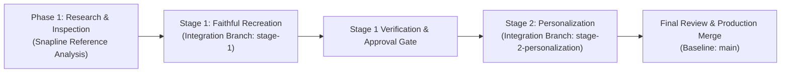

# Implementation Plan: Snapline Developer Portfolio

**Project Name:** Snapline Developer Portfolio  
**Reference Target:** [https://snapline.framer.website/](https://snapline.framer.website/)  
**Workflow Strategy:** Option B (Two-Stage Evolution)  
**Previous Architecture Archive:** [retro-pc-implementation-plan.md](file:///d:/portfolio/docs/archive/retro-pc-implementation-plan.md)  
**Document Link:** [implementation-plan.md](file:///d:/portfolio/docs/implementation-plan.md)  
**Status:** Active Master Plan — Initialized for Snapline Reference Analysis.

---

## 1. Executive Summary & Strategy Overview (Option B)

This project executes a disciplined two-stage development workflow (Option B) to build a production-grade developer portfolio based on the Snapline reference website (`https://snapline.framer.website/`):

### The Two Stages Defined

1. **Stage 1 — Faithful Snapline Recreation (`stage-1`):**
   - Recreate the reference website (`https://snapline.framer.website/`) 1:1 with complete fidelity.
   - Match all visual layout, typography, color palettes, responsive behavior, transitions, and micro-interactions.
   - Keep the codebase completely private and local during development.
   - Build using modern standard stack: Next.js 16 (App Router), TypeScript (strict mode), Tailwind CSS v4, Lucide React, and Framer Motion.
   - Serves as the verified, pixel-perfect baseline before any personal content is introduced.

2. **Stage 2 — Personalization (`stage-2-personalization`):**
   - Branch from the completed, fully tested, and approved `stage-1`.
   - Transform the recreation into a personalized developer portfolio.
   - Replace placeholder case studies, bio copy, profile photography/avatar, services, resume links, and contact information with the user's authentic data.
   - Configure personalized metadata, OpenGraph cards, domain settings, and SEO tags.
   - Once Stage 2 is verified and approved, it is merged into `main` for production readiness.

---

## 2. Git Branch Architecture & Governance Rules

Strict Git branching rules are enforced across the entire lifecycle to guarantee stability, auditability, and zero data loss.

### Core Branches
- **`main`:** The permanent, production-ready, stable project baseline. No experimental or unapproved code ever enters `main`.
- **`stage-1`:** The dedicated integration branch for all Stage 1 faithful recreation tasks. All Stage 1 task Pull Requests must target `stage-1`.
- **`stage-2-personalization`:** The future integration branch for Stage 2 personalization. **This branch will be cut from `stage-1` only after Stage 1 is 100% complete, verified, and approved.**

### Mandatory Git Workflow Rules
1. **`main` is the Stable Baseline:** `main` represents the stable release baseline.
2. **`stage-1` is the Stage 1 Integration Branch:** All faithful recreation tasks integrate into `stage-1`.
3. **`stage-2-personalization` Lineage:** `stage-2-personalization` must be created strictly from the completed, verified `stage-1`.
4. **One Unique Branch Per Numbered Task:** Every numbered task requires its own dedicated Git branch (`task/<num>-<short-slug>`).
5. **Strict Integration Lineage:** Task branches must always be created from the latest, up-to-date relevant integration branch:
   - Stage 1 task branches originate from `stage-1` (`git checkout stage-1 && git pull origin stage-1 && git checkout -b task/...`).
   - Stage 2 task branches originate from `stage-2-personalization` (`git checkout stage-2-personalization && git pull origin stage-2-personalization && git checkout -b task/...`).
6. **Independent Implementation:** Each numbered task must be implemented independently. Never combine multiple tasks into a single branch.
7. **Atomic Commits & Dedicated PRs:** Each task requires its own Conventional Commit and dedicated Pull Request.
8. **PR Target Discipline:** PRs must explicitly target the appropriate integration branch (`stage-1` for Stage 1, `stage-2-personalization` for Stage 2).
9. **Approval Gate (No Auto-Merging):** Never merge Pull Requests automatically. Every PR requires explicit user review and approval before merging.
10. **No Direct Commits:** Never work or commit directly on `main`, `stage-1`, or `stage-2-personalization`. All changes must arrive via approved Pull Requests.
11. **Zero Data Loss:** Never overwrite uncommitted changes or discard user modifications.
12. **No Force Operations:** Never run `git push --force` or `git push -f`.

---

## 3. Task Lifecycle & Status Tracking Protocol

Every task in the project follows a standardized lifecycle with strict status progression.

### Task Status Definitions
- **`NOT STARTED`:** The task is defined in the implementation plan, but no branch or work has commenced.
- **`IN PROGRESS`:** A dedicated task branch has been cut from the latest integration branch, and implementation is active.
- **`IMPLEMENTED`:** The scoped files and code for the task have been created/modified and visually verified.
- **`TESTED`:** The changes have passed typechecking (`tsc`), linting, component unit tests, and build verification (`npm run build`).
- **`PR CREATED`:** The branch has been pushed to `origin`, and a Pull Request targeting the integration branch has been created.
- **`MERGED`:** The Pull Request has been reviewed and approved by the user, and merged into the integration branch.

### Master Task Tracking Matrix Schema
Once the Snapline reference inspection is complete, all tasks will be cataloged using the following standard tracking matrix:

| Task Number | Task Description | Branch Name | Status | Pull Request | Commit | Merge Status |
| :--- | :--- | :--- | :--- | :--- | :--- | :--- |
| *TBD* | *Pending Snapline Reference Inspection* | *task/...* | `NOT STARTED` | - | - | `Unmerged` |

> [!IMPORTANT]
> **Task List Formulation Protocol:**
> In accordance with governance rules, the final task breakdown is **not invented upfront**. The definitive list of milestones and numbered tasks will be established immediately following the structured Phase 1 analysis of the Snapline reference website (`https://snapline.framer.website/`), detailing its layout, navigation, typography, motion physics, component hierarchy, and asset inventory.

---

## 4. Stage Completion Criteria

Both stages have concrete, testable completion criteria that must be satisfied and signed off before progressing.

### Stage 1: Faithful Snapline Recreation Completion Criteria
1. **1:1 Visual & Layout Fidelity:**
   - Every section, grid, container, and whitespace matches the Snapline reference layout across all viewports (desktop $\ge 1200\text{px}$, tablet $768\text{px} - 1199\text{px}$, mobile $< 768\text{px}$).
   - Typography, font scales, weights, line heights, and letter spacings match reference specifications.
   - Color palettes, backgrounds, borders, shadows, and subtle gradients mirror the reference design system.
2. **Interactive & Motion Fidelity:**
   - Smooth scroll behaviors, sticky headers, navigation drawers/menus, and modal windows operate identically to the reference.
   - Framer Motion transitions, spring physics, hover states, active states, and entrance animations match reference timings and easings.
3. **Engineering & Architecture Standards:**
   - Next.js 16 App Router architecture utilizing strict TypeScript mode with zero `any` types.
   - Tailwind CSS v4 styling with zero legacy configuration files.
   - Clean component modularity with isolated primitives, hooks, domain types, and static data layers.
4. **Quality Assurance & Verification:**
   - `npm run build` succeeds with zero errors, type warnings, or compilation failures.
   - Test suite passes without failures.
   - Multi-viewport browser visual regression testing verifies layout integrity against reference screenshots.
5. **Governance Sign-Off:**
   - All Stage 1 task PRs reviewed, approved, and merged into `stage-1`.
   - Clean Git working tree with all remote tracking synchronized.

### Stage 2: Personalization Completion Criteria
1. **Lineage Verification:**
   - `stage-2-personalization` successfully created from the approved, complete `stage-1` branch.
2. **Content & Brand Customization:**
   - Profile copy, bio, headline, and identity updated to the developer's personal background and voice.
   - Case studies and work showcase replaced with genuine personal projects, client work, live links, and GitHub repositories.
   - Skills, tech stack, and service offerings personalized.
   - Photography, avatar, and project media replaced with high-resolution personal assets.
   - Resume / CV download link connected to developer's updated resume document.
   - Contact form or mailto link configured to the developer's real contact endpoints.
3. **SEO, OpenGraph & Metadata:**
   - Metadata, title tags, favicon, and OpenGraph preview images personalized for production indexing.
4. **Final Regression & Production Delivery:**
   - Full regression test run across mobile and desktop.
   - Final approval received from the user.
   - Pull Request created from `stage-2-personalization` to `main`, reviewed, approved, and merged.

---

## 5. Next Steps: Snapline Reference Inspection

The immediate next phase is the comprehensive inspection of `https://snapline.framer.website/`:
1. **Visual & Architectural Inspection:** Analyze DOM structure, semantic sections, navigation paradigms, and typography.
2. **Asset & Palette Extraction:** Catalog fonts, color tokens, icons, and media components.
3. **Responsive Breakpoint Mapping:** Document desktop, tablet, and mobile layouts.
4. **Task Matrix Formulation:** Generate the complete milestone breakdown and individual numbered tasks mapped to dedicated branches.
