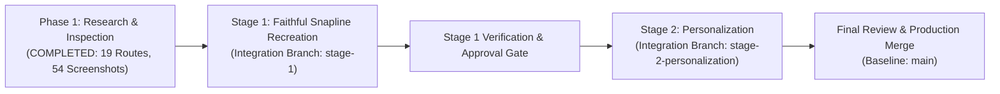
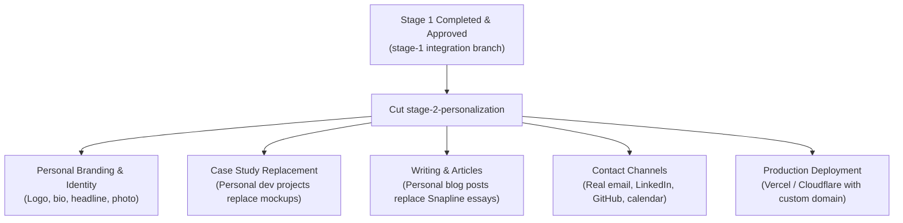

# Implementation Plan: Snapline Developer Portfolio

**Project Name:** Snapline Developer Portfolio  
**Reference Target:** [https://snapline.framer.website/](https://snapline.framer.website/)  
**Workflow Strategy:** Option B (Two-Stage Evolution)  
**Previous Architecture Archive:** [retro-pc-implementation-plan.md](file:///d:/portfolio/docs/archive/retro-pc-implementation-plan.md)  
**Architecture Analysis:** [project-structure-analysis.md](file:///d:/portfolio/docs/project-structure-analysis.md)  
**Master Research Archive:** [docs/research/snapline/README.md](file:///d:/portfolio/docs/research/snapline/README.md)  
**Document Link:** [implementation-plan.md](file:///d:/portfolio/docs/implementation-plan.md)  
**Status:** Approved Master Roadmap — Corrected & Finalized for Stage 1 Execution  

---

## 1. Executive Summary & Strategy Overview (Option B)

This project executes a disciplined two-stage development workflow (Option B) to build a production-grade developer portfolio based on the Snapline reference website (`https://snapline.framer.website/`):



### The Two Stages Defined

1. **Stage 1 — Faithful Snapline Recreation (`stage-1`):**
   - Recreate the reference website (`https://snapline.framer.website/`) 1:1 with complete visual, structural, and motion fidelity.
   - Match all **18 expected content routes** across shared template patterns:
     - Route 1: Homepage (`/`)
     - Route 2: Work Catalog (`/work`)
     - Routes 3–8: Six Project Detail Pages (`/work/orbit`, `/work/pilot`, `/work/kite`, `/work/grid`, `/work/bloom`, `/work/tidal`)
     - Route 9: About Page with FAQ Accordion (`/about`)
     - Route 10: Journal Catalog (`/journal`)
     - Routes 11–15: Five Editorial Articles (`/journal/constraints`, `/journal/white-space`, `/journal/design-system`, `/journal/typography-brand`, `/journal/handoff`)
     - Route 16: Contact Page with Dark Theme & Form (`/contact`)
     - Routes 17–18: Legal Pages with Tab Toggle (`/privacy`, `/terms`)
   - Implement the authentic custom error recovery canvas via an explicit direct route (`src/app/404/page.tsx`) and an unknown URL fallback boundary (`src/app/not-found.tsx`), both sharing a reusable `NotFoundCanvas` component preserving the original Snapline composition (huge bold 404 background watermark, 3 interactive draggable Polaroid photo cards with `# Layer 01–03` tags and dimension badges, "This page wandered off..." copy, and "Back home" / "See the work" action buttons).
   - Embody the Figma design canvas metaphor: base canvas `#E6E6E3` with repeating 22px dot grid, white artboard containers, interactive selection frames with 8 resize handles, universal bottom floating dock (`~280px`), simulated collaborator cursors, and Lisbon local time.
   - **Rendering & Routing Architecture:**
     - Next.js 16 App Router with TypeScript strict mode.
     - Static pre-rendering for fixed content routes (`/`, `/work`, `/about`, `/journal`, `/contact`, `/privacy`, `/terms`).
     - Dynamic routes backed by structured data, utilizing `generateStaticParams` specifically for the 6 project slugs (`/work/[slug]`) and 5 article slugs (`/journal/[slug]`) (11 dynamic routes total).
     - Explicit direct route `src/app/404/page.tsx` for `/404` and global fallback `src/app/not-found.tsx` for arbitrary unknown URLs, sharing a common `NotFoundCanvas` component.
     - Development and production build workflow: standard Next.js (`npm run dev`, `npm run build`, `npm run start`). Static export (`output: 'export'`) is treated as a separate future deployment decision rather than an upfront foundation constraint.
   - Keep the project strictly local and private during development to respect asset demonstration licensing.

2. **Stage 2 — Personalization (`stage-2-personalization`):**
   - Cut from the completed, tested, reviewed, and approved `stage-1` integration branch.
   - Replace demonstration content with authentic personal developer case studies, custom biography, real contact channels, and customized branding.
   - **Mandate:** Do not create `stage-2-personalization` or introduce personal content until Stage 1 is 100% complete and approved.

---

## 2. Core Git Workflow & Governance Mandates

All implementation tasks strictly adhere to the non-negotiable rules codified in `AGENTS.md`:

1. **Stable Branch Baseline:** `main` is the permanent, production-ready baseline.
2. **Stage 1 Integration Branch:** `stage-1` is the integration branch for all Stage 1 recreation tasks. All task PRs must target `stage-1`.
3. **One Unique Branch Per Task:** Every numbered task requires one dedicated Git branch (`task/<milestone>.<task-number>-<short-slug>`).
4. **Strict Lineage:** All task branches must be branched from the latest, up-to-date `stage-1` (`git checkout stage-1 && git pull origin stage-1 && git checkout -b task/...`).
5. **No Direct Commits:** Never implement or commit code directly on `main` or `stage-1`. All changes arrive via Pull Requests.
6. **Atomic Tasks:** Never combine numbered tasks into a single branch. Implement ONLY the scoped files and code for that specific numbered task.
7. **Just-In-Time Branch Creation:** Never create task branches upfront. Create a branch only immediately prior to starting work on that task.
8. **Dependency Verification:** Before cutting a task branch, verify all prerequisite tasks have been tested, reviewed, and merged into `stage-1`.
9. **Approval Gate (No Auto-Merging):** Never merge Pull Requests automatically. Every PR requires explicit user review and approval before merging.
10. **Pre-PR Quality Gate:** Every task must pass typechecking (`tsc`), linting, build validation (`npm run build`), and diff inspection (`git diff`, `git status`) before PR creation.
11. **Zero Data Loss:** Never overwrite uncommitted changes or discard user modifications.
12. **No Force Operations:** Never run `git push --force` or `git push -f`. Never run destructive resets.
13. **Legacy Branch Preservation:** The legacy branch `task/1.1-nextjs-scaffold` is permanently preserved and never overwritten or reused. Task 1.1 uses `task/1.1-nextjs-app-foundation`.

---

## 3. Master Stage 1 Implementation Task Matrix (53 Tasks)

| Task ID | Task Description | Branch Name | Priority | Complexity | Visual QA | Status | PR | Commit | Merge Status |
|:---:|:---|:---|:---:|:---:|:---:|:---:|:---:|:---:|:---:|
| **M1: Foundation & Setup** | | | | | | | | | |
| `1.1` | Next.js 16 App Router & TypeScript Foundation | `task/1.1-nextjs-app-foundation` | Critical | Medium | Yes | `MERGED` | #4 | `c082b0c` | `Merged into stage-1` |
| `1.2` | Tailwind CSS v4 & Design Token Integration | `task/1.2-tailwind-v4-tokens` | Critical | Medium | Yes | `MERGED` | #5 | `4d11f35` | `Merged into stage-1` |
| `1.3` | Web Font Integration (Geist & Inter WOFF2) | `task/1.3-font-integration` | High | Low | Yes | `MERGED` | #6 | `25c7ab6` | `Merged into stage-1` |
| `1.4` | Static Asset Pipeline, Licensing Gates & Staging | `task/1.4-static-assets` | High | Low | Yes | `MERGED` | #7 | `becf773` | `Merged into stage-1` |
| `1.5` | Shared Application Shell & Root Layout | `task/1.5-root-layout` | Critical | Medium | Yes | `MERGED` | #8 | `0430782` | `Merged into stage-1` |
| **M2: Domain Modeling & Data** | | | | | | | | | |
| `2.1` | Domain Data Types & Schemas | `task/2.1-domain-types` | High | Low | No | `MERGED` | #9 | `e62eb1b` | `Merged into stage-1` |
| `2.2` | Work Case Studies Structured Data (6 Projects) | `task/2.2-work-mock-data` | High | Medium | No | `MERGED` | #10 | `3825814` | `Merged into stage-1` |
| `2.3` | Journal Articles Structured Data (5 Articles) | `task/2.3-journal-mock-data` | High | Medium | No | `MERGED` | #11 | `0a86d4f` | `Merged into stage-1` |
| `2.4` | Site Navigation & Global Metadata Configurations | `task/2.4-navigation-metadata` | Medium | Low | No | `IMPLEMENTED` | - | - | `Unmerged` |
| **M3: Design System Primitives** | | | | | | | | | |
| `3.1` | Canvas Background & Repeating Dot-Grid Primitive | `task/3.1-dot-grid-canvas` | Critical | Low | Yes | `NOT STARTED` | - | - | `Unmerged` |
| `3.2` | Artboard Surface & Card Container Primitives | `task/3.2-card-primitives` | High | Low | Yes | `NOT STARTED` | - | - | `Unmerged` |
| `3.3` | Pill, Badge, and Category Tag Primitives | `task/3.3-pill-badge-primitives` | Medium | Low | Yes | `NOT STARTED` | - | - | `Unmerged` |
| `3.4` | Button & Interactive Link Primitives | `task/3.4-button-primitives` | High | Low | Yes | `NOT STARTED` | - | - | `Unmerged` |
| `3.5` | Form Input, Textarea, and Select Primitives | `task/3.5-input-primitives` | High | Medium | Yes | `NOT STARTED` | - | - | `Unmerged` |
| `3.6` | Figma Selection Frame & Dimension Handle Overlay | `task/3.6-figma-selection-overlay` | High | High | Yes | `NOT STARTED` | - | - | `Unmerged` |
| **M4: Canvas & Navigation** | | | | | | | | | |
| `4.1` | Persistent Top Header with Brand Mark & Contact CTA | `task/4.1-top-header` | High | Low | Yes | `NOT STARTED` | - | - | `Unmerged` |
| `4.2` | Universal Floating Bottom Dock Navigation | `task/4.2-floating-dock` | Critical | High | Yes | `NOT STARTED` | - | - | `Unmerged` |
| `4.3` | 2D Canvas Camera, Pan/Zoom & Page Transitions | `task/4.3-canvas-camera-transitions` | Critical | High | Yes | `NOT STARTED` | - | - | `Unmerged` |
| `4.4` | Global Page Footer & Lisbon Time Synchronization | `task/4.4-global-footer` | Medium | Low | Yes | `NOT STARTED` | - | - | `Unmerged` |
| **M5: Homepage Implementation** | | | | | | | | | |
| `5.1` | Hero Section Layout & Animated Role Rotator | `task/5.1-hero-section` | High | Medium | Yes | `NOT STARTED` | - | - | `Unmerged` |
| `5.2` | Draggable & Resizable Hero Portrait | `task/5.2-draggable-resizable-portrait` | High | High | Yes | `NOT STARTED` | - | - | `Unmerged` |
| `5.3` | Simulated Multiplayer Collaborator Cursors | `task/5.3-collaborator-cursors` | Medium | Medium | Yes | `NOT STARTED` | - | - | `Unmerged` |
| `5.4` | Client Logos Social Proof Section | `task/5.4-client-logos` | Medium | Low | Yes | `NOT STARTED` | - | - | `Unmerged` |
| `5.5` | 4-Step Process Section | `task/5.5-process-section` | Medium | Low | Yes | `NOT STARTED` | - | - | `Unmerged` |
| `5.6` | Homepage Featured Works & Journal Teaser | `task/5.6-home-featured-previews` | High | Medium | Yes | `NOT STARTED` | - | - | `Unmerged` |
| **M6: Work Catalog Showcase** | | | | | | | | | |
| `6.1` | Work Page Layout & Counter Header | `task/6.1-work-catalog-header` | High | Low | Yes | `NOT STARTED` | - | - | `Unmerged` |
| `6.2` | Category Filtering System & Active State Animation | `task/6.2-work-category-filters` | High | Medium | Yes | `NOT STARTED` | - | - | `Unmerged` |
| `6.3` | 2-Column Responsive Card Grid View | `task/6.3-work-grid-view` | High | Medium | Yes | `NOT STARTED` | - | - | `Unmerged` |
| `6.4` | Editorial Tabular List View | `task/6.4-work-list-view` | Medium | Medium | Yes | `NOT STARTED` | - | - | `Unmerged` |
| `6.5` | Grid vs List Segmented Toggle & Layout Transition | `task/6.5-work-view-toggle` | Medium | Medium | Yes | `NOT STARTED` | - | - | `Unmerged` |
| **M7: Project Detail Pages** | | | | | | | | | |
| `7.1` | Reusable Project Detail Page Layout & Header | `task/7.1-project-detail-template` | High | Medium | Yes | `NOT STARTED` | - | - | `Unmerged` |
| `7.2` | 5-Column Project Metadata Bar Component | `task/7.2-project-metadata-bar` | High | Low | Yes | `NOT STARTED` | - | - | `Unmerged` |
| `7.3` | Project Narrative Sections & 3 Impact Metrics | `task/7.3-project-narrative-metrics` | High | Medium | Yes | `NOT STARTED` | - | - | `Unmerged` |
| `7.4` | Project Circular Navigation Card & Footer CTA | `task/7.4-project-circular-nav` | Medium | Low | Yes | `NOT STARTED` | - | - | `Unmerged` |
| `7.5` | Dynamic Project Route Generation (`/work/[slug]`) | `task/7.5-dynamic-project-routes` | Critical | Medium | Yes | `NOT STARTED` | - | - | `Unmerged` |
| **M8: About Page & FAQ** | | | | | | | | | |
| `8.1` | About Page Bio Header & 4-Stat Metrics Grid | `task/8.1-about-bio-stats` | High | Low | Yes | `NOT STARTED` | - | - | `Unmerged` |
| `8.2` | Chronological Career Experience Timeline | `task/8.2-about-experience-timeline` | High | Low | Yes | `NOT STARTED` | - | - | `Unmerged` |
| `8.3` | 6-Card Software & Tools Stack Grid | `task/8.3-about-tools-grid` | Medium | Low | Yes | `NOT STARTED` | - | - | `Unmerged` |
| `8.4` | 5-Item Interactive FAQ Accordion Component | `task/8.4-about-faq-accordion` | High | Medium | Yes | `NOT STARTED` | - | - | `Unmerged` |
| **M9: Journal & Editorial** | | | | | | | | | |
| `9.1` | Journal Catalog Page Layout & Category Filters | `task/9.1-journal-catalog-layout` | High | Medium | Yes | `NOT STARTED` | - | - | `Unmerged` |
| `9.2` | Reusable Editorial Article Page Template | `task/9.2-journal-article-template` | High | Medium | Yes | `NOT STARTED` | - | - | `Unmerged` |
| `9.3` | Dynamic Journal Route Generation (`/journal/[slug]`) | `task/9.3-dynamic-journal-routes` | Critical | Medium | Yes | `NOT STARTED` | - | - | `Unmerged` |
| **M10: Contact Page & Form** | | | | | | | | | |
| `10.1` | Contact Page Dark Container Layout (`#161616`) | `task/10.1-contact-page-layout` | High | Low | Yes | `NOT STARTED` | - | - | `Unmerged` |
| `10.2` | Inquiry Form Controls & Custom Select Dropdowns | `task/10.2-contact-form-inputs` | High | Medium | Yes | `NOT STARTED` | - | - | `Unmerged` |
| `10.3` | Client-Side Validation & Mock Submission State | `task/10.3-contact-form-validation` | High | Medium | Yes | `NOT STARTED` | - | - | `Unmerged` |
| **M11: Legal & Error Pages** | | | | | | | | | |
| `11.1` | Shared Legal Page Layout with Segmented Tab Nav | `task/11.1-legal-tab-template` | Medium | Low | Yes | `NOT STARTED` | - | - | `Unmerged` |
| `11.2` | Privacy (`/privacy`) & Terms (`/terms`) Routes | `task/11.2-legal-routes` | Medium | Low | Yes | `NOT STARTED` | - | - | `Unmerged` |
| `11.3` | Custom 404 Recovery Canvas with 3 Draggable Cards | `task/11.3-custom-404-canvas` | High | High | Yes | `NOT STARTED` | - | - | `Unmerged` |
| **M12: Responsive Optimization** | | | | | | | | | |
| `12.1` | Tablet (768px) Viewport Optimization & Reflow | `task/12.1-tablet-responsive` | Critical | Medium | Yes | `NOT STARTED` | - | - | `Unmerged` |
| `12.2` | Mobile (390px) Viewport Optimization & Tap Targets | `task/12.2-mobile-responsive` | Critical | Medium | Yes | `NOT STARTED` | - | - | `Unmerged` |
| **M13: Interaction Polish** | | | | | | | | | |
| `13.1` | Scroll-Triggered Entrance Animations | `task/13.1-scroll-animations` | Medium | Medium | Yes | `NOT STARTED` | - | - | `Unmerged` |
| `13.2` | Keyboard A11y, Focus Rings, and Motion Settings | `task/13.2-a11y-keyboard-motion` | High | Medium | Yes | `NOT STARTED` | - | - | `Unmerged` |
| **M14: Quality Assurance** | | | | | | | | | |
| `14.1` | Cross-Route Build & Visual Regression Audit | `task/14.1-e2e-visual-audit` | Critical | High | Yes | `NOT STARTED` | - | - | `Unmerged` |

---

## 4. Granular Task Specifications (All 53 Tasks)

```
================================================================================
MILESTONE 1: PROJECT FOUNDATION & ENVIRONMENT SETUP (Area A)
================================================================================
```

### Task 1.1: Next.js 16 App Router & TypeScript Foundation
- **Task ID:** `1.1`
- **Task Name:** Next.js 16 App Router & TypeScript Foundation
- **Priority:** Critical | **Complexity:** Medium | **Visual QA:** Yes
- **Scope:** Root Next.js scaffold and TypeScript strict configuration.
- **Objective:** Establish the minimal Next.js App Router scaffold with strict TypeScript, ESLint, and configuration files, preserving the legacy `task/1.1-nextjs-scaffold` branch untouched.
- **Affected Files:** `package.json`, `tsconfig.json`, `next.config.ts`, `.gitignore`, `src/app/layout.tsx`, `src/app/page.tsx`.
- **Dependencies:** None (initial foundation task).
- **Expected Result:** Clean Next.js project boots locally on `npm run dev` with strict type checking and zero runtime errors.
- **Acceptance Criteria:**
  1. `npm run dev` starts dev server on `localhost:3000` without warnings.
  2. `npx tsc --noEmit` exits with status 0.
  3. `package.json` contains dependencies for `next`, `react`, `react-dom`, `typescript`.
- **Testing Requirements:** Run `npx tsc --noEmit` and `npm run build`.
- **Responsive Baseline:** Scaffold boots across Desktop (1440px), Tablet (768px), and Mobile (390px).
- **Research References:** `docs/project-structure-analysis.md`.
- **Task Branch:** `task/1.1-nextjs-app-foundation`
- **Commit Message:** `feat(setup): initialize Next.js App Router and TypeScript foundation`
- **PR Title:** `feat(setup): initialize Next.js App Router and TypeScript foundation`

### Task 1.2: Tailwind CSS v4 & Design Token Integration
- **Task ID:** `1.2`
- **Task Name:** Tailwind CSS v4 & Design Token Integration
- **Priority:** Critical | **Complexity:** Medium | **Visual QA:** Yes
- **Scope:** Styling architecture and design token binding.
- **Objective:** Configure Tailwind CSS v4 with custom design tokens mapped directly from `docs/research/snapline/design-tokens.json` (`#E6E6E3` canvas, `#FFFFFF` surface, `#161616` dark surface, `#D6FF3F` neon lime, `#FF3B5C` guideline pink).
- **Affected Files:** `src/styles/globals.css`, `postcss.config.mjs`, `package.json`.
- **Dependencies:** Task 1.1.
- **Expected Result:** Tailwind CSS v4 theme directives (`@theme`) compile token utility classes (`bg-canvas`, `text-neon-lime`, etc.).
- **Acceptance Criteria:**
  1. Token utility classes compile without CSS errors.
  2. Background `#E6E6E3` and accent `#D6FF3F` render accurately in a sample component.
- **Testing Requirements:** Validate compiled CSS output and run `npm run build`.
- **Responsive Baseline:** Standard Tailwind responsive prefixes (`md:`, `lg:`) functional across 1440px, 768px, 390px.
- **Research References:** `docs/research/snapline/design-tokens.json`.
- **Task Branch:** `task/1.2-tailwind-v4-tokens`
- **Commit Message:** `feat(styles): configure Tailwind CSS v4 and design tokens`
- **PR Title:** `feat(styles): configure Tailwind CSS v4 and design tokens`

### Task 1.3: Web Font Integration (Geist & Inter WOFF2)
- **Task ID:** `1.3`
- **Task Name:** Web Font Integration (Geist & Inter WOFF2)
- **Priority:** High | **Complexity:** Low | **Visual QA:** Yes
- **Scope:** Local typography pipeline.
- **Objective:** Stage verified WOFF2 font files (`Geist` Regular 400, Medium 500, SemiBold 600, and `Inter` Bold 700) into `public/fonts/` and configure `next/font/local` font variables. Verify SIL Open Font License compliance.
- **Affected Files:** `public/fonts/*`, `src/styles/fonts.ts`, `src/app/layout.tsx`.
- **Dependencies:** Task 1.1, Task 1.2.
- **Expected Result:** Geist and Inter render locally with zero Layout Shift (CLS) and no external Google Fonts network calls.
- **Acceptance Criteria:**
  1. Font family variables (`--font-geist`, `--font-inter`) attach to root HTML element.
  2. Inspecting computed styles on body confirms `font-family: Geist, ...`.
- **Testing Requirements:** Verify font rendering in browser devtools computed styles.
- **Responsive Baseline:** Consistent typography rendering across 1440px, 768px, and 390px.
- **Research References:** `docs/research/snapline/design-tokens.json` (typography section).
- **Task Branch:** `task/1.3-font-integration`
- **Commit Message:** `feat(fonts): stage local Geist and Inter WOFF2 fonts with next/font`
- **PR Title:** `feat(fonts): stage local Geist and Inter WOFF2 fonts with next/font`

### Task 1.4: Static Asset Pipeline, Licensing Gates & Staging
- **Task ID:** `1.4`
- **Task Name:** Static Asset Pipeline, Licensing Gates & Staging
- **Priority:** High | **Complexity:** Low | **Visual QA:** Yes
- **Scope:** Asset provenance tracking, licensing verification, and local staging.
- **Objective:** Establish asset source tracking, verify demonstration licensing for local recreation, validate image dimensions against `asset-inventory.csv`, stage verified local assets into `public/images/` and `public/icons/`, and configure temporary local placeholders for any unverified third-party assets.
- **Affected Files:** `public/images/*`, `public/icons/*`, `docs/research/snapline/asset-inventory.csv`.
- **Dependencies:** Task 1.1.
- **Expected Result:** All 28 project assets are organized locally at clean public paths (`/images/hero-portrait.webp`, etc.) with strict licensing documentation.
- **Acceptance Criteria:**
  1. All 15 demonstration images render locally with verified dimensions matching `asset-inventory.csv`.
  2. Zero unverified assets or external CDN dependencies downloaded without provenance records.
  3. Font licenses verified as SIL Open Font License.
- **Testing Requirements:** Validate HTTP GET 200 for all local assets; run dimension checks.
- **Responsive Baseline:** High-resolution assets display responsive srcset handling across 1440px, 768px, 390px.
- **Research References:** `docs/research/snapline/asset-inventory.csv`.
- **Task Branch:** `task/1.4-static-assets`
- **Commit Message:** `feat(assets): establish asset licensing gates and stage local inventory`
- **PR Title:** `feat(assets): establish asset licensing gates and stage local inventory`

### Task 1.5: Shared Application Shell & Root Layout
- **Task ID:** `1.5`
- **Task Name:** Shared Application Shell & Root Layout
- **Priority:** Critical | **Complexity:** Medium | **Visual QA:** Yes
- **Scope:** Root viewport layout and global document metadata.
- **Objective:** Construct `src/app/layout.tsx` embedding font classes, base canvas tone (`#E6E6E3`), viewport meta tags, and global SEO metadata.
- **Affected Files:** `src/app/layout.tsx`, `src/app/page.tsx`.
- **Dependencies:** Task 1.2, Task 1.3, Task 1.4.
- **Expected Result:** Root layout wraps every page with consistent viewport dimensions, dark background styling, and metadata tags.
- **Acceptance Criteria:**
  1. Page renders with background `#E6E6E3` on dev server.
  2. Browser tab displays `Maya Ortiz | Product Designer in Lisbon`.
- **Testing Requirements:** Build test (`npm run build`) and DOM inspection.
- **Responsive Baseline:** Mobile viewport meta `width=device-width, initial-scale=1` active across 1440px, 768px, 390px.
- **Research References:** `docs/research/snapline/PAGE_TOPOLOGY.md`.
- **Task Branch:** `task/1.5-root-layout`
- **Commit Message:** `feat(layout): implement root layout and global document shell`
- **PR Title:** `feat(layout): implement root layout and global document shell`

```
================================================================================
MILESTONE 2: DOMAIN MODELING & STRUCTURED DATA (Area A, F, H)
================================================================================
```

### Task 2.1: Domain Data Types & Schemas
- **Task ID:** `2.1`
- **Task Name:** Domain Data Types & Schemas
- **Priority:** High | **Complexity:** Low | **Visual QA:** No
- **Scope:** TypeScript domain definitions.
- **Objective:** Define strict TypeScript interfaces for Project (`ProjectItem`, `ProjectCategory`, `ProjectMetric`, `ProjectMeta`), Article (`JournalArticle`, `ArticleCategory`), FAQ, Experience, and Tools.
- **Affected Files:** `src/types/project.ts`, `src/types/journal.ts`, `src/types/about.ts`, `src/types/navigation.ts`.
- **Dependencies:** Task 1.1.
- **Expected Result:** Type definitions export cleanly with zero `any` types.
- **Acceptance Criteria:**
  1. `ProjectItem` includes `slug`, `title`, `premise`, `client`, `role`, `type`, `year`, `duration`, `metrics`, `heroImage`.
  2. `JournalArticle` includes `slug`, `title`, `category`, `date`, `readTime`, `excerpt`, `heroImage`, `content`.
- **Testing Requirements:** Run `npx tsc --noEmit`.
- **Responsive Baseline:** N/A (Data types).
- **Research References:** `docs/research/snapline/PAGE_TOPOLOGY.md`.
- **Task Branch:** `task/2.1-domain-types`
- **Commit Message:** `feat(types): define TypeScript domain interfaces for projects and articles`
- **PR Title:** `feat(types): define TypeScript domain interfaces for projects and articles`

### Task 2.2: Work Case Studies Structured Data (6 Projects)
- **Task ID:** `2.2`
- **Task Name:** Work Case Studies Structured Data (6 Projects)
- **Priority:** High | **Complexity:** Medium | **Visual QA:** No
- **Scope:** Static data record creation for projects.
- **Objective:** Create the structured dataset in `src/data/projects.ts` containing complete narrative content, 5 metadata columns, and 3 impact metrics for all 6 verified projects (Orbit, Pilot, Kite, Grid, Bloom, Tidal).
- **Affected Files:** `src/data/projects.ts`.
- **Dependencies:** Task 2.1.
- **Expected Result:** Typed array of exactly 6 projects ready for catalog and detail rendering.
- **Acceptance Criteria:**
  1. Contains all 6 slugs: `orbit`, `pilot`, `kite`, `grid`, `bloom`, `tidal`.
  2. Each project contains valid metric labels and values matching reference analysis.
- **Testing Requirements:** Typecheck data module with `tsc --noEmit`.
- **Responsive Baseline:** N/A (Data records).
- **Research References:** `docs/research/snapline/reference-analysis.md` (Section 3).
- **Task Branch:** `task/2.2-work-mock-data`
- **Commit Message:** `feat(data): populate structured data records for six work projects`
- **PR Title:** `feat(data): populate structured data records for six work projects`

### Task 2.3: Journal Articles Structured Data (5 Articles)
- **Task ID:** `2.3`
- **Task Name:** Journal Articles Structured Data (5 Articles)
- **Priority:** High | **Complexity:** Medium | **Visual QA:** No
- **Scope:** Static data record creation for journal articles.
- **Objective:** Create the structured dataset in `src/data/journal.ts` containing complete editorial body copy, headings, excerpts, read times, and dates for all 5 verified articles.
- **Affected Files:** `src/data/journal.ts`.
- **Dependencies:** Task 2.1.
- **Expected Result:** Typed array of exactly 5 articles ready for catalog and article rendering.
- **Acceptance Criteria:**
  1. Contains all 5 slugs: `constraints`, `white-space`, `design-system`, `typography-brand`, `handoff`.
  2. Body content structured with markdown/HTML string sections.
- **Testing Requirements:** Run `tsc --noEmit`.
- **Responsive Baseline:** N/A (Data records).
- **Research References:** `docs/research/snapline/PAGE_TOPOLOGY.md` (Section 3).
- **Task Branch:** `task/2.3-journal-mock-data`
- **Commit Message:** `feat(data): populate structured data records for five journal articles`
- **PR Title:** `feat(data): populate structured data records for five journal articles`

### Task 2.4: Site Navigation & Global Metadata Configurations
- **Task ID:** `2.4`
- **Task Name:** Site Navigation & Global Metadata Configurations
- **Priority:** Medium | **Complexity:** Low | **Visual QA:** No
- **Scope:** Global site metadata configuration.
- **Objective:** Configure navigation item arrays (dock triggers, sitemap links, social handles) and OpenGraph / title metadata in `src/data/navigation.ts`.
- **Affected Files:** `src/data/navigation.ts`, `src/data/site-config.ts`.
- **Dependencies:** Task 2.1.
- **Expected Result:** Centralized navigation metadata consumed by header, dock, and footer.
- **Acceptance Criteria:**
  1. Exports dock items with icon names and route paths.
  2. Exports footer sitemap items for Pages, Info, and Social.
- **Testing Requirements:** Run `tsc --noEmit`.
- **Responsive Baseline:** N/A (Config records).
- **Research References:** `docs/research/snapline/PAGE_TOPOLOGY.md` (Section 2).
- **Task Branch:** `task/2.4-navigation-metadata`
- **Commit Message:** `feat(data): configure site navigation and footer sitemap datasets`
- **PR Title:** `feat(data): configure site navigation and footer sitemap datasets`

```
================================================================================
MILESTONE 3: GLOBAL DESIGN SYSTEM & UI PRIMITIVES (Area B)
================================================================================
```

### Task 3.1: Canvas Background & Repeating Dot-Grid Primitive
- **Task ID:** `3.1`
- **Task Name:** Canvas Background & Repeating Dot-Grid Primitive
- **Priority:** Critical | **Complexity:** Low | **Visual QA:** Yes
- **Scope:** Global canvas background rendering.
- **Objective:** Implement `src/components/canvas/DotGridBackground.tsx` matching verified CSS rule `#E6E6E3 radial-gradient(circle, #C3C3BF 1px, transparent 1.3px) 0 0 / 22px 22px`.
- **Affected Files:** `src/components/canvas/DotGridBackground.tsx`, `src/styles/globals.css`.
- **Dependencies:** Task 1.2, Task 1.5.
- **Expected Result:** Continuous 22px repeating dot grid visible on canvas base layer behind artboard cards.
- **Acceptance Criteria:**
  1. Base color matches `#E6E6E3`.
  2. Dot color matches `#C3C3BF` with anti-aliased edge.
  3. Cell dimensions measure exactly `22px × 22px`.
- **Testing Requirements:** Visual comparison against `docs/research/snapline/screenshots/desktop/home-desktop-initial.png`.
- **Responsive Baseline:** Continuous pattern without distortion across 1440px, 768px, and 390px.
- **Research References:** `docs/research/snapline/design-tokens.json`.
- **Task Branch:** `task/3.1-dot-grid-canvas`
- **Commit Message:** `feat(ui): implement canvas background with 22px repeating dot grid`
- **PR Title:** `feat(ui): implement canvas background with 22px repeating dot grid`

### Task 3.2: Artboard Surface & Card Container Primitives
- **Task ID:** `3.2`
- **Task Name:** Artboard Surface & Card Container Primitives
- **Priority:** High | **Complexity:** Low | **Visual QA:** Yes
- **Scope:** Atomic container components.
- **Objective:** Create `ArtboardContainer.tsx` (white `#FFFFFF` background, rounded borders `16px–24px`, subtle shadow `0 2px 12px rgba(0,0,0,0.04)`) and `DarkContainer.tsx` (`#161616` container).
- **Affected Files:** `src/components/primitives/ArtboardContainer.tsx`, `src/components/primitives/DarkContainer.tsx`.
- **Dependencies:** Task 1.2.
- **Expected Result:** Reusable card containers encapsulating page sections on the canvas.
- **Acceptance Criteria:**
  1. Artboard container max-width constrained to `1200px` with responsive padding.
  2. Dark container supports nested light text and dark borders (`rgba(255,255,255,0.12)`).
- **Testing Requirements:** Visual inspection across viewports.
- **Responsive Baseline:** Desktop (1440px): `padding: 48px`, max-width `1200px` | Tablet (768px): `padding: 32px`, max-width `100%` | Mobile (390px): `padding: 16px`, lateral margin `16px`.
- **Research References:** `docs/research/snapline/responsive-analysis.md`.
- **Task Branch:** `task/3.2-card-primitives`
- **Commit Message:** `feat(ui): create artboard and dark container card primitives`
- **PR Title:** `feat(ui): create artboard and dark container card primitives`

### Task 3.3: Pill, Badge, and Category Tag Primitives
- **Task ID:** `3.3`
- **Task Name:** Pill, Badge, and Category Tag Primitives
- **Priority:** Medium | **Complexity:** Low | **Visual QA:** Yes
- **Scope:** Atomic status indicators.
- **Objective:** Create reusable pill primitives (`PillBadge.tsx`, `AvailabilityBadge.tsx`) supporting active/inactive states, count chips (e.g. `All · 6`), and pulsating green availability indicator.
- **Affected Files:** `src/components/primitives/PillBadge.tsx`, `src/components/primitives/AvailabilityBadge.tsx`.
- **Dependencies:** Task 1.2.
- **Expected Result:** High-craft pill components with `border-radius: 9999px`.
- **Acceptance Criteria:**
  1. Active pill renders `#0A0A0A` background with white text.
  2. Inactive pill renders white background with hairline border.
  3. Availability badge pulses green `#22C55E` indicator.
- **Testing Requirements:** Unit verification of state props (`isActive`, `variant`).
- **Responsive Baseline:** Desktop: horizontal inline row | Tablet: 2-row wrap | Mobile: 3-row compact wrap with `min-height: 36px`.
- **Research References:** `docs/research/snapline/design-tokens.json`.
- **Task Branch:** `task/3.3-pill-badge-primitives`
- **Commit Message:** `feat(ui): implement pill, badge, and category tag primitives`
- **PR Title:** `feat(ui): implement pill, badge, and category tag primitives`

### Task 3.4: Button & Interactive Link Primitives
- **Task ID:** `3.4`
- **Task Name:** Button & Interactive Link Primitives
- **Priority:** High | **Complexity:** Low | **Visual QA:** Yes
- **Scope:** Interactive button components.
- **Objective:** Create `Button.tsx` and `BackLink.tsx` supporting primary lime (`#D6FF3F`), secondary pill, and back navigation (`← All works`, `← Journal`).
- **Affected Files:** `src/components/primitives/Button.tsx`, `src/components/primitives/BackLink.tsx`.
- **Dependencies:** Task 1.2.
- **Expected Result:** Interactive buttons with hover transitions and click compression (`scale: 0.98`).
- **Acceptance Criteria:**
  1. Primary button displays `#D6FF3F` background, bold black text, and rounded pill shape.
  2. BackLink translates left arrow 4px on hover.
- **Testing Requirements:** Verify hover and tap states in browser.
- **Responsive Baseline:** Desktop: standard height `44px` | Tablet: `44px` | Mobile: full-width submit buttons with `min-height: 48px` tap target.
- **Research References:** `docs/research/snapline/interaction-matrix.md` (Interaction 4 & 5).
- **Task Branch:** `task/3.4-button-primitives`
- **Commit Message:** `feat(ui): implement button and backlink interactive primitives`
- **PR Title:** `feat(ui): implement button and backlink interactive primitives`

### Task 3.5: Form Input, Textarea, and Select Primitives
- **Task ID:** `3.5`
- **Task Name:** Form Input, Textarea, and Select Primitives
- **Priority:** High | **Complexity:** Medium | **Visual QA:** Yes
- **Scope:** Dark form controls.
- **Objective:** Create `TextInput.tsx`, `TextArea.tsx`, and `CustomSelect.tsx` matching the dark contact form styling (`#161616` surface, `#D6FF3F` focus border).
- **Affected Files:** `src/components/primitives/TextInput.tsx`, `src/components/primitives/TextArea.tsx`, `src/components/primitives/CustomSelect.tsx`.
- **Dependencies:** Task 1.2.
- **Expected Result:** Accessible input controls with glowing neon lime focus rings and dark option dropdowns.
- **Acceptance Criteria:**
  1. Focused input transitions border to `2px solid #D6FF3F`.
  2. Empty required input exposes native browser HTML5 validation.
- **Testing Requirements:** Test keyboard focus, blur, and typing behavior.
- **Responsive Baseline:** Desktop: 2-column input grid | Tablet: 2-column | Mobile: single-column full-width stack (`min-height: 48px`).
- **Research References:** `docs/research/snapline/interaction-matrix.md` (Interaction 5).
- **Task Branch:** `task/3.5-input-primitives`
- **Commit Message:** `feat(ui): implement dark form inputs, textareas, and custom selects`
- **PR Title:** `feat(ui): implement dark form inputs, textareas, and custom selects`

### Task 3.6: Figma Selection Frame & Dimension Handle Overlay
- **Task ID:** `3.6`
- **Task Name:** Figma Selection Frame & Dimension Handle Overlay
- **Priority:** High | **Complexity:** High | **Visual QA:** Yes
- **Scope:** Signature Figma design UI overlay primitive.
- **Objective:** Create `FigmaSelectionOverlay.tsx` rendering an outer selection hairline border, 8 square handles (4 corners, 4 midpoints, `6px × 6px`), top layer name tag (e.g. `# Project / Cover`), and neon lime dimension badge (`454 × 341`).
- **Affected Files:** `src/components/primitives/FigmaSelectionOverlay.tsx`.
- **Dependencies:** Task 1.2.
- **Expected Result:** Reusable hover/active overlay attaching to cards and hero portrait.
- **Acceptance Criteria:**
  1. Renders 8 positioned handles with light box-shadow.
  2. Top label displays `# tag-name` in monospace font.
  3. Bottom badge displays dimensions in lime `#D6FF3F` pill.
- **Testing Requirements:** Visual comparison against `docs/research/snapline/screenshots/interactions/work-desktop-card-hover-orbit.png`.
- **Responsive Baseline:** Desktop: hover-activated overlay with handles | Tablet/Mobile: selection handles suppressed to avoid interfering with touch scrolling.
- **Research References:** `docs/research/snapline/interaction-matrix.md` (Interaction 2).
- **Task Branch:** `task/3.6-figma-selection-overlay`
- **Commit Message:** `feat(ui): implement Figma selection frame and handle overlay primitive`
- **PR Title:** `feat(ui): implement Figma selection frame and handle overlay primitive`

```
================================================================================
MILESTONE 4: CANVAS & NAVIGATION ARCHITECTURE (Area C)
================================================================================
```

### Task 4.1: Persistent Top Header with Brand Mark & Contact CTA
- **Task ID:** `4.1`
- **Task Name:** Persistent Top Header with Brand Mark & Contact CTA
- **Priority:** High | **Complexity:** Low | **Visual QA:** Yes
- **Scope:** Global persistent header.
- **Objective:** Implement `Header.tsx` fixed at top (`height: 56px`), with `Maya.` logo on left and `Get in touch` pill button on right.
- **Affected Files:** `src/components/navigation/Header.tsx`, `src/app/layout.tsx`.
- **Dependencies:** Task 3.4.
- **Expected Result:** Minimal sticky/fixed header consistently rendered across desktop, tablet, and mobile with no hamburger menu.
- **Acceptance Criteria:**
  1. Left mark links to `/`.
  2. Right CTA links to `/contact`.
  3. Retains identical layout across all breakpoints.
- **Testing Requirements:** Verify position fixed behavior during page scroll.
- **Responsive Baseline:** Desktop: `height: 56px`, `padding: 0 24px` | Tablet: `height: 56px`, `padding: 0 24px` | Mobile: `height: 56px`, `padding: 0 16px`.
- **Research References:** `docs/research/snapline/PAGE_TOPOLOGY.md` (Section 2).
- **Task Branch:** `task/4.1-top-header`
- **Commit Message:** `feat(nav): implement persistent top header with brand and contact trigger`
- **PR Title:** `feat(nav): implement persistent top header with brand and contact trigger`

### Task 4.2: Universal Floating Bottom Dock Navigation
- **Task ID:** `4.2`
- **Task Name:** Universal Floating Bottom Dock Navigation
- **Priority:** Critical | **Complexity:** High | **Visual QA:** Yes
- **Scope:** Universal primary navigation dock.
- **Objective:** Implement `FloatingDock.tsx` fixed at bottom center (`width: ~280px`, `z-index: 1000`, `backdrop-filter: blur(12px)`) with 5 icons (`Home`, `Work`, `About`, `Journal`, `Contact`), `100%` zoom badge, and active dark pill indicator with neon lime active icon.
- **Affected Files:** `src/components/navigation/FloatingDock.tsx`, `src/app/layout.tsx`.
- **Dependencies:** Task 2.4, Task 3.4.
- **Expected Result:** Glassmorphic floating dock that smoothly indicates active route across all viewports.
- **Acceptance Criteria:**
  1. Active route displays `#0A0A0A` rounded container with `#D6FF3F` icon.
  2. Inactive icons display gray stroke `#666666`, turning `#EAEAEA` on hover.
  3. Remains persistently visible on desktop, tablet, and mobile.
- **Testing Requirements:** Route navigation testing and visual state inspection.
- **Responsive Baseline:** Desktop: `bottom: 24px`, width `280px` | Tablet: `bottom: 16px`, width `280px` | Mobile: `bottom: 16px`, width `280px` with safe-area padding (`env(safe-area-inset-bottom)`).
- **Research References:** `docs/research/snapline/interaction-matrix.md` (Interaction 1 & 7).
- **Task Branch:** `task/4.2-floating-dock`
- **Commit Message:** `feat(nav): implement universal floating bottom dock navigation`
- **PR Title:** `feat(nav): implement universal floating bottom dock navigation`

### Task 4.3: 2D Canvas Camera, Pan/Zoom & Page Transitions
- **Task ID:** `4.3`
- **Task Name:** 2D Canvas Camera, Pan/Zoom & Page Transitions
- **Priority:** Critical | **Complexity:** High | **Visual QA:** Yes
- **Scope:** Spatial 2D canvas coordinate engine and camera navigation.
- **Objective:** Implement `CanvasProvider.tsx` and `useCanvasPan.ts` to manage a 2D artboard coordinate system, camera positioning, panning, zooming, spatial movement between pages, smooth page transition animations, URL synchronization, browser back/forward navigation, responsive canvas bounds, and strict prevention of unintended horizontal and vertical scroll overflow.
- **Affected Files:** `src/components/canvas/CanvasProvider.tsx`, `src/hooks/useCanvasPan.ts`, `src/app/layout.tsx`.
- **Dependencies:** Task 3.1, Task 4.2.
- **Expected Result:** Route changes trigger spatial 2D camera translations between artboards using proposed starting spring physics (`stiffness: 260, damping: 24`, mass 1). Note on evidence status: As documented in `interaction-matrix.md` (Global Interactions), these spring parameters represent an engineering implementation hypothesis derived from standard Framer Motion presets rather than an empirically measured Snapline runtime setting; visual tuning and manual refinement against the live reference site are required during task execution, synchronizing history without breaking native back/forward buttons or producing document scroll overflow.
- **Acceptance Criteria:**
  1. 2D camera coordinates map correctly to active page artboards.
  2. Browser back and forward buttons navigate history and restore correct canvas camera position.
  3. Zero unwanted horizontal scrollbars appear on viewport (`overflow: hidden` on canvas wrapper).
  4. URL updates synchronously with route change.
- **Testing Requirements:** Test rapid back/forward navigation; verify 60fps animation; inspect scroll overflow.
- **Responsive Baseline:** Desktop: full 2D spatial pan and zoom | Tablet/Mobile: translations constrained to vertical artboard alignments with zero horizontal overflow.
- **Research References:** `docs/research/snapline/PAGE_TOPOLOGY.md` (Section 1) and `docs/research/snapline/interaction-matrix.md` (Interaction 9).
- **Task Branch:** `task/4.3-canvas-camera-transitions`
- **Commit Message:** `feat(canvas): implement 2D canvas camera, pan/zoom engine, and page transitions`
- **PR Title:** `feat(canvas): implement 2D canvas camera, pan/zoom engine, and page transitions`

### Task 4.4: Global Page Footer & Lisbon Time Synchronization
- **Task ID:** `4.4`
- **Task Name:** Global Page Footer & Lisbon Time Synchronization
- **Priority:** Medium | **Complexity:** Low | **Visual QA:** Yes
- **Scope:** Shared footer and live clock component.
- **Objective:** Implement `Footer.tsx` containing the Lisbon time display (`HH:MM in Lisbon`) formatted to `Europe/Lisbon` timezone with minute-level client synchronization, sitemap links (`Pages`, `Info`, `Social`), and `"Back to top ↑"` smooth scroll trigger.
- **Affected Files:** `src/components/navigation/Footer.tsx`, `src/hooks/useLisbonTime.ts`.
- **Dependencies:** Task 2.4, Task 3.4.
- **Expected Result:** Clean footer with accurate Lisbon local time string (`HH:MM in Lisbon`) updated on minute intervals without excessive render loops.
- **Acceptance Criteria:**
  1. Time renders accurately matching `Europe/Lisbon` timezone via `Intl.DateTimeFormat`.
  2. Minute-level timer updates time without hydration mismatch.
  3. `"Back to top"` triggers smooth window scroll to `0, 0`.
- **Testing Requirements:** Unit test Lisbon timezone string formatting; test scroll button.
- **Responsive Baseline:** Desktop: 4-column footer layout | Tablet: 4-column | Mobile: 2-column wrap with centered copyright.
- **Research References:** `docs/research/snapline/PAGE_TOPOLOGY.md` (Section 2).
- **Task Branch:** `task/4.4-global-footer`
- **Commit Message:** `feat(nav): implement global footer with synchronized Lisbon real-time clock`
- **PR Title:** `feat(nav): implement global footer with synchronized Lisbon real-time clock`

```
================================================================================
MILESTONE 5: HOMEPAGE IMPLEMENTATION (Area D)
================================================================================
```

### Task 5.1: Hero Section Layout & Animated Role Rotator
- **Task ID:** `5.1`
- **Task Name:** Hero Section Layout & Animated Role Rotator
- **Priority:** High | **Complexity:** Medium | **Visual QA:** Yes
- **Scope:** Homepage hero layout and headline animation.
- **Objective:** Construct `HeroSection.tsx` featuring the 72px display headline, availability badge, and an animated role rotator cycling `[Product Designer]`, `[Design Lead]`, `[Systems Thinker]`.
- **Affected Files:** `src/components/home/HeroSection.tsx`, `src/components/home/RoleRotator.tsx`, `src/app/page.tsx`.
- **Dependencies:** Task 1.5, Task 3.3.
- **Expected Result:** Asymmetric 2-column hero with fluid upward spring text flip every 3 seconds.
- **Acceptance Criteria:**
  1. Role flipper cycles smoothly every 3s inside overflow-hidden container.
  2. Display typography measures 72px desktop $
ightarrow$ 52px tablet $
ightarrow$ 38px mobile.
- **Testing Requirements:** Visual timing verification against `docs/research/snapline/screenshots/desktop/home-desktop-initial.png`.
- **Responsive Baseline:** Desktop (1440px): 60/40 2-column split, 72px heading | Tablet (768px): single-column stack, 52px heading | Mobile (390px): single-column stack, 38px heading (`line-height: 1.15`).
- **Research References:** `docs/research/snapline/responsive-analysis.md` (Homepage).
- **Task Branch:** `task/5.1-hero-section`
- **Commit Message:** `feat(home): implement hero section layout and animated role rotator`
- **PR Title:** `feat(home): implement hero section layout and animated role rotator`

### Task 5.2: Draggable & Resizable Hero Portrait
- **Task ID:** `5.2`
- **Task Name:** Draggable & Resizable Hero Portrait
- **Priority:** High | **Complexity:** High | **Visual QA:** Yes
- **Scope:** Interactive portrait container with drag and handle-based resize dynamics.
- **Objective:** Implement `HeroPortrait.tsx` wrapping the portrait container with an active Figma selection frame, 8 resize handles (4 corners, 4 midpoints), mouse drag capabilities, handle-driven container resizing, live dimension badge updates (e.g. `380 × 475`), boundary constraints, responsive positioning, and touch-appropriate behavior.
- **Affected Files:** `src/components/home/HeroPortrait.tsx`, `src/hooks/useResizableFrame.ts`.
- **Dependencies:** Task 3.6, Task 5.1.
- **Expected Result:** Portrait frame can be dragged and resized via its 8 corner/midpoint handles with real-time dimension readout and canvas boundary constraints, distinguishing decorative Figma tags from functional interactive resize state.
- **Acceptance Criteria:**
  1. 8 selection handles (4 corners, 4 midpoints) render with correct box-shadow.
  2. Dragging handles resizes bounding container with live dimension badge update.
  3. Dragging container body repositions frame with boundary limits.
  4. On touch devices, free canvas dragging is proposed to be disabled (or constrained) to prevent touch-drag events from capturing and disrupting vertical page scrolling. Note on evidence status: As documented in `interaction-matrix.md` and `responsive-analysis.md`, portrait dragging on mobile was not directly observed during reconnaissance; this behavior is an engineering implementation proposal that requires empirical verification and tuning against the reference website during task execution.
- **Testing Requirements:** Test drag and resize handles on desktop; test touch scroll on mobile.
- **Responsive Baseline:** Desktop (1440px): interactive 380px wide frame | Tablet (768px): centered stack below headline (`maxWidth: 420px`) | Mobile (390px): full width with 16px lateral margins; touch-drag behavior to be verified against reference.
- **Research References:** `docs/research/snapline/interaction-matrix.md` (Homepage Interactions).
- **Task Branch:** `task/5.2-draggable-resizable-portrait`
- **Commit Message:** `feat(home): implement draggable and resizable hero portrait with live dimensions`
- **PR Title:** `feat(home): implement draggable and resizable hero portrait with live dimensions`

### Task 5.3: Simulated Multiplayer Collaborator Cursors
- **Task ID:** `5.3`
- **Task Name:** Simulated Multiplayer Collaborator Cursors
- **Priority:** Medium | **Complexity:** Medium | **Visual QA:** Yes
- **Scope:** Figma multiplayer cursor simulation.
- **Objective:** Create `CollaboratorCursors.tsx` simulating two wandering Figma cursors: "Lena · PM" (neon lime `#D6FF3F`) and "Sam · Dev" (cyan `#00E5FF`) on desktop viewports.
- **Affected Files:** `src/components/home/CollaboratorCursors.tsx`.
- **Dependencies:** Task 5.1.
- **Expected Result:** Cursors drift smoothly across the hero canvas and hover over key sentences.
- **Acceptance Criteria:**
  1. Cursors follow predefined SVG motion paths with spring easing.
  2. Completely disabled/suppressed on viewports $< 1200px$.
- **Testing Requirements:** Verify render on desktop and complete omission on mobile.
- **Responsive Baseline:** Desktop (1440px): active floating cursors | Tablet (768px) & Mobile (390px): completely hidden via `hidden lg:block`.
- **Research References:** `docs/research/snapline/PAGE_TOPOLOGY.md` (Section 1).
- **Task Branch:** `task/5.3-collaborator-cursors`
- **Commit Message:** `feat(home): implement simulated multiplayer collaborator cursors`
- **PR Title:** `feat(home): implement simulated multiplayer collaborator cursors`

### Task 5.4: Client Logos Social Proof Section
- **Task ID:** `5.4`
- **Task Name:** Client Logos Social Proof Section
- **Priority:** Medium | **Complexity:** Low | **Visual QA:** Yes
- **Scope:** Social proof section.
- **Objective:** Implement `ClientLogos.tsx` displaying client partnership logos in a subtle muted monochrome row beneath hero CTAs.
- **Affected Files:** `src/components/home/ClientLogos.tsx`.
- **Dependencies:** Task 5.1.
- **Expected Result:** Clean logo row with subtle opacity hover effects.
- **Acceptance Criteria:**
  1. Logos render with muted gray tint (`#8A8A8A`), transitioning on hover.
  2. Wrap into 2 rows on mobile.
- **Testing Requirements:** Visual comparison against reference desktop screenshot.
- **Responsive Baseline:** Desktop: single horizontal row | Tablet: 2-column wrap | Mobile: 2x2 grid with centered alignment.
- **Research References:** `docs/research/snapline/screenshots/desktop/home-desktop-initial.png`.
- **Task Branch:** `task/5.4-client-logos`
- **Commit Message:** `feat(home): implement client logos social proof section`
- **PR Title:** `feat(home): implement client logos social proof section`

### Task 5.5: 4-Step Process Section
- **Task ID:** `5.5`
- **Task Name:** 4-Step Process Section
- **Priority:** Medium | **Complexity:** Low | **Visual QA:** Yes
- **Scope:** Process section layout.
- **Objective:** Implement `ProcessSection.tsx` detailing the 4 methodology stages (01 Discover, 02 Define, 03 Design, 04 Deliver) with numbered step headers and descriptions.
- **Affected Files:** `src/components/home/ProcessSection.tsx`.
- **Dependencies:** Task 3.2.
- **Expected Result:** 4-column desktop layout reflowing to 2x2 on tablet and single-column on mobile.
- **Acceptance Criteria:**
  1. Step numbers render in monospace typography (`01`, `02`, etc.).
  2. Reflows cleanly across breakpoints without horizontal scroll.
- **Testing Requirements:** Viewport resize verification.
- **Responsive Baseline:** Desktop (1440px): 4 columns across 1200px | Tablet (768px): 2x2 grid | Mobile (390px): 4 stacked vertical rows.
- **Research References:** `docs/research/snapline/responsive-analysis.md` (Homepage).
- **Task Branch:** `task/5.5-process-section`
- **Commit Message:** `feat(home): implement 4-step methodology process section`
- **PR Title:** `feat(home): implement 4-step methodology process section`

### Task 5.6: Homepage Featured Works & Journal Teaser
- **Task ID:** `5.6`
- **Task Name:** Homepage Featured Works & Journal Teaser
- **Priority:** High | **Complexity:** Medium | **Visual QA:** Yes
- **Scope:** Homepage showcases.
- **Objective:** Implement `FeaturedWorkSection.tsx` and `JournalTeaserSection.tsx` highlighting top case studies and latest journal articles on the homepage.
- **Affected Files:** `src/components/home/FeaturedWorkSection.tsx`, `src/components/home/JournalTeaserSection.tsx`, `src/app/page.tsx`.
- **Dependencies:** Task 2.2, Task 2.3, Task 3.6.
- **Expected Result:** Homepage renders full end-to-end experience with live links to `/work` and `/journal`.
- **Acceptance Criteria:**
  1. Featured cards attach `FigmaSelectionOverlay` on hover.
  2. Clicking "View all work" navigates to `/work`.
- **Testing Requirements:** End-to-end navigation testing on homepage.
- **Responsive Baseline:** Desktop: 2-column featured cards | Tablet: 2-column | Mobile: single-column stack.
- **Research References:** `docs/research/snapline/PAGE_TOPOLOGY.md` (Route 1).
- **Task Branch:** `task/5.6-home-featured-previews`
- **Commit Message:** `feat(home): implement featured works grid and journal teaser section`
- **PR Title:** `feat(home): implement featured works grid and journal teaser section`

```
================================================================================
MILESTONE 6: WORK CATALOG SHOWCASE (Area E)
================================================================================
```

### Task 6.1: Work Page Layout & Counter Header
- **Task ID:** `6.1`
- **Task Name:** Work Page Layout & Counter Header
- **Priority:** High | **Complexity:** Low | **Visual QA:** Yes
- **Scope:** Work catalog page framework.
- **Objective:** Create `src/app/work/page.tsx` and `WorkHeader.tsx` displaying page title "Work", project count, category filters container, and view mode toggle.
- **Affected Files:** `src/app/work/page.tsx`, `src/components/work/WorkHeader.tsx`.
- **Dependencies:** Task 2.2, Task 3.2.
- **Expected Result:** Top header with count badge and responsive controls container.
- **Acceptance Criteria:**
  1. Displays title and total count (`6`).
  2. Wraps controls neatly on tablet and mobile.
- **Testing Requirements:** Check header layout across 1440px, 768px, 390px.
- **Responsive Baseline:** Desktop (1440px): 2-column flexbox header | Tablet (768px): 2-row flexbox | Mobile (390px): stacked title and wrapped controls.
- **Research References:** `docs/research/snapline/screenshots/desktop/work-desktop-initial.png`.
- **Task Branch:** `task/6.1-work-catalog-header`
- **Commit Message:** `feat(work): implement work catalog page layout and header`
- **PR Title:** `feat(work): implement work catalog page layout and header`

### Task 6.2: Category Filtering System & Active State Animation
- **Task ID:** `6.2`
- **Task Name:** Category Filtering System & Active State Animation
- **Priority:** High | **Complexity:** Medium | **Visual QA:** Yes
- **Scope:** Interactive filtering logic.
- **Objective:** Implement `CategoryFilterBar.tsx` filtering projects by `All · 6`, `Web app · 2`, `Mobile app · 2`, `Design system · 1`, `Brand · 1` with Framer Motion layout animations.
- **Affected Files:** `src/components/work/CategoryFilterBar.tsx`.
- **Dependencies:** Task 3.3, Task 6.1.
- **Expected Result:** Clicking filter pills smoothly filters the project dataset with instant layout reordering.
- **Acceptance Criteria:**
  1. Active pill renders solid black with white text.
  2. Inactive pills render white with count chip.
  3. Projects re-render instantly without page reload.
- **Testing Requirements:** Click through all 5 filter options and verify card count matches chip.
- **Responsive Baseline:** Desktop: single horizontal row | Tablet: 2-row wrap | Mobile: 3-row compact wrap.
- **Research References:** `docs/research/snapline/interaction-matrix.md` (Interaction 3).
- **Task Branch:** `task/6.2-work-category-filters`
- **Commit Message:** `feat(work): implement category filtering bar and count animations`
- **PR Title:** `feat(work): implement category filtering bar and count animations`

### Task 6.3: 2-Column Responsive Card Grid View
- **Task ID:** `6.3`
- **Task Name:** 2-Column Responsive Card Grid View
- **Priority:** High | **Complexity:** Medium | **Visual QA:** Yes
- **Scope:** Grid view layout and card components.
- **Objective:** Implement `WorkGrid.tsx` and `ProjectCard.tsx` rendering case studies in a 2-column grid (`568px` card width, `32px` gap) with `FigmaSelectionOverlay` hover frames.
- **Affected Files:** `src/components/work/WorkGrid.tsx`, `src/components/work/ProjectCard.tsx`.
- **Dependencies:** Task 3.6, Task 6.2.
- **Expected Result:** 2-column visual grid with hover selection frames and links to `/work/[slug]`.
- **Acceptance Criteria:**
  1. Hovering card triggers Figma selection frame and dimension badge (`454 × 341`).
  2. Image does not scale; artboard selection outline activates.
- **Testing Requirements:** Visual comparison against `docs/research/snapline/screenshots/desktop/work-desktop-grid-view.png`.
- **Responsive Baseline:** Desktop (1440px): 2 columns, gap `32px` | Tablet (768px): 2 columns, gap `24px` | Mobile (390px): 1 column, card width `358px` (100%).
- **Research References:** `docs/research/snapline/responsive-analysis.md` (Work Catalog).
- **Task Branch:** `task/6.3-work-grid-view`
- **Commit Message:** `feat(work): implement 2-column responsive project card grid view`
- **PR Title:** `feat(work): implement 2-column responsive project card grid view`

### Task 6.4: Editorial Tabular List View
- **Task ID:** `6.4`
- **Task Name:** Editorial Tabular List View
- **Priority:** Medium | **Complexity:** Medium | **Visual QA:** Yes
- **Scope:** Alternative list presentation.
- **Objective:** Implement `WorkList.tsx` rendering projects in a clean editorial table with columns for Index (`01`), Title, Category, and Year, with hover row highlight.
- **Affected Files:** `src/components/work/WorkList.tsx`, `src/components/work/WorkListRow.tsx`.
- **Dependencies:** Task 6.2.
- **Expected Result:** Clean tabular list view with right arrow `→` shifting 4px on hover.
- **Acceptance Criteria:**
  1. Hover row illuminates background `#F9F9F8`.
  2. Arrow translates right on hover.
  3. Mobile hides secondary columns (Category/Year) gracefully.
- **Testing Requirements:** Visual comparison against `docs/research/snapline/screenshots/desktop/work-desktop-list-view.png`.
- **Responsive Baseline:** Desktop: 4 columns (Index, Title, Category, Year) | Tablet: 4 columns | Mobile: 2 columns (Index, Title + Arrow), Category/Year hidden.
- **Research References:** `docs/research/snapline/interaction-matrix.md` (Work Page Interactions).
- **Task Branch:** `task/6.4-work-list-view`
- **Commit Message:** `feat(work): implement editorial tabular list view component`
- **PR Title:** `feat(work): implement editorial tabular list view component`

### Task 6.5: Grid vs List Segmented Toggle & Layout Transition
- **Task ID:** `6.5`
- **Task Name:** Grid vs List Segmented Toggle & Layout Transition
- **Priority:** Medium | **Complexity:** Medium | **Visual QA:** Yes
- **Scope:** View mode switcher.
- **Objective:** Implement `ViewModeToggle.tsx` allowing users to toggle between Grid and List views with smooth cross-fade animation.
- **Affected Files:** `src/components/work/ViewModeToggle.tsx`, `src/app/work/page.tsx`.
- **Dependencies:** Task 6.3, Task 6.4.
- **Expected Result:** Segmented pill button toggling views with state persistence.
- **Acceptance Criteria:**
  1. Clicking List switches to table view instantly.
  2. Clicking Grid restores image card view.
- **Testing Requirements:** Toggle back and forth across different categories.
- **Responsive Baseline:** Fully accessible segmented control across 1440px, 768px, 390px.
- **Research References:** `docs/research/snapline/interaction-matrix.md` (Interaction 3).
- **Task Branch:** `task/6.5-work-view-toggle`
- **Commit Message:** `feat(work): implement grid vs list segmented toggle with crossfade`
- **PR Title:** `feat(work): implement grid vs list segmented toggle with crossfade`

```
================================================================================
MILESTONE 7: PROJECT DETAIL PAGES (Area F)
================================================================================
```

### Task 7.1: Reusable Project Detail Page Layout & Header
- **Task ID:** `7.1`
- **Task Name:** Reusable Project Detail Page Layout & Header
- **Priority:** High | **Complexity:** Medium | **Visual QA:** Yes
- **Scope:** Reusable case study page framework.
- **Objective:** Implement `ProjectDetailLayout.tsx` featuring `← All works` backlink, title with hot-pink baseline line (`#FF3B5C`), and narrative premise.
- **Affected Files:** `src/components/project/ProjectDetailLayout.tsx`, `src/components/project/ProjectHero.tsx`.
- **Dependencies:** Task 3.2, Task 3.4.
- **Expected Result:** Standardized case study header matching the 100% identical template schema verified across all 6 projects.
- **Acceptance Criteria:**
  1. Backlink returns user to `/work`.
  2. Hot-pink baseline line aligns beneath project title.
- **Testing Requirements:** Visual comparison against `docs/research/snapline/screenshots/desktop/project-orbit-desktop-hero.png`.
- **Responsive Baseline:** Desktop: display heading 64px | Tablet: heading 48px | Mobile: heading 36px with tight line height.
- **Research References:** `docs/research/snapline/PAGE_TOPOLOGY.md` (Template 1).
- **Task Branch:** `task/7.1-project-detail-template`
- **Commit Message:** `feat(project): implement reusable project detail layout and hero header`
- **PR Title:** `feat(project): implement reusable project detail layout and hero header`

### Task 7.2: 5-Column Project Metadata Bar Component
- **Task ID:** `7.2`
- **Task Name:** 5-Column Project Metadata Bar Component
- **Priority:** High | **Complexity:** Low | **Visual QA:** Yes
- **Scope:** Standardized metadata bar.
- **Objective:** Implement `ProjectMetaBar.tsx` rendering the 5 verified columns: `CLIENT`, `ROLE`, `TYPE`, `YEAR`, `DURATION`.
- **Affected Files:** `src/components/project/ProjectMetaBar.tsx`.
- **Dependencies:** Task 7.1.
- **Expected Result:** Horizontal metadata grid with uppercase muted labels and bold values.
- **Acceptance Criteria:**
  1. Labels styled with muted gray `#605F5F` and `12px` font.
  2. Values styled with black bold typography.
- **Testing Requirements:** Test across all 6 project metadata sets.
- **Responsive Baseline:** Desktop (1440px): 5 horizontal columns | Tablet (768px): 2x2 + 1 grid | Mobile (390px): stacked rows or compact 2-column 12px matrix.
- **Research References:** `docs/research/snapline/responsive-analysis.md` (Project Detail).
- **Task Branch:** `task/7.2-project-metadata-bar`
- **Commit Message:** `feat(project): implement 5-column project metadata bar component`
- **PR Title:** `feat(project): implement 5-column project metadata bar component`

### Task 7.3: Project Narrative Sections & 3 Impact Metrics
- **Task ID:** `7.3`
- **Task Name:** Project Narrative Sections & 3 Impact Metrics
- **Priority:** High | **Complexity:** Medium | **Visual QA:** Yes
- **Scope:** Narrative body and metrics cards.
- **Objective:** Implement `ProjectNarrative.tsx` (Overview, Challenge, Approach) and `ProjectMetrics.tsx` (3-column quantitative impact card block).
- **Affected Files:** `src/components/project/ProjectNarrative.tsx`, `src/components/project/ProjectMetrics.tsx`.
- **Dependencies:** Task 7.2.
- **Expected Result:** High-readability editorial case study sections and high-contrast metric callout cards.
- **Acceptance Criteria:**
  1. Metric numbers use Inter Bold 700 with high visual contrast.
  2. Narrative body line-height measures `1.6em`.
- **Testing Requirements:** Visual comparison against `docs/research/snapline/screenshots/desktop/project-orbit-desktop-overview.png`.
- **Responsive Baseline:** Desktop: 3 columns for metrics | Tablet: 3 columns | Mobile: single-column vertical stack.
- **Research References:** `docs/research/snapline/reference-analysis.md` (Section 3).
- **Task Branch:** `task/7.3-project-narrative-metrics`
- **Commit Message:** `feat(project): implement project narrative sections and 3 impact metrics`
- **PR Title:** `feat(project): implement project narrative sections and 3 impact metrics`

### Task 7.4: Project Circular Navigation Card & Footer CTA
- **Task ID:** `7.4`
- **Task Name:** Project Circular Navigation Card & Footer CTA
- **Priority:** Medium | **Complexity:** Low | **Visual QA:** Yes
- **Scope:** Bottom case study navigation.
- **Objective:** Implement `NextProjectCard.tsx` rendering next case study preview in sequence (Orbit $
ightarrow$ Pilot $
ightarrow$ Kite $
ightarrow$ Grid $
ightarrow$ Bloom $
ightarrow$ Tidal $
ightarrow$ Orbit) and dark footer CTA.
- **Affected Files:** `src/components/project/NextProjectCard.tsx`, `src/components/project/ProjectFooterCTA.tsx`.
- **Dependencies:** Task 7.3.
- **Expected Result:** Circular navigation card linking seamlessly to the next project.
- **Acceptance Criteria:**
  1. Next project calculates correctly in circular sequence.
  2. Dark footer CTA card invites inquiry with link to `/contact`.
- **Testing Requirements:** Verify circular link on all 6 projects.
- **Responsive Baseline:** Desktop: centered card | Tablet: 100% width | Mobile: 100% width.
- **Research References:** `docs/research/snapline/PAGE_TOPOLOGY.md` (Template 1).
- **Task Branch:** `task/7.4-project-circular-nav`
- **Commit Message:** `feat(project): implement next project circular navigation and footer CTA`
- **PR Title:** `feat(project): implement next project circular navigation and footer CTA`

### Task 7.5: Dynamic Project Route Generation (`/work/[slug]`)
- **Task ID:** `7.5`
- **Task Name:** Dynamic Project Route Generation (`/work/[slug]`)
- **Priority:** Critical | **Complexity:** Medium | **Visual QA:** Yes
- **Scope:** Dynamic routing and metadata generation for project routes.
- **Objective:** Implement `src/app/work/[slug]/page.tsx` with `generateStaticParams` pre-rendering all 6 project slugs (`orbit`, `pilot`, `kite`, `grid`, `bloom`, `tidal`) and `generateMetadata` generating dynamic page titles (`Orbit | Maya Ortiz`, etc.).
- **Affected Files:** `src/app/work/[slug]/page.tsx`.
- **Dependencies:** Task 2.2, Tasks 7.1–7.4.
- **Expected Result:** All 6 project routes compile cleanly with dedicated page titles and full template content.
- **Acceptance Criteria:**
  1. `/work/orbit`, `/work/pilot`, `/work/kite`, `/work/grid`, `/work/bloom`, `/work/tidal` render expected case studies.
  2. Invalid slug (e.g. `/work/invalid`) triggers `notFound()`.
- **Testing Requirements:** Run `npm run build` to verify pre-rendering of all 6 routes.
- **Responsive Baseline:** All 6 projects verified at 1440px, 768px, 390px.
- **Research References:** `docs/research/snapline/PAGE_TOPOLOGY.md` (Route 3).
- **Task Branch:** `task/7.5-dynamic-project-routes`
- **Commit Message:** `feat(project): generate dynamic project routes with static params and metadata`
- **PR Title:** `feat(project): generate dynamic project routes with static params and metadata`

```
================================================================================
MILESTONE 8: ABOUT PAGE & FAQ ACCORDION (Area G)
================================================================================
```

### Task 8.1: About Page Bio Header & 4-Stat Metrics Grid
- **Task ID:** `8.1`
- **Task Name:** About Page Bio Header & 4-Stat Metrics Grid
- **Priority:** High | **Complexity:** Low | **Visual QA:** Yes
- **Scope:** About page bio and statistics.
- **Objective:** Implement `src/app/about/page.tsx`, `AboutBio.tsx`, and `AboutStatsGrid.tsx` rendering the 4 metric cards (`10+ Years`, `60+ Projects`, `50+ Teams`, `4 Awards`).
- **Affected Files:** `src/app/about/page.tsx`, `src/components/about/AboutBio.tsx`, `src/components/about/AboutStatsGrid.tsx`.
- **Dependencies:** Task 3.2.
- **Expected Result:** About page header with portrait, bio paragraphs, and 4-column metric grid.
- **Acceptance Criteria:**
  1. Metrics display 4 columns on desktop $
ightarrow$ 2x2 grid on tablet/mobile.
  2. Numbers render in high-contrast bold typography.
- **Testing Requirements:** Visual comparison against `docs/research/snapline/screenshots/desktop/about-desktop-initial.png`.
- **Responsive Baseline:** Desktop: 4 columns | Tablet: 2x2 grid | Mobile: 2x2 compact block (`gap: 12px`).
- **Research References:** `docs/research/snapline/responsive-analysis.md` (About Page).
- **Task Branch:** `task/8.1-about-bio-stats`
- **Commit Message:** `feat(about): implement about bio header and 4-stat metrics grid`
- **PR Title:** `feat(about): implement about bio header and 4-stat metrics grid`

### Task 8.2: Chronological Career Experience Timeline
- **Task ID:** `8.2`
- **Task Name:** Chronological Career Experience Timeline
- **Priority:** High | **Complexity:** Low | **Visual QA:** Yes
- **Scope:** Career experience timeline.
- **Objective:** Implement `ExperienceTimeline.tsx` displaying chronological roles, company names, dates, and responsibilities.
- **Affected Files:** `src/components/about/ExperienceTimeline.tsx`.
- **Dependencies:** Task 8.1.
- **Expected Result:** Clean timeline layout with dates positioned cleanly alongside role descriptions.
- **Acceptance Criteria:**
  1. Dates aligned on left column (`200px`) on desktop.
  2. On mobile, dates stack directly above role titles.
- **Testing Requirements:** Visual comparison against `docs/research/snapline/screenshots/desktop/about-desktop-experience.png`.
- **Responsive Baseline:** Desktop: 2-column layout | Tablet: 2-column | Mobile: vertical tree with dates stacked over titles.
- **Research References:** `docs/research/snapline/responsive-analysis.md` (About Page).
- **Task Branch:** `task/8.2-about-experience-timeline`
- **Commit Message:** `feat(about): implement chronological career experience timeline`
- **PR Title:** `feat(about): implement chronological career experience timeline`

### Task 8.3: 6-Card Software & Tools Stack Grid
- **Task ID:** `8.3`
- **Task Name:** 6-Card Software & Tools Stack Grid
- **Priority:** Medium | **Complexity:** Low | **Visual QA:** Yes
- **Scope:** Software stack component.
- **Objective:** Implement `ToolsGrid.tsx` rendering the 6 verified tool cards (Figma, Framer, Principle, Next.js, Linear, Notion) with icons and proficiency descriptions.
- **Affected Files:** `src/components/about/ToolsGrid.tsx`.
- **Dependencies:** Task 8.1.
- **Expected Result:** 3-column x 2-row tool grid reflowing to 2x3 on tablet and 1-column on mobile.
- **Acceptance Criteria:**
  1. Each card displays software icon, name, and usage description.
  2. Subtle hover border highlight.
- **Testing Requirements:** Visual comparison against `docs/research/snapline/screenshots/desktop/about-desktop-tools.png`.
- **Responsive Baseline:** Desktop: 3 columns x 2 rows | Tablet: 2 columns x 3 rows | Mobile: single-column stack.
- **Research References:** `docs/research/snapline/PAGE_TOPOLOGY.md` (Route 4).
- **Task Branch:** `task/8.3-about-tools-grid`
- **Commit Message:** `feat(about): implement 6-card software and tools stack grid`
- **PR Title:** `feat(about): implement 6-card software and tools stack grid`

### Task 8.4: 5-Item Interactive FAQ Accordion Component
- **Task ID:** `8.4`
- **Task Name:** 5-Item Interactive FAQ Accordion Component
- **Priority:** High | **Complexity:** Medium | **Visual QA:** Yes
- **Scope:** Interactive FAQ accordion.
- **Objective:** Implement `FAQAccordion.tsx` featuring the 5 verified FAQ questions with animated height expansion (`0px` to `auto`), neon lime circular button (`#D6FF3F`), and `+` icon rotating 45° to `x`.
- **Affected Files:** `src/components/about/FAQAccordion.tsx`, `src/components/about/FAQItem.tsx`.
- **Dependencies:** Task 8.1.
- **Expected Result:** Accessible accordion with smooth spring height animation and interactive toggle icons.
- **Acceptance Criteria:**
  1. Clicking header expands answer smoothly (`stiffness: 300, damping: 25`).
  2. Toggle button turns lime `#D6FF3F` and rotates `+` to `x`.
  3. Minimum tap height `56px` for touch devices.
- **Testing Requirements:** Visual comparison against `docs/research/snapline/screenshots/interactions/about-desktop-faq-expanded.png`.
- **Responsive Baseline:** Desktop: standard accordion container | Tablet: full-width | Mobile: full touch targets (`min-height: 56px`).
- **Research References:** `docs/research/snapline/interaction-matrix.md` (FAQ Accordion).
- **Task Branch:** `task/8.4-about-faq-accordion`
- **Commit Message:** `feat(about): implement 5-item interactive FAQ accordion component`
- **PR Title:** `feat(about): implement 5-item interactive FAQ accordion component`

```
================================================================================
MILESTONE 9: JOURNAL CATALOG & EDITORIAL READER (Area H)
================================================================================
```

### Task 9.1: Journal Catalog Page Layout & Category Filters
- **Task ID:** `9.1`
- **Task Name:** Journal Catalog Page Layout & Category Filters
- **Priority:** High | **Complexity:** Medium | **Visual QA:** Yes
- **Scope:** Journal catalog index.
- **Objective:** Implement `src/app/journal/page.tsx` displaying editorial writing index, category filter pills (`All`, `Design`, `Process`, `Branding`), and 5 article preview cards.
- **Affected Files:** `src/app/journal/page.tsx`, `src/components/journal/JournalCard.tsx`.
- **Dependencies:** Task 2.3, Task 3.3.
- **Expected Result:** Editorial journal listing with hover title darkening, arrow translation (`translateX(4px)`), and category filtering.
- **Acceptance Criteria:**
  1. Displays all 5 articles with category, publication date, and read time.
  2. Hovering an article triggers arrow translation and subtle background highlight.
- **Testing Requirements:** Visual comparison against `docs/research/snapline/screenshots/desktop/journal-desktop-initial.png`.
- **Responsive Baseline:** Desktop: spacious editorial card list | Tablet: fluid container | Mobile: single-column vertical list with compact tags.
- **Research References:** `docs/research/snapline/interaction-matrix.md` (Interaction 4).
- **Task Branch:** `task/9.1-journal-catalog-layout`
- **Commit Message:** `feat(journal): implement journal catalog layout and article cards`
- **PR Title:** `feat(journal): implement journal catalog layout and article cards`

### Task 9.2: Reusable Editorial Article Page Template
- **Task ID:** `9.2`
- **Task Name:** Reusable Editorial Article Page Template
- **Priority:** High | **Complexity:** Medium | **Visual QA:** Yes
- **Scope:** Reusable article reading template.
- **Objective:** Implement `ArticleTemplate.tsx` featuring `← Journal` backlink, category tag, publication date, read time, display title, lead quote deck, hero image, and formatted editorial body copy.
- **Affected Files:** `src/components/journal/ArticleTemplate.tsx`, `src/components/journal/ArticleHeader.tsx`.
- **Dependencies:** Task 3.2, Task 3.4.
- **Expected Result:** Clean longform editorial layout with readable measure (`maxWidth: 720px`) and generous line height (`1.7em`).
- **Acceptance Criteria:**
  1. Formatted pull-quotes and H2 section headings.
  2. Backlink returns cleanly to `/journal`.
- **Testing Requirements:** Visual comparison against `docs/research/snapline/screenshots/desktop/journal-constraints-article-desktop.png`.
- **Responsive Baseline:** Desktop: centered readable measure (720px) | Tablet: 32px side margins, 17px body font | Mobile: 16px margins, 15px body font (`line-height: 1.55`).
- **Research References:** `docs/research/snapline/PAGE_TOPOLOGY.md` (Template 2).
- **Task Branch:** `task/9.2-journal-article-template`
- **Commit Message:** `feat(journal): implement reusable editorial article page template`
- **PR Title:** `feat(journal): implement reusable editorial article page template`

### Task 9.3: Dynamic Journal Route Generation (`/journal/[slug]`)
- **Task ID:** `9.3`
- **Task Name:** Dynamic Journal Route Generation (`/journal/[slug]`)
- **Priority:** Critical | **Complexity:** Medium | **Visual QA:** Yes
- **Scope:** Dynamic routing for journal articles.
- **Objective:** Implement `src/app/journal/[slug]/page.tsx` with `generateStaticParams` pre-rendering all 5 article slugs (`constraints`, `white-space`, `design-system`, `typography-brand`, `handoff`) and dynamic metadata generation.
- **Affected Files:** `src/app/journal/[slug]/page.tsx`.
- **Dependencies:** Task 2.3, Task 9.2.
- **Expected Result:** All 5 article routes compile cleanly with unique page titles.
- **Acceptance Criteria:**
  1. `/journal/constraints`, `/journal/white-space`, `/journal/design-system`, `/journal/typography-brand`, `/journal/handoff` return 200 OK.
  2. Invalid article slug triggers `notFound()`.
- **Testing Requirements:** Run `npm run build` to verify static pre-rendering of all 5 routes.
- **Responsive Baseline:** Tested at 1440px, 768px, and 390px.
- **Research References:** `docs/research/snapline/PAGE_TOPOLOGY.md` (Section 3).
- **Task Branch:** `task/9.3-dynamic-journal-routes`
- **Commit Message:** `feat(journal): generate dynamic journal routes with static params`
- **PR Title:** `feat(journal): generate dynamic journal routes with static params`

```
================================================================================
MILESTONE 10: CONTACT PAGE & INQUIRY FORM (Area I)
================================================================================
```

### Task 10.1: Contact Page Dark Container Layout (`#161616`)
- **Task ID:** `10.1`
- **Task Name:** Contact Page Dark Container Layout (`#161616`)
- **Priority:** High | **Complexity:** Low | **Visual QA:** Yes
- **Scope:** Contact page structure.
- **Objective:** Implement `src/app/contact/page.tsx` rendering the centered dark container card (`#161616`, `maxWidth: 640px`) with contact header and Lisbon availability status badge.
- **Affected Files:** `src/app/contact/page.tsx`, `src/components/contact/ContactHeader.tsx`.
- **Dependencies:** Task 3.2, Task 3.3.
- **Expected Result:** High-contrast dark artboard card centered on the `#E6E6E3` dot-grid canvas.
- **Acceptance Criteria:**
  1. Background color matches `#161616` with light text.
  2. Availability badge displays "Booking projects for January" with green indicator.
- **Testing Requirements:** Visual comparison against `docs/research/snapline/screenshots/desktop/contact-desktop-initial.png`.
- **Responsive Baseline:** Desktop: centered 640px card | Tablet: full-width within 32px page margins | Mobile: full-width within 16px margins, padding reduced to 20px.
- **Research References:** `docs/research/snapline/responsive-analysis.md` (Contact Page).
- **Task Branch:** `task/10.1-contact-page-layout`
- **Commit Message:** `feat(contact): implement contact page dark container layout`
- **PR Title:** `feat(contact): implement contact page dark container layout`

### Task 10.2: Inquiry Form Controls & Custom Select Dropdowns
- **Task ID:** `10.2`
- **Task Name:** Inquiry Form Controls & Custom Select Dropdowns
- **Priority:** High | **Complexity:** Medium | **Visual QA:** Yes
- **Scope:** Contact form field layout.
- **Objective:** Implement `ContactForm.tsx` integrating inputs for Name, Email, Project Description, and custom select dropdowns for `Service needed`, `Budget`, and `Timeline`.
- **Affected Files:** `src/components/contact/ContactForm.tsx`.
- **Dependencies:** Task 3.5, Task 10.1.
- **Expected Result:** Clean 2-column input rows reflowing to single-column on mobile with neon lime focus states.
- **Acceptance Criteria:**
  1. Inputs focus with glowing `2px solid #D6FF3F` border.
  2. Select comboboxes match dark theme styling.
- **Testing Requirements:** Test form input typing, tab order, and dropdown selections.
- **Responsive Baseline:** Desktop: 2-column rows for Name/Email | Tablet: 2-column | Mobile: all input pairs stack vertically into single rows.
- **Research References:** `docs/research/snapline/interaction-matrix.md` (Interaction 5).
- **Task Branch:** `task/10.2-contact-form-inputs`
- **Commit Message:** `feat(contact): implement inquiry form inputs and custom select controls`
- **PR Title:** `feat(contact): implement inquiry form inputs and custom select controls`

### Task 10.3: Client-Side Validation & Mock Submission State
- **Task ID:** `10.3`
- **Task Name:** Client-Side Validation & Mock Submission State
- **Priority:** High | **Complexity:** Medium | **Visual QA:** Yes
- **Scope:** Form validation and local demonstration response.
- **Objective:** Add HTML5 constraint validation and a local mock submission handler that displays an authentic confirmation card ("Inquiry received — Maya will respond within 24 hours") without transmitting external network requests.
- **Affected Files:** `src/components/contact/ContactForm.tsx`, `src/components/contact/ContactSuccessCard.tsx`.
- **Dependencies:** Task 10.2.
- **Expected Result:** Safe, self-contained demonstration form with complete validation feedback and success state.
- **Acceptance Criteria:**
  1. Submitting empty form halts with native validation popup on `Name`.
  2. Valid submission triggers smooth transition to mock success card.
  3. Zero external network requests transmitted.
- **Testing Requirements:** Test empty submit, invalid email submit, and successful local submit.
- **Responsive Baseline:** Success card renders cleanly across 1440px, 768px, 390px.
- **Research References:** `docs/research/snapline/reference-analysis.md` (Section 13).
- **Task Branch:** `task/10.3-contact-form-validation`
- **Commit Message:** `feat(contact): implement form validation and local mock submission state`
- **PR Title:** `feat(contact): implement form validation and local mock submission state`

```
================================================================================
MILESTONE 11: LEGAL & ERROR RECOVERY PAGES (Area J, K)
================================================================================
```

### Task 11.1: Shared Legal Page Layout with Segmented Tab Nav
- **Task ID:** `11.1`
- **Task Name:** Shared Legal Page Layout with Segmented Tab Nav
- **Priority:** Medium | **Complexity:** Low | **Visual QA:** Yes
- **Scope:** Legal page layout framework.
- **Objective:** Implement `LegalLayout.tsx` featuring the segmented pill toggle allowing users to toggle between `[Privacy]` and `[Terms]`, last updated date, and contact email.
- **Affected Files:** `src/components/legal/LegalLayout.tsx`, `src/components/legal/LegalTabNav.tsx`.
- **Dependencies:** Task 3.2, Task 3.3.
- **Expected Result:** Clean legal reading container with active tab highlighting.
- **Acceptance Criteria:**
  1. Active tab displays solid black pill.
  2. Clicking opposite tab navigates between `/privacy` and `/terms`.
- **Testing Requirements:** Test tab switching and route navigation.
- **Responsive Baseline:** Desktop: centered legal card | Tablet: 32px side margins | Mobile: 16px margins, full-width clauses.
- **Research References:** `docs/research/snapline/PAGE_TOPOLOGY.md` (Template 3).
- **Task Branch:** `task/11.1-legal-tab-template`
- **Commit Message:** `feat(legal): implement shared legal page layout with segmented tab navigation`
- **PR Title:** `feat(legal): implement shared legal page layout with segmented tab navigation`

### Task 11.2: Privacy Policy (`/privacy`) & Terms of Service (`/terms`) Routes
- **Task ID:** `11.2`
- **Task Name:** Privacy Policy (`/privacy`) & Terms of Service (`/terms`) Routes
- **Priority:** Medium | **Complexity:** Low | **Visual QA:** Yes
- **Scope:** Legal route handlers.
- **Objective:** Implement fixed routes `src/app/privacy/page.tsx` (4 numbered clauses) and `src/app/terms/page.tsx` (3 numbered clauses) with full verified legal copy.
- **Affected Files:** `src/app/privacy/page.tsx`, `src/app/terms/page.tsx`.
- **Dependencies:** Task 11.1.
- **Expected Result:** Both legal routes return 200 OK with verified clauses and active tab state.
- **Acceptance Criteria:**
  1. `/privacy` displays clauses 01–04.
  2. `/terms` displays clauses 01–03.
- **Testing Requirements:** Visual comparison against `docs/research/snapline/screenshots/desktop/privacy-desktop-initial.png`.
- **Responsive Baseline:** Tested at 1440px, 768px, and 390px.
- **Research References:** `docs/research/snapline/reference-analysis.md` (Section 3).
- **Task Branch:** `task/11.2-legal-routes`
- **Commit Message:** `feat(legal): implement privacy policy and terms of service page routes`
- **PR Title:** `feat(legal): implement privacy policy and terms of service page routes`

### Task 11.3: Custom 404 Recovery Canvas with 3 Draggable Polaroids
- **Task ID:** `11.3`
- **Task Name:** Custom 404 Recovery Canvas with 3 Draggable Polaroids
- **Priority:** High | **Complexity:** High | **Visual QA:** Yes
- **Scope:** Custom error recovery architecture (direct `/404` route + root `not-found.tsx` fallback + shared reusable canvas component preserving authentic Snapline composition).
- **Objective:** Implement an explicit direct route at `src/app/404/page.tsx`, a global fallback boundary at `src/app/not-found.tsx`, and a shared reusable component `src/components/error/NotFoundCanvas.tsx` that faithfully recreates the original Snapline 404 composition: base dot-grid canvas, huge centered bold black `404` background watermark, horizontal hot-pink typographic baseline guide (`#FF3B5C`), 3 interactive draggable Polaroid photo cards (`AST-09`, `AST-10`, `AST-11`) with `# Layer 01–03` tags and neon lime dimension badges (`170 × 192`), the exact two-line copy ("This page wandered off. Shuffle the photos while you're here, then" / "let's get you back to something worth looking at."), and the two action buttons ("Back home" navigating to `/` and "See the work" navigating to `/work`).
- **Affected Files:** `src/app/404/page.tsx`, `src/app/not-found.tsx`, `src/components/error/NotFoundCanvas.tsx`, `src/components/error/PolaroidStack.tsx`, `src/components/error/PolaroidCard.tsx`.
- **Dependencies:** Task 3.1, Task 3.4.
- **Expected Result:** Both direct access at `/404` and arbitrary invalid URLs render the identical, authentic Snapline 404 experience without visual discrepancy.
- **Acceptance Criteria:**
  1. Direct navigation to `/404` successfully renders the original 404 composition via `src/app/404/page.tsx`.
  2. Requesting an arbitrary unknown URL triggers the Next.js `src/app/not-found.tsx` fallback rendering the identical shared recovery canvas.
  3. Production build testing (`npm run build && npm run start`): Direct `/404` and unknown URL fallback are both tested against a running production server; actual HTTP response status is empirically verified (confirming expected 404 document status on unknown URLs).
  4. The 3 Polaroid cards render with authentic photography (`AST-09`, `AST-10`, `AST-11`), fanning out over the `404` watermark with slight initial rotations (~ -12°, 0°, +12°).
  5. Dragging any Polaroid card lifts it with elevated drop shadow, displaying a Figma selection bounding box with 8 resize handles, layer tag (`# Layer 01/02/03`), and neon lime dimension badge (`170 × 192`, `#D4FF00`).
  6. The two action buttons function correctly: "Back home" navigates to `/` and "See the work" navigates to `/work`.
  7. Persistent top Header (`Maya.` / `Get in touch`) and bottom Floating Dock render and function normally.
- **Testing Requirements:**
  1. Production Server Testing: Run `npm run build && npm run start` and test with browser and curl.
  2. Direct Route: Navigate to `http://localhost:3000/404`, confirm visual rendering and inspect HTTP response status.
  3. Fallback Route: Request `http://localhost:3000/arbitrary-missing-slug`, confirm visual rendering and inspect HTTP response status.
  4. Interactive Testing: Test dragging each of the 3 Polaroid cards across desktop, tablet, and mobile; verify selection handles and dimension badge visibility during drag.
  5. Action Button Testing: Click "Back home" (verifying navigation to `/`) and "See the work" (verifying navigation to `/work`).
  6. Visual Regression: Compare side-by-side against all 5 reference screenshots (`docs/research/snapline/screenshots/desktop/404-desktop-initial.png`, `docs/research/snapline/screenshots/interactions/404-desktop-polaroid-drag-start.png`, `docs/research/snapline/screenshots/interactions/404-desktop-polaroid-drag-moved.png`, `docs/research/snapline/screenshots/tablet/404-tablet-768px.png`, `docs/research/snapline/screenshots/mobile/404-mobile-390px.png`).
- **Responsive Baseline:** Desktop: fanned out cards across canvas | Tablet: cards scaled proportionally to fit 768px width | Mobile: cards scaled to fit 390px width with drag boundaries constrained to viewport bounds.
- **Research References:** `docs/research/snapline/PAGE_TOPOLOGY.md` (Template 4: Custom 404 Recovery Canvas), `docs/research/snapline/reference-analysis.md` (Section 2 Route Inventory & Section 3 Figma Metaphors), `docs/research/snapline/interaction-matrix.md` (Section 4 Interactive 404 Polaroid Draggable Cards), and `docs/research/snapline/asset-inventory.csv` (`AST-09`, `AST-10`, `AST-11`).
- **Task Branch:** `task/11.3-custom-404-canvas`
- **Commit Message:** `feat(error): implement authentic 404 recovery canvas with 3 draggable polaroids and direct route/fallback handling`
- **PR Title:** `feat(error): implement authentic 404 recovery canvas with 3 draggable polaroids and direct route/fallback handling`

```
================================================================================
MILESTONE 12: RESPONSIVE OPTIMIZATION & TOUCH ERGONOMICS (Area L)
================================================================================
```

### Task 12.1: Tablet (768px) Viewport Optimization & Layout Reflow
- **Task ID:** `12.1`
- **Task Name:** Tablet (768px) Viewport Optimization & Layout Reflow
- **Priority:** Critical | **Complexity:** Medium | **Visual QA:** Yes
- **Scope:** Comprehensive tablet breakpoint refinement and cross-page consistency.
- **Objective:** Audit and fine-tune all 18 content routes and 404 page specifically at `768px` tablet width, verifying stacked hero, 2x2 stats grids, 24px container padding, and persistent dock placement.
- **Affected Files:** `src/components/*` across all layouts.
- **Dependencies:** Milestones 5–11.
- **Expected Result:** Zero horizontal scroll overflow and pixel-accurate alignment across all 9 tablet screenshots.
- **Acceptance Criteria:**
  1. Verified against all 9 tablet reference screenshots in `docs/research/snapline/screenshots/tablet/`.
  2. Headline font sizes measure `52px` on hero.
- **Testing Requirements:** Tablet browser viewport testing at 768px × 1024px.
- **Responsive Baseline:** Tablet tier (768px – 1199px).
- **Research References:** `docs/research/snapline/responsive-analysis.md` (Tablet).
- **Task Branch:** `task/12.1-tablet-responsive`
- **Commit Message:** `feat(responsive): optimize tablet (768px) layout reflows and typography scales`
- **PR Title:** `feat(responsive): optimize tablet (768px) layout reflows and typography scales`

### Task 12.2: Mobile (390px) Viewport Optimization & Tap Targets
- **Task ID:** `12.2`
- **Task Name:** Mobile (390px) Viewport Optimization & Tap Targets
- **Priority:** Critical | **Complexity:** Medium | **Visual QA:** Yes
- **Scope:** Comprehensive mobile breakpoint refinement and touch target verification.
- **Objective:** Audit and fine-tune all 18 content routes and 404 page at `390px` mobile width, verifying single-column stack, minimum `44px` touch hit targets, `16px` lateral margins, and persistent bottom dock with safe-area insets.
- **Affected Files:** `src/components/*` across all layouts.
- **Dependencies:** Task 12.1.
- **Expected Result:** Seamless mobile experience matching all 9 mobile reference screenshots.
- **Acceptance Criteria:**
  1. Verified against all 9 mobile reference screenshots in `docs/research/snapline/screenshots/mobile/`.
  2. Dock positioned `16px` above bottom edge with safe area compliance.
- **Testing Requirements:** Mobile viewport testing at 390px × 844px.
- **Responsive Baseline:** Mobile tier (< 768px).
- **Research References:** `docs/research/snapline/responsive-analysis.md` (Mobile).
- **Task Branch:** `task/12.2-mobile-responsive`
- **Commit Message:** `feat(responsive): optimize mobile (390px) layout stack and touch hit targets`
- **PR Title:** `feat(responsive): optimize mobile (390px) layout stack and touch hit targets`

```
================================================================================
MILESTONE 13: INTERACTION POLISH & MOTION ACCESSIBILITY (Area M)
================================================================================
```

### Task 13.1: Scroll-Triggered Entrance Animations
- **Task ID:** `13.1`
- **Task Name:** Scroll-Triggered Entrance Animations
- **Priority:** Medium | **Complexity:** Medium | **Visual QA:** Yes
- **Scope:** Scroll reveal animations.
- **Objective:** Integrate Framer Motion `whileInView` observers across project cards, section headers, and testimonials (`opacity: 0 -> 1`, `translateY(16px) -> 0`).
- **Affected Files:** `src/components/motion/ScrollReveal.tsx`, various section components.
- **Dependencies:** Milestones 5–11.
- **Expected Result:** Subtle, elegant entrance reveals as cards enter the viewport during scrolling.
- **Acceptance Criteria:**
  1. Animations trigger only once (`viewport={{ once: true }}`).
  2. Spring easing creates natural, non-distracting motion.
- **Testing Requirements:** Scroll performance test (maintain 60fps).
- **Responsive Baseline:** Lightweight transforms performant across 1440px, 768px, 390px.
- **Research References:** `docs/research/snapline/interaction-matrix.md` (Interaction 8).
- **Task Branch:** `task/13.1-scroll-animations`
- **Commit Message:** `feat(motion): implement scroll-triggered entrance animations with whileInView`
- **PR Title:** `feat(motion): implement scroll-triggered entrance animations with whileInView`

### Task 13.2: Keyboard Accessibility, Focus Rings, and Motion Settings
- **Task ID:** `13.2`
- **Task Name:** Keyboard Accessibility, Focus Rings, and Motion Settings
- **Priority:** High | **Complexity:** Medium | **Visual QA:** Yes
- **Scope:** Accessibility and reduced motion compliance.
- **Objective:** Implement visible keyboard focus rings (`focus-visible:ring-2 focus-visible:ring-[#D6FF3F]`), complete ARIA attributes on accordions/docks, and respect `prefers-reduced-motion`.
- **Affected Files:** `src/styles/globals.css`, `src/components/navigation/*`, `src/components/about/FAQAccordion.tsx`.
- **Dependencies:** Task 13.1.
- **Expected Result:** Full keyboard navigation support (Tab / Enter / Space) and graceful animation suppression for reduced motion users.
- **Acceptance Criteria:**
  1. Tab navigates through dock, buttons, and form inputs with visible `#D6FF3F` ring.
  2. `prefers-reduced-motion: reduce` disables canvas panning and text flips.
- **Testing Requirements:** Keyboard navigation audit; test with reduced-motion media query emulation.
- **Responsive Baseline:** Accessible across all viewports and input modalities (keyboard, touch, mouse).
- **Research References:** `docs/research/snapline/reference-analysis.md` (Section 9).
- **Task Branch:** `task/13.2-a11y-keyboard-motion`
- **Commit Message:** `feat(a11y): implement keyboard focus indicators and reduced motion support`
- **PR Title:** `feat(a11y): implement keyboard focus indicators and reduced motion support`

```
================================================================================
MILESTONE 14: QUALITY ASSURANCE & VISUAL REGRESSION (Area N)
================================================================================
```

### Task 14.1: Cross-Route End-to-End Build & Visual Regression Audit
- **Task ID:** `14.1`
- **Task Name:** Cross-Route End-to-End Build & Visual Regression Audit
- **Priority:** Critical | **Complexity:** High | **Visual QA:** Yes
- **Scope:** Comprehensive final validation.
- **Objective:** Execute exhaustive cross-route audit comparing the completed Next.js application against all 54 reference screenshots, validating zero console errors, clean static production build, and 100% route coverage across all 18 content routes and custom 404 page.
- **Affected Files:** Whole repository audit.
- **Dependencies:** All previous tasks (1.1 through 13.2).
- **Expected Result:** Production build passes with 0 errors; visual regression confirms 1:1 fidelity with reference screenshots.
- **Acceptance Criteria:**
  1. All 18 content routes render without errors.
  2. All 6 project detail routes render valid case studies.
  3. All 5 journal article routes render valid articles.
  4. Custom 404 experience renders at `/404` and on arbitrary invalid URLs.
  5. Zero expected content pages return a 404 response.
  6. Zero console errors or unhandled exceptions across all pages.
  7. Visual comparison against 54 screenshots confirms pixel-accurate fidelity.
- **Testing Requirements:** Run production build, automated route crawl, and multi-viewport visual checks.
- **Responsive Baseline:** Validated at 1440px Desktop, 768px Tablet, and 390px Mobile.
- **Research References:** All 54 screenshots in `docs/research/snapline/screenshots/`.
- **Task Branch:** `task/14.1-e2e-visual-audit`
- **Commit Message:** `test(qa): complete cross-route build and visual regression audit for Stage 1`
- **PR Title:** `test(qa): complete cross-route build and visual regression audit for Stage 1`

---

## 5. Dependencies & Execution Graph

The 53 tasks are structured in a strict topological dependency order:

```mermaid
flowchart TD
    subgraph M1["M1: Foundation (Tasks 1.1–1.5)"]
        T11["1.1 Next.js Foundation"] --> T12["1.2 Tailwind v4 Tokens"]
        T12 --> T13["1.3 Font Integration"]
        T11 --> T14["1.4 Static Assets & Licensing"]
        T12 & T13 & T14 --> T15["1.5 Root Layout"]
    end

    subgraph M2["M2: Data & Modeling (Tasks 2.1–2.4)"]
        T11 --> T21["2.1 Domain Types"]
        T21 --> T22["2.2 Work Data (6 Projects)"]
        T21 --> T23["2.3 Journal Data (5 Articles)"]
        T21 --> T24["2.4 Navigation Config"]
    end

    subgraph M3["M3: Primitives (Tasks 3.1–3.6)"]
        T12 & T15 --> T31["3.1 Dot-Grid Canvas"]
        T12 --> T32["3.2 Card Primitives"]
        T12 --> T33["3.3 Pill & Badge Primitives"]
        T12 --> T34["3.4 Button Primitives"]
        T12 --> T35["3.5 Input Primitives"]
        T12 --> T36["3.6 Figma Selection Frame"]
    end

    subgraph M4["M4: Canvas & Nav (Tasks 4.1–4.4)"]
        T34 --> T41["4.1 Top Header"]
        T24 & T34 --> T42["4.2 Floating Dock"]
        T31 & T42 --> T43["4.3 2D Canvas Camera & Pan"]
        T24 & T34 --> T44["4.4 Lisbon Time Footer"]
    end

    subgraph M5["M5: Homepage (Tasks 5.1–5.6)"]
        T15 & T33 --> T51["5.1 Hero Section"]
        T36 & T51 --> T52["5.2 Draggable/Resizable Portrait"]
        T51 --> T53["5.3 Collaborator Cursors"]
        T51 --> T54["5.4 Client Logos"]
        T32 --> T55["5.5 4-Step Process"]
        T22 & T23 & T36 --> T56["5.6 Featured Previews"]
    end

    subgraph M6["M6: Work Catalog (Tasks 6.1–6.5)"]
        T22 & T32 --> T61["6.1 Work Header"]
        T33 & T61 --> T62["6.2 Category Filters"]
        T36 & T62 --> T63["6.3 2-Col Card Grid"]
        T62 --> T64["6.4 Tabular List View"]
        T63 & T64 --> T65["6.5 Grid/List Toggle"]
    end

    subgraph M7["M7: Project Detail (Tasks 7.1–7.5)"]
        T32 & T34 --> T71["7.1 Detail Template Layout"]
        T71 --> T72["7.2 5-Col Metadata Bar"]
        T72 --> T73["7.3 Narrative & Metrics"]
        T73 --> T74["7.4 Circular Nav & Footer"]
        T22 & T71 & T74 --> T75["7.5 Dynamic Routes (6 Projects)"]
    end

    subgraph M8["M8: About Page (Tasks 8.1–8.4)"]
        T32 --> T81["8.1 Bio & 4-Stat Grid"]
        T81 --> T82["8.2 Experience Timeline"]
        T81 --> T83["8.3 6 Tools Grid"]
        T81 --> T84["8.4 5-Item FAQ Accordion"]
    end

    subgraph M9["M9: Journal (Tasks 9.1–9.3)"]
        T23 & T33 --> T91["9.1 Journal Catalog"]
        T32 & T34 --> T92["9.2 Editorial Template"]
        T23 & T92 --> T93["9.3 Dynamic Routes (5 Articles)"]
    end

    subgraph M10["M10: Contact Page (Tasks 10.1–10.3)"]
        T32 & T33 --> T101["10.1 Dark Container Layout"]
        T35 & T101 --> T102["10.2 Inquiry Form Controls"]
        T102 --> T103["10.3 Client-Side Validation"]
    end

    subgraph M11["M11: Legal & 404 (Tasks 11.1–11.3)"]
        T32 & T33 --> T111["11.1 Legal Tab Template"]
        T111 --> T112["11.2 Privacy & Terms Routes"]
        T31 & T34 --> T113["11.3 Custom 404 Canvas"]
    end

    subgraph M12["M12: Responsive (Tasks 12.1–12.2)"]
        M5 & M6 & M7 & M8 & M9 & M10 & M11 --> T121["12.1 Tablet (768px) Refinement"]
        T121 --> T122["12.2 Mobile (390px) Refinement"]
    end

    subgraph M13["M13: Polish & A11y (Tasks 13.1–13.2)"]
        T122 --> T131["13.1 Scroll Animations"]
        T131 --> T132["13.2 Keyboard A11y & Motion"]
    end

    subgraph M14["M14: Final QA (Task 14.1)"]
        T132 --> T141["14.1 Cross-Route Build & Visual QA Audit"]
    end
```



### Critical Implementation Path
1. `Task 1.1` (Scaffold) $
ightarrow$ `Task 1.2` (Tokens) $
ightarrow$ `Task 1.5` (Root Layout)
2. `Task 2.1` (Domain Types) $
ightarrow$ `Task 2.2` & `Task 2.3` (Data Records)
3. `Task 3.1` (Canvas Dot-Grid) & `Task 3.2` (Card Primitives)
4. `Task 4.2` (Dock) & `Task 4.3` (Canvas Pan Engine)
5. `Task 7.1` (Project Template) $
ightarrow$ `Task 7.5` (6 Project Routes)
6. `Task 9.2` (Editorial Template) $
ightarrow$ `Task 9.3` (5 Article Routes)
7. `Task 12.1` $
ightarrow$ `Task 12.2` (Responsive Refinement)
8. `Task 14.1` (Final Cross-Route Visual Regression Audit)

---

## 6. Comprehensive GitHub Branch Mapping

Every task maps to a unique branch created just-in-time from latest `stage-1`:

| Task ID | Exact Branch Name | Base Branch | Target PR Branch | Commit Message | PR Title | Initial Status |
|:---:|:---|:---:|:---:|:---|:---|:---:|
| `1.1` | `task/1.1-nextjs-app-foundation` | `stage-1` | `stage-1` | `feat(setup): initialize Next.js App Router and TypeScript foundation` | `feat(setup): initialize Next.js App Router and TypeScript foundation` | `MERGED` |
| `1.2` | `task/1.2-tailwind-v4-tokens` | `stage-1` | `stage-1` | `feat(styles): configure Tailwind CSS v4 and design tokens` | `feat(styles): configure Tailwind CSS v4 and design tokens` | `MERGED` |
| `1.3` | `task/1.3-font-integration` | `stage-1` | `stage-1` | `feat(fonts): stage local Geist and Inter WOFF2 fonts with next/font` | `feat(fonts): stage local Geist and Inter WOFF2 fonts with next/font` | `MERGED` |
| `1.4` | `task/1.4-static-assets` | `stage-1` | `stage-1` | `feat(assets): establish asset licensing gates and stage local inventory` | `feat(assets): establish asset licensing gates and stage local inventory` | `MERGED` |
| `1.5` | `task/1.5-root-layout` | `stage-1` | `stage-1` | `feat(layout): implement root layout and global document shell` | `feat(layout): implement root layout and global document shell` | `MERGED` |
| `2.1` | `task/2.1-domain-types` | `stage-1` | `stage-1` | `feat(types): define TypeScript domain interfaces for projects and articles` | `feat(types): define TypeScript domain interfaces for projects and articles` | `MERGED` |
| `2.2` | `task/2.2-work-mock-data` | `stage-1` | `stage-1` | `feat(data): populate structured data records for six work projects` | `feat(data): populate structured data records for six work projects` | `MERGED` |
| `2.3` | `task/2.3-journal-mock-data` | `stage-1` | `stage-1` | `feat(data): populate structured data records for five journal articles` | `feat(data): populate structured data records for five journal articles` | `MERGED` |
| `2.4` | `task/2.4-navigation-metadata` | `stage-1` | `stage-1` | `feat(data): configure site navigation and footer sitemap datasets` | `feat(data): configure site navigation and footer sitemap datasets` | `IMPLEMENTED` |
| `3.1` | `task/3.1-dot-grid-canvas` | `stage-1` | `stage-1` | `feat(ui): implement canvas background with 22px repeating dot grid` | `feat(ui): implement canvas background with 22px repeating dot grid` | `NOT STARTED` |
| `3.2` | `task/3.2-card-primitives` | `stage-1` | `stage-1` | `feat(ui): create artboard and dark container card primitives` | `feat(ui): create artboard and dark container card primitives` | `NOT STARTED` |
| `3.3` | `task/3.3-pill-badge-primitives` | `stage-1` | `stage-1` | `feat(ui): implement pill, badge, and category tag primitives` | `feat(ui): implement pill, badge, and category tag primitives` | `NOT STARTED` |
| `3.4` | `task/3.4-button-primitives` | `stage-1` | `stage-1` | `feat(ui): implement button and backlink interactive primitives` | `feat(ui): implement button and backlink interactive primitives` | `NOT STARTED` |
| `3.5` | `task/3.5-input-primitives` | `stage-1` | `stage-1` | `feat(ui): implement dark form inputs, textareas, and custom selects` | `feat(ui): implement dark form inputs, textareas, and custom selects` | `NOT STARTED` |
| `3.6` | `task/3.6-figma-selection-overlay` | `stage-1` | `stage-1` | `feat(ui): implement Figma selection frame and handle overlay primitive` | `feat(ui): implement Figma selection frame and handle overlay primitive` | `NOT STARTED` |
| `4.1` | `task/4.1-top-header` | `stage-1` | `stage-1` | `feat(nav): implement persistent top header with brand and contact trigger` | `feat(nav): implement persistent top header with brand and contact trigger` | `NOT STARTED` |
| `4.2` | `task/4.2-floating-dock` | `stage-1` | `stage-1` | `feat(nav): implement universal floating bottom dock navigation` | `feat(nav): implement universal floating bottom dock navigation` | `NOT STARTED` |
| `4.3` | `task/4.3-canvas-camera-transitions` | `stage-1` | `stage-1` | `feat(canvas): implement 2D canvas camera, pan/zoom engine, and page transitions` | `feat(canvas): implement 2D canvas camera, pan/zoom engine, and page transitions` | `NOT STARTED` |
| `4.4` | `task/4.4-global-footer` | `stage-1` | `stage-1` | `feat(nav): implement global footer with synchronized Lisbon real-time clock` | `feat(nav): implement global footer with synchronized Lisbon real-time clock` | `NOT STARTED` |
| `5.1` | `task/5.1-hero-section` | `stage-1` | `stage-1` | `feat(home): implement hero section layout and animated role rotator` | `feat(home): implement hero section layout and animated role rotator` | `NOT STARTED` |
| `5.2` | `task/5.2-draggable-resizable-portrait` | `stage-1` | `stage-1` | `feat(home): implement draggable and resizable hero portrait with live dimensions` | `feat(home): implement draggable and resizable hero portrait with live dimensions` | `NOT STARTED` |
| `5.3` | `task/5.3-collaborator-cursors` | `stage-1` | `stage-1` | `feat(home): implement simulated multiplayer collaborator cursors` | `feat(home): implement simulated multiplayer collaborator cursors` | `NOT STARTED` |
| `5.4` | `task/5.4-client-logos` | `stage-1` | `stage-1` | `feat(home): implement client logos social proof section` | `feat(home): implement client logos social proof section` | `NOT STARTED` |
| `5.5` | `task/5.5-process-section` | `stage-1` | `stage-1` | `feat(home): implement 4-step methodology process section` | `feat(home): implement 4-step methodology process section` | `NOT STARTED` |
| `5.6` | `task/5.6-home-featured-previews` | `stage-1` | `stage-1` | `feat(home): implement featured works grid and journal teaser section` | `feat(home): implement featured works grid and journal teaser section` | `NOT STARTED` |
| `6.1` | `task/6.1-work-catalog-header` | `stage-1` | `stage-1` | `feat(work): implement work catalog page layout and header` | `feat(work): implement work catalog page layout and header` | `NOT STARTED` |
| `6.2` | `task/6.2-work-category-filters` | `stage-1` | `stage-1` | `feat(work): implement category filtering bar and count animations` | `feat(work): implement category filtering bar and count animations` | `NOT STARTED` |
| `6.3` | `task/6.3-work-grid-view` | `stage-1` | `stage-1` | `feat(work): implement 2-column responsive project card grid view` | `feat(work): implement 2-column responsive project card grid view` | `NOT STARTED` |
| `6.4` | `task/6.4-work-list-view` | `stage-1` | `stage-1` | `feat(work): implement editorial tabular list view component` | `feat(work): implement editorial tabular list view component` | `NOT STARTED` |
| `6.5` | `task/6.5-work-view-toggle` | `stage-1` | `stage-1` | `feat(work): implement grid vs list segmented toggle with crossfade` | `feat(work): implement grid vs list segmented toggle with crossfade` | `NOT STARTED` |
| `7.1` | `task/7.1-project-detail-template` | `stage-1` | `stage-1` | `feat(project): implement reusable project detail layout and hero header` | `feat(project): implement reusable project detail layout and hero header` | `NOT STARTED` |
| `7.2` | `task/7.2-project-metadata-bar` | `stage-1` | `stage-1` | `feat(project): implement 5-column project metadata bar component` | `feat(project): implement 5-column project metadata bar component` | `NOT STARTED` |
| `7.3` | `task/7.3-project-narrative-metrics` | `stage-1` | `stage-1` | `feat(project): implement project narrative sections and 3 impact metrics` | `feat(project): implement project narrative sections and 3 impact metrics` | `NOT STARTED` |
| `7.4` | `task/7.4-project-circular-nav` | `stage-1` | `stage-1` | `feat(project): implement next project circular navigation and footer CTA` | `feat(project): implement next project circular navigation and footer CTA` | `NOT STARTED` |
| `7.5` | `task/7.5-dynamic-project-routes` | `stage-1` | `stage-1` | `feat(project): generate dynamic project routes with static params and metadata` | `feat(project): generate dynamic project routes with static params and metadata` | `NOT STARTED` |
| `8.1` | `task/8.1-about-bio-stats` | `stage-1` | `stage-1` | `feat(about): implement about bio header and 4-stat metrics grid` | `feat(about): implement about bio header and 4-stat metrics grid` | `NOT STARTED` |
| `8.2` | `task/8.2-about-experience-timeline` | `stage-1` | `stage-1` | `feat(about): implement chronological career experience timeline` | `feat(about): implement chronological career experience timeline` | `NOT STARTED` |
| `8.3` | `task/8.3-about-tools-grid` | `stage-1` | `stage-1` | `feat(about): implement 6-card software and tools stack grid` | `feat(about): implement 6-card software and tools stack grid` | `NOT STARTED` |
| `8.4` | `task/8.4-about-faq-accordion` | `stage-1` | `stage-1` | `feat(about): implement 5-item interactive FAQ accordion component` | `feat(about): implement 5-item interactive FAQ accordion component` | `NOT STARTED` |
| `9.1` | `task/9.1-journal-catalog-layout` | `stage-1` | `stage-1` | `feat(journal): implement journal catalog layout and article cards` | `feat(journal): implement journal catalog layout and article cards` | `NOT STARTED` |
| `9.2` | `task/9.2-journal-article-template` | `stage-1` | `stage-1` | `feat(journal): implement reusable editorial article page template` | `feat(journal): implement reusable editorial article page template` | `NOT STARTED` |
| `9.3` | `task/9.3-dynamic-journal-routes` | `stage-1` | `stage-1` | `feat(journal): generate dynamic journal routes with static params` | `feat(journal): generate dynamic journal routes with static params` | `NOT STARTED` |
| `10.1` | `task/10.1-contact-page-layout` | `stage-1` | `stage-1` | `feat(contact): implement contact page dark container layout` | `feat(contact): implement contact page dark container layout` | `NOT STARTED` |
| `10.2` | `task/10.2-contact-form-inputs` | `stage-1` | `stage-1` | `feat(contact): implement inquiry form inputs and custom select controls` | `feat(contact): implement inquiry form inputs and custom select controls` | `NOT STARTED` |
| `10.3` | `task/10.3-contact-form-validation` | `stage-1` | `stage-1` | `feat(contact): implement form validation and local mock submission state` | `feat(contact): implement form validation and local mock submission state` | `NOT STARTED` |
| `11.1` | `task/11.1-legal-tab-template` | `stage-1` | `stage-1` | `feat(legal): implement shared legal page layout with segmented tab navigation` | `feat(legal): implement shared legal page layout with segmented tab navigation` | `NOT STARTED` |
| `11.2` | `task/11.2-legal-routes` | `stage-1` | `stage-1` | `feat(legal): implement privacy policy and terms of service page routes` | `feat(legal): implement privacy policy and terms of service page routes` | `NOT STARTED` |
| `11.3` | `task/11.3-custom-404-canvas` | `stage-1` | `stage-1` | `feat(error): implement custom 404 recovery canvas with draggable Polaroid cards` | `feat(error): implement custom 404 recovery canvas with draggable Polaroid cards` | `NOT STARTED` |
| `12.1` | `task/12.1-tablet-responsive` | `stage-1` | `stage-1` | `feat(responsive): optimize tablet (768px) layout reflows and typography scales` | `feat(responsive): optimize tablet (768px) layout reflows and typography scales` | `NOT STARTED` |
| `12.2` | `task/12.2-mobile-responsive` | `stage-1` | `stage-1` | `feat(responsive): optimize mobile (390px) layout stack and touch hit targets` | `feat(responsive): optimize mobile (390px) layout stack and touch hit targets` | `NOT STARTED` |
| `13.1` | `task/13.1-scroll-animations` | `stage-1` | `stage-1` | `feat(motion): implement scroll-triggered entrance animations with whileInView` | `feat(motion): implement scroll-triggered entrance animations with whileInView` | `NOT STARTED` |
| `13.2` | `task/13.2-a11y-keyboard-motion` | `stage-1` | `stage-1` | `feat(a11y): implement keyboard focus indicators and reduced motion support` | `feat(a11y): implement keyboard focus indicators and reduced motion support` | `NOT STARTED` |
| `14.1` | `task/14.1-e2e-visual-audit` | `stage-1` | `stage-1` | `test(qa): complete cross-route build and visual regression audit for Stage 1` | `test(qa): complete cross-route build and visual regression audit for Stage 1` | `NOT STARTED` |

---

## 7. Stage 1 Quality Assurance & Visual Regression Strategy

To ensure zero divergence from the reference website, quality assurance is embedded into every task and consolidated in Milestone 14:
1. **Pre-PR Quality Gate for Every Task:**
   - Strict TypeScript compilation (`npx tsc --noEmit`) with zero errors.
   - Production build validation (`npm run build`).
   - Git diff inspection (`git diff`, `git status`) verifying zero untracked files or unrelated edits.
2. **54-Screenshot Visual Regression Protocol (Task 14.1):**
   - Every route in local development is visually benchmarked side-by-side against its corresponding reference screenshot in `docs/research/snapline/screenshots/`:
     - **Desktop (1440px):** 28 screenshots compared.
     - **Tablet (768px):** 9 screenshots compared.
     - **Mobile (390px):** 9 screenshots compared.
     - **Interactions:** 8 interaction states compared.
3. **Responsive Viewport Matrix:**
   - Desktop: `1440px × 900px`
   - Tablet: `768px × 1024px`
   - Mobile: `390px × 844px`
4. **Interactive State Verification:**
   - Floating dock active indicator transitions cleanly without stutter.
   - Accordion expanding/collapsing height physics operates smoothly.
   - Contact form validation and mock submission work without network leakage.
   - Draggable portrait and Polaroid cards maintain smooth boundary constraints.

---

## 8. Stage 1 Sign-Off & Completion Criteria

Stage 1 is complete only when all 53 tasks have been implemented, reviewed, approved, and merged into `stage-1`, satisfying these criteria:
1. **All 18 Expected Content Routes Render Correctly:** Every expected content page (`/`, `/work`, 6 projects, `/about`, `/journal`, 5 articles, `/contact`, `/privacy`, `/terms`) loads with complete visual and structural fidelity.
2. **All 6 Project Detail Routes Work:** Dedicated case study routes (`/work/orbit`, `/work/pilot`, `/work/kite`, `/work/grid`, `/work/bloom`, `/work/tidal`) compile and display verified metadata and metrics.
3. **All 5 Journal Article Routes Work:** Editorial routes (`/journal/constraints`, `/journal/white-space`, `/journal/design-system`, `/journal/typography-brand`, `/journal/handoff`) render full formatted content.
4. **Custom 404 Recovery Experience Operates Intentionally Across Both Scenarios:**
   - **Explicit Direct Route:** Navigating directly to `/404` renders the authentic recovery canvas via `src/app/404/page.tsx` with complete Snapline composition (huge 404 watermark, 3 draggable Polaroids with Layer 01–03 tags and dimension badges, "This page wandered off..." copy, and "Back home" / "See the work" action buttons).
   - **Invalid URL Fallback:** Navigating to an arbitrary invalid URL (e.g. `/invalid-page`) automatically renders the identical shared custom recovery canvas via `src/app/not-found.tsx`.
   - **HTTP Status Verification in Production:** Verified via running production build (`npm run build && npm run start`) that both direct `/404` and unknown URL fallback routes operate correctly, with actual HTTP response status codes empirically measured and verified (confirming expected 404 status on unknown URL requests).
   - **Zero Expected Content Pages Display 404:** No valid content link erroneously returns a 404 error or triggers the not-found fallback.
5. **1:1 Visual & Motion Fidelity:** All fonts, colors, line heights, paddings, borders, shadows, and Figma selection handles mirror the reference website.
6. **Universal Floating Dock:** Dock functions as the universal primary navigation across desktop, tablet, and mobile.
7. **Zero Console Errors:** The browser console remains completely clean of React hydration errors, 404 network warnings, or syntax warnings.
8. **Strict Local Development:** The repository remains strictly local during Stage 1.
9. **User Approval Gate:** Explicit user review and sign-off on the complete Stage 1 recreation.

---

## 9. Preliminary Stage 2 Personalization Outline (`stage-2-personalization`)

*Note: Stage 2 planning is preliminary and strictly deferred until Stage 1 completion and sign-off.*



### Stage 2 Target Areas:
1. **Branch Architecture:** Branch `stage-2-personalization` cut directly from approved `stage-1`.
2. **Case Study Replacement:** Replace Orbit, Pilot, Kite, Grid, Bloom, Tidal with authentic software engineering projects, system architectures, and live application links.
3. **Identity & Hero Transformation:** Replace Maya Ortiz bio, portrait, and Lisbon clock with personal developer identity, headshot, and local timezone.
4. **Writing & Articles:** Replace Snapline design essays with technical articles on frontend engineering, full-stack architecture, and dev workflows.
5. **Production Deployment:** Connect contact form to a live email service (e.g. Resend) and deploy the portfolio to production hosting under a custom domain.
