# Retro PC Portfolio Reference Inspection Report

**Reference URL:** [https://retro-pc.framer.website/](https://retro-pc.framer.website/)  
**Inspected Portfolio:** Milo Varga – Designer & Creative Developer (Tallinn, Estonia)  
**Template Author:** Nostalgia Computer Portfolio Template by Julian Romli  
**Inspection Date:** November 17, 2026  
**Inspection Method:** End-to-end browser automation (navigation, DOM inspection, click/hover states, viewport resize, audio & keyboard testing)

---

## Executive Summary

The reference site is an interactive, browser-based recreation of a vintage 1980s personal computer (reminiscent of the IBM 5150 / Apple Macintosh era). It renders a physical 3D beige desktop workstation with realistic lighting from window blinds, a physical monochrome amber-phosphor CRT display with scanline/curvature shaders, a mechanical keyboard, mouse, and computer tower. 

Inside the simulated CRT monitor, the site executes a full retro desktop operating system GUI where each portfolio section (Work, About, Services, Journal, Contact) operates as an interactive retro window with draggable headers, maximize/close buttons, custom retro typography, tactile mechanical sound effects, and seamless routing.

---

## Detailed Findings Across All 12 Functional Areas

### 1. Initial Loading / Startup & Power State

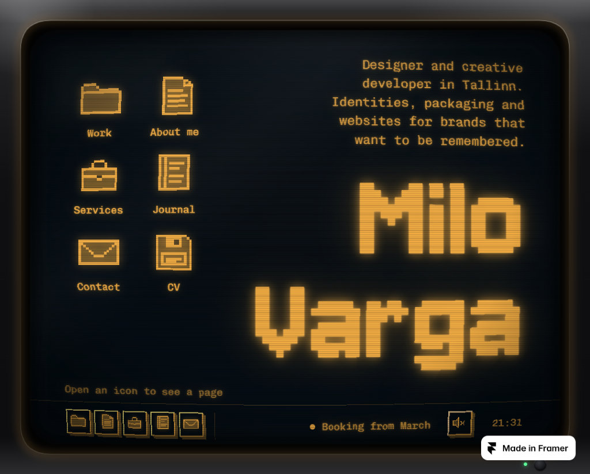
*Figure 1.1: Powered-off CRT with standby prompt and amber LED indicator.*

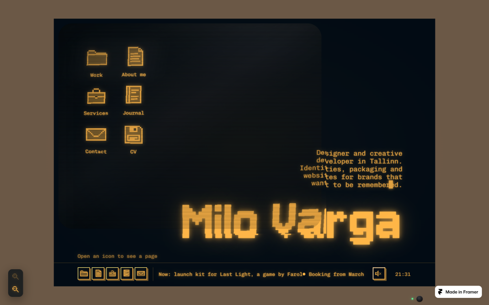
*Figure 1.2: Screen warm-up and phosphor bloom upon system activation.*

#### Behavior & Interaction
* **Power Off State:**
  * When unpowered or powered off via the physical power button on the CRT bezel, the screen is deep black (`#000000`).
  * A retro terminal cursor and blinking text prompt appear: `"Press any key or the power button"`.
  * The monitor bezel LED switch turns amber/orange (`#D48308`).
* **Power On / Boot Trigger:**
  * Triggered by pressing **any keyboard key** (e.g., `Space`, `Enter`) or clicking the **physical bezel power button**.
  * Instant tactile mechanical switch click sound (`switch.mp3`) followed by a retro system beep (`beep.mp3`).
  * Phosphor bloom animation: An authentic amber scanline flash and warm-up flicker transition, expanding horizontally from the center before revealing the desktop.
  * The physical LED turns bright solid green (`#33FF33` glow).
* **Loading Bar / BIOS:**
  * There is no artificial long BIOS memory POST sequence; it transitions swiftly directly to the desktop workspace to prevent user bounce rates while preserving retro aesthetics.

---

### 2. Main Computer Desktop Interface

*Figure 2.1: Full 3D desk view with beige CRT monitor, keyboard, tower, and ambient sunlight.*

*Figure 2.2: Zoomed monitor view focusing on the amber phosphor display.*

#### Visual Architecture & Metaphor
* **Dual Viewport Cameras (Responsive 3D Space):**
  1. **Full Desk View (`>= 1000px` screen width, aspect ratio `>= 1.2`):**
     * Shows a vintage wooden desk surface illuminated by dramatic venetian-blind sunlight shadows.
     * High-detail 3D models: Beige plastic CRT monitor, vintage mechanical keyboard, retro two-button beige mouse, and desktop computer tower.
  2. **Monitor Close-up View (`crt-view-close`):**
     * Camera zooms directly into the CRT glass screen.
     * Framed by a textured beige plastic bezel with cooling slots, a tactile power button, power LED indicator, and camera zoom toggle buttons.
* **CRT Screen Display Shaders & Effects:**
  * **Color Palette:** High-contrast amber phosphor (`#F8A51D` primary highlight, `#D48308` midtone, `#B66E04` border/dim, `#000000` deep black background).
  * **Scanlines:** CSS linear-gradient repeating raster overlay (`rgba(248, 165, 29, 0.05)` scanline lines at 3px intervals).
  * **Curvature & Glass Reflection:** Vignette shadow around the inner perimeter simulating spherical tube curvature, with subtle diagonal glass reflection streaks.
  * **Phosphor Bloom:** Subtle `text-shadow: 0 0 6px rgba(248, 165, 29, 0.6)` on typography and vector borders.
* **Desktop Canvas Content:**
  * **Left Column:** 6 desktop pixel-art icons aligned vertically.
  * **Center / Right Wallpaper Text:**
    * Ambient copy: *"Designer and creative developer in Tallinn. Identities, packaging and websites for brands that want to be remembered."*
    * Huge glowing headline: **`Milo Varga`** in pixelated typography.
    * Prompt hint: *"Open an icon to see a page"*.
* **Bottom Taskbar / Dock:**
  * Fixed bottom dock bar with dark amber borders containing:
    * 5 mini quick-launch icons.
    * Active application pill indicator.
    * Studio availability status badge: `• Booking from March`.
    * Audio toggle button with speaker icon and hover tooltip.
    * Real-time 24-hour digital clock.

---

### 3. Navigation Icons and Desktop Behavior

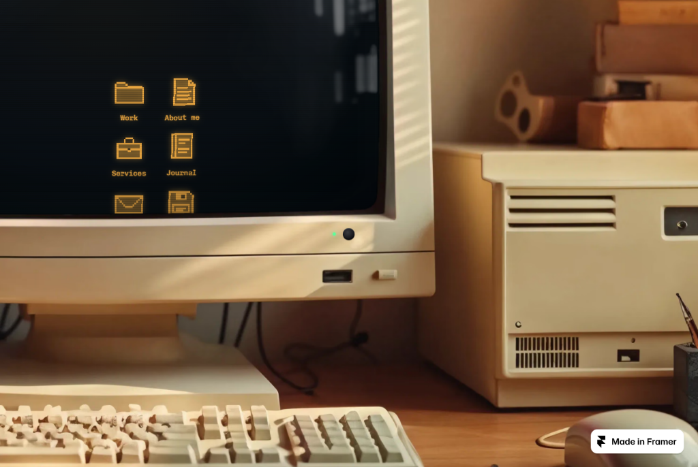
*Figure 3.1: Desktop icons arranged vertically on the left.*

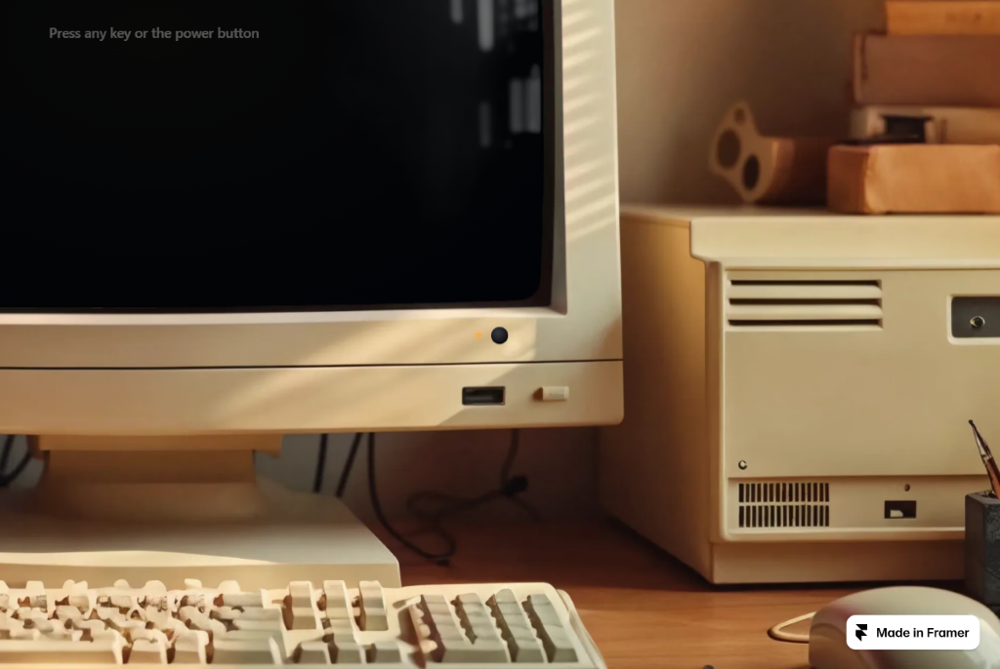
*Figure 3.2: Hover and focus state on desktop icons.*

#### Desktop Icons Breakdown
| Icon Name | Pixel Art Graphic | Target Route / Action | Behavior on Activation |
| :--- | :--- | :--- | :--- |
| **Work** | Folder with tab | `/work` | Opens Work application window inside CRT |
| **About me** | Dog-eared text document | `/about` | Opens About Me application window inside CRT |
| **Services** | Hard-shell briefcase | `/services` | Opens Services application window inside CRT |
| **Journal** | Open notebook with bookmark | `/journal` | Opens Journal application window inside CRT |
| **Contact** | Stamped envelope | `/contact` | Opens New Message email composer window |
| **CV** | 3.5-inch floppy disk | Direct PDF URL | Opens resume PDF in a new browser tab |

#### Interaction Model
* **Activation:** Single-click activates and opens the item (no frustrating double-click required, catering to modern web ergonomics while retaining retro look).
* **Hover State:** Dashed/solid amber highlight box appears around the icon and label, icon brightness increases with an amber glow bloom, and the cursor changes to a pixelated retro pointer.
* **Window Spawning:** Clicking any navigation icon smoothly opens a vintage OS window inside the CRT screen canvas without page reloading or losing desk context.

---

### 4. Work / Projects Interface (`/work`)

*Figure 4.1: Work portfolio window open inside CRT.*

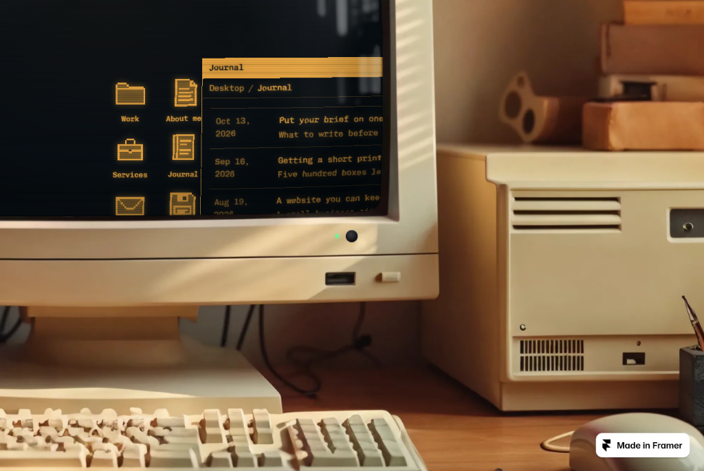
*Figure 4.2: 3-column project cards grid inside the Work window.*

*Figure 4.3: Work window maximized to full CRT display width.*

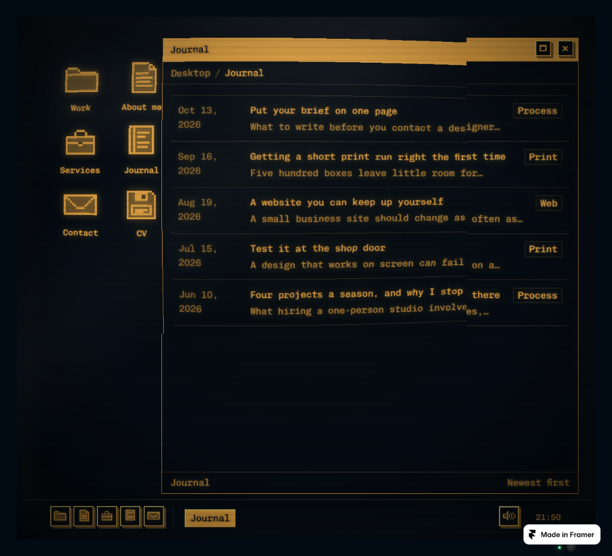
*Figure 4.4: In-depth project case study view (`/work/bolo`).*

#### Window Frame & Controls
* **Window Header:** Striped retro title bar, title `"Work"`, and breadcrumb indicator `Desktop / Work`.
* **Window Controls:**
  * **Maximize Button (Overlapping Rectangles):** Toggles window between standard floating window and full-screen CRT canvas coverage.
  * **Close Button (`x`):** Closes the window and transitions the route back to `/` (Desktop).
* **Project Showcase Grid (10 Total Projects):**
  * Displayed in a responsive 3-column retro grid with thumbnail imagery filtered through an amber duotone / dither aesthetic.
  * Projects listed:
    1. **Bolo (2025):** Cake packaging design
    2. **Last Light (2025):** Press box & game launch kit
    3. **Rumo (2025):** Meal pouches (03)
    4. **Recibo (2025):** Q2 financial report
    5. **Kopje (2024):** Cup carrier & bag
    6. **Vidro (2024):** Glass specimen book
    7. **Cais (2024):** Granite trail cards
    8. **Corte (2023):** Gift box & cards
    9. **Viga (2023):** Steel beam business card
    10. **Dobra (2023):** Photo gallery tablet UI
* **Project Case Study Detail View (`/work/[slug]`):**
  * Clicking any card navigates to the detailed project view.
  * Features high-resolution client imagery, project metadata (Client, Year, Role, Services, Deliverables), structured narrative typography, and an embedded back button to return to the project grid.

---

### 5. About Me Interface (`/about`)

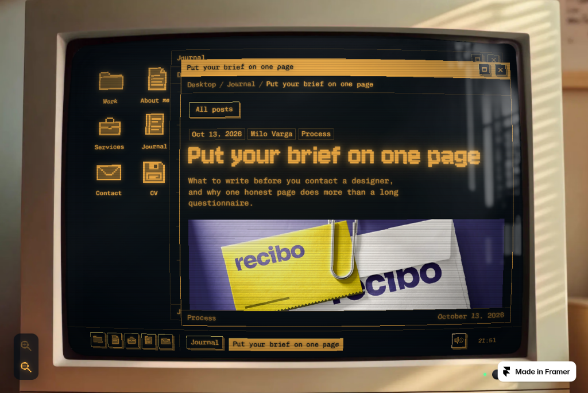
*Figure 5.1: About Me window displaying pixel avatar and bio.*

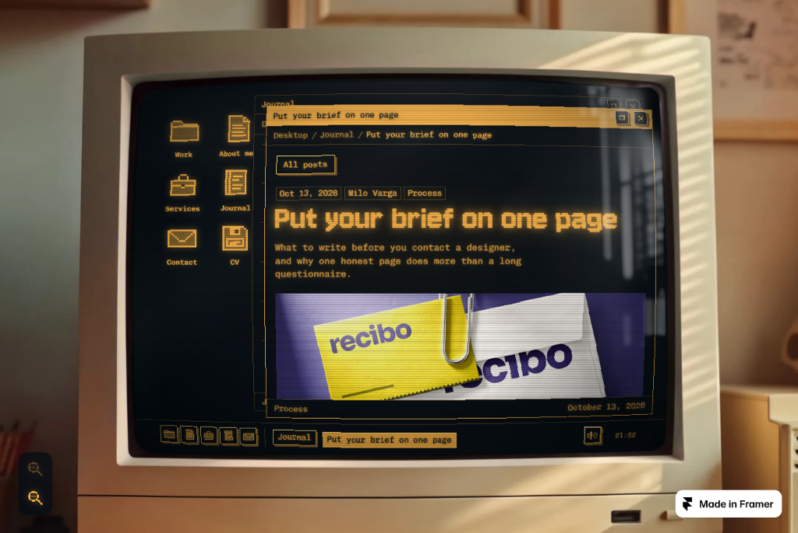
*Figure 5.2: Client list, recognition, and technical colophon.*

#### Content & Layout Structure
* **Header:** Title bar `"About me"`, breadcrumb `Desktop / About me`.
* **Profile Section:**
  * Retro pixel-art avatar portrait of Milo Varga.
  * Personal studio narrative: Solo designer and creative developer operating from Kalamaja, Tallinn, Estonia.
* **Core Competencies ("What I do"):**
  * Brand Identity, Bespoke Packaging, Custom Framer Websites.
* **Client & Studio Roster:** Boutique fashion labels, artisan bakeries, indie game studios, and specialty packaging manufacturers.
* **Accolades & Recognition:** Awwwards Site of the Day, FWA, Type Directors Club.
* **Technical Colophon:** Explicitly documents font choices, retro CRT shader implementation, Framer platform credits, and audio design credits.

---

### 6. Services Interface (`/services`)

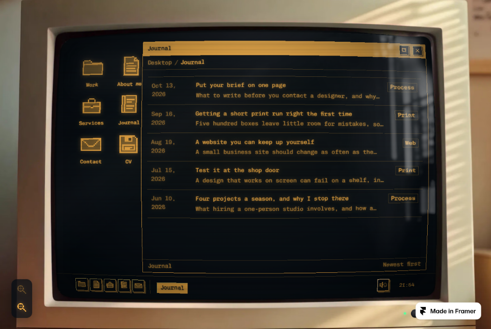
*Figure 6.1: Services window with pricing and scope overview.*

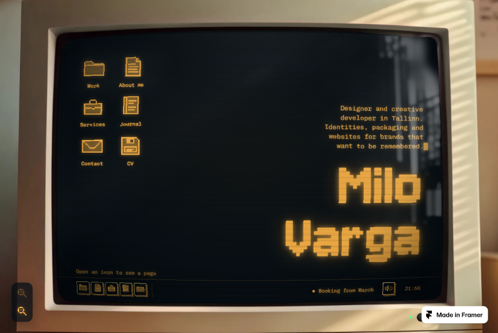
*Figure 6.2: Service package deliverables and direct booking action buttons.*

#### Structure & Offerings
* **Headline:** *"Four things I do, alone or together. Most projects use two. Prices are where projects usually start."*
* **4 Service Packages:**
  1. **Identity:**
     * Price & Timeline: *From €4,000 · 4 to 6 weeks*
     * Deliverables: Logo and wordmark, Type and colour, One-page guide, Files for print and screen.
     * CTA: `[Book an identity]` -> Links directly to `/contact`.
  2. **Packaging:**
     * Price & Timeline: *From €3,000 · Per range, 3 to 5 weeks*
     * Deliverables: Dielines in every size, Artwork per flavour, Press check, Handover.
     * CTA: `[Book packaging]` -> Links directly to `/contact`.
  3. **Websites:**
     * Price & Timeline: *From €3,500 · 3 to 5 weeks*
     * Deliverables: Design and build in Framer, CMS, Search and sharing, Handover call.
     * CTA: `[Book a website]` -> Links directly to `/contact`.
  4. **Launch Kits:**
     * Price & Timeline: *From €5,000 · 6 to 8 weeks*
     * Deliverables: Key art, Store page assets, Press box, Trailer edit.
     * CTA: `[Book a launch kit]` -> Links directly to `/contact`.
* **Live Studio Availability Notice:** Fixed footer badge reaffirming current booking window (`Booking from March`).

---

### 7. Journal Interface (`/journal`)

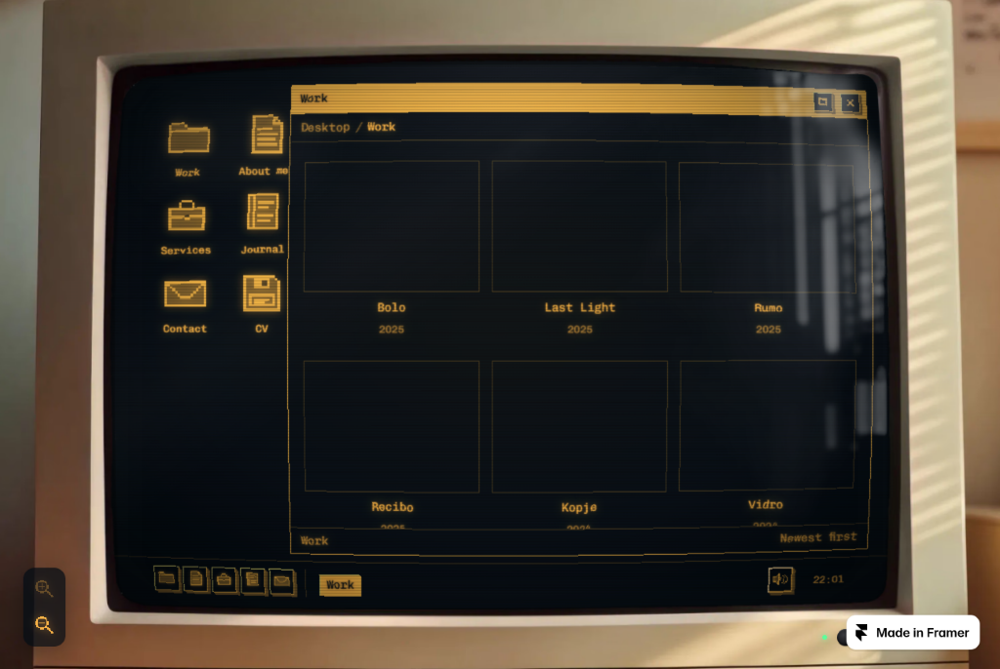
*Figure 7.1: Journal articles index window.*

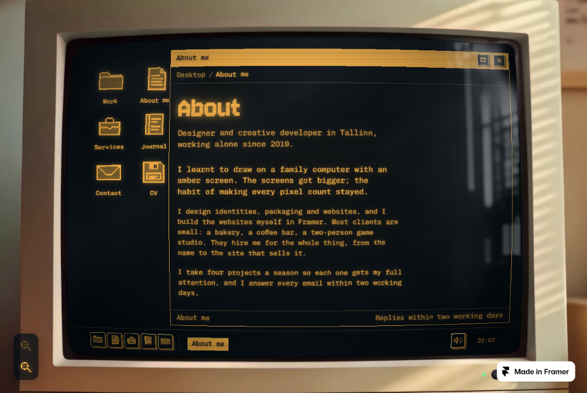
*Figure 7.2: Reading view for selected article.*

#### Content & Reader Architecture
* **Articles Listing (5 Articles):**
  1. *"Put your brief on one page"* (2025)
  2. *"Dielines that printers will actually like"* (2024)
  3. *"What four years of solo practice taught me"* (2024)
  4. *"A website is not a brochure"* (2023)
  5. *"Stop using 12 column grids for everything"* (2023)
* **Reader Interaction:**
  * Clicking an article opens an in-window reader modal.
  * Formatted with retro monospace subheadings, serif body text for long-form readability, pull-quotes with amber border accents, and estimated reading time.

---

### 8. Contact Interface (`/contact`)

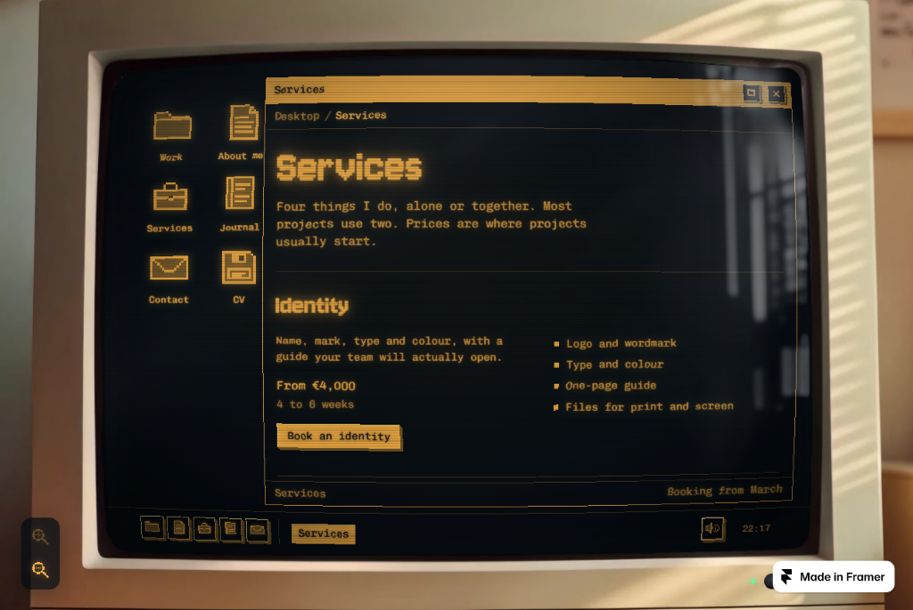
*Figure 8.1: Retro email client contact window.*

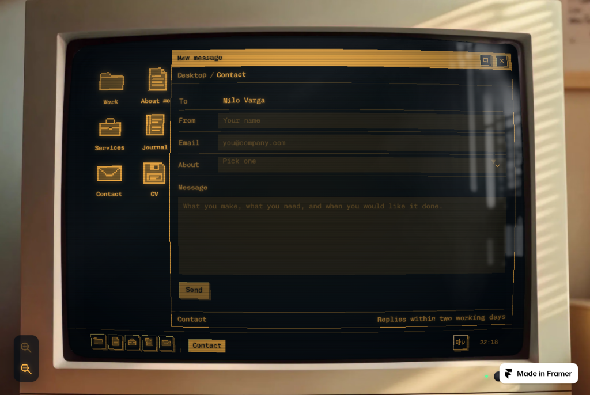
*Figure 8.2: Dropdown selector and message composer.*

#### Design & Interaction
* **Theme:** Styled as an authentic vintage email client window titled `"New message"`.
* **Form Fields:**
  * **`To`:** `Milo Varga` (read-only amber field).
  * **`From`:** Text input with placeholder `"Your name"`.
  * **`Email`:** Email input with placeholder `"you@company.com"`.
  * **`About`:** Native-styled retro dropdown menu with choices:
    * `Pick one` (default)
    * `Identity`
    * `Packaging`
    * `Website`
    * `Something else`
  * **`Message`:** Multi-line textarea (`placeholder="What you make, what you need, and when you would like it done."`).
  * **`Send`:** Beveled amber button with retro click-down 3D inset shadow effect.
* **Sidebar Details:**
  * Direct email link: `hello@milovarga.ee` (`mailto:`)
  * Studio Location: Kalamaja, Tallinn, Estonia
  * Availability: *"New projects from March. Four a season."*
  * Social Links: Instagram, Behance, LinkedIn
  * Response SLA: *"Replies within two working days"*

---

### 9. CV Interaction

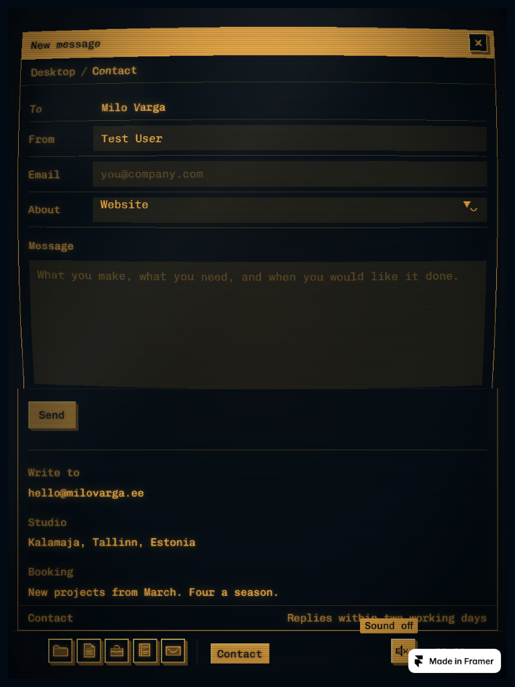
*Figure 9.1: Desktop 3.5" floppy disk CV icon.*

#### Behavior
* The desktop **CV** icon is represented by a 3.5" floppy disk graphic.
* Clicking it activates an `<a>` tag with:
  * `href="https://framerusercontent.com/assets/NuMiMkt5u6yyMoFLqnZJemKpCFs.pdf"`
  * `target="_blank"`
* It directly opens the raw PDF resume in a new browser tab for reading or saving, rather than rendering inside an in-OS window.

---

### 10. Sound Controls and Timer

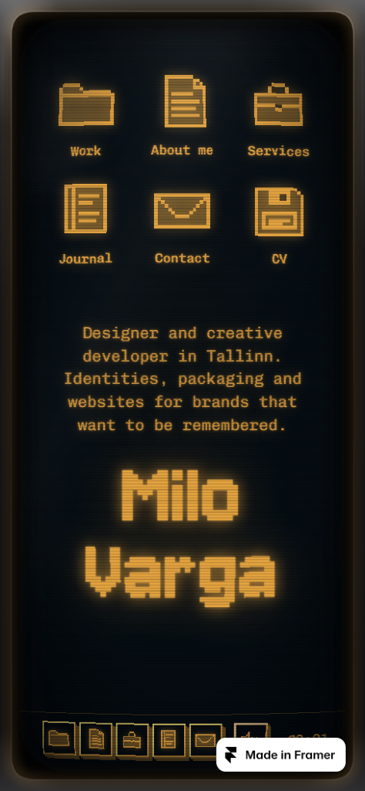
*Figure 10.1: Dock sound toggle with amber tooltip.*

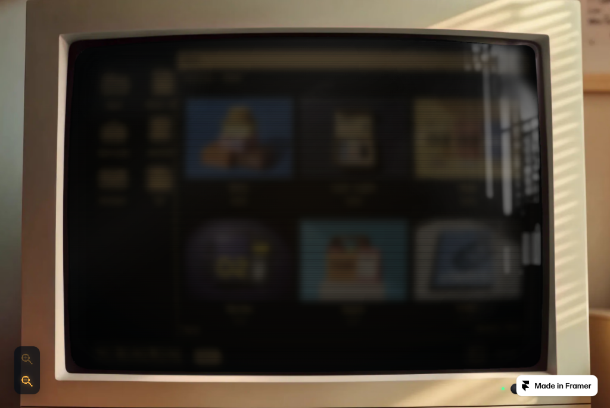
*Figure 10.2: Live 24-hour clock and status indicator.*

#### Audio System
* **Control Button:** Located on the right side of the bottom dock bar with a speaker glyph.
* **State & Accessibility:**
  * Unmuted: `aria-label="Turn the sound off"`
  * Muted: `aria-label="Turn the sound on"`
  * Hover displays tooltip: `"Sound on"` / `"Sound off"`.
* **Audio Assets Loaded in DOM:**
  * `switch.mp3`: Mechanical rocker switch click sound on CRT power on/off.
  * `beep.mp3`: Vintage terminal POST beep.

#### Timer / Clock Widget
* **Clock Type:** Real-time 24-hour digital clock (format: `HH:MM`).
* **Behavior:** Synchronizes with the user's system clock (confirmed updating dynamically from `21:31` to `22:32` during automated inspection).
* It is not a Pomodoro timer or countdown; it is a permanent live status clock reinforcing the operating system illusion.

---

### 11. Animations, Shaders and Micro-Interactions

* **CRT Power Flicker:** Screen collapses to a bright horizontal line then fades to black on power-down, and expands with phosphor bloom on power-up.
* **Camera Focal Shift:** Smooth cubic-bezier camera zoom between the 3D desk view and close-up monitor view.
* **Scanlines & CRT Curvature:** Pure CSS layered background with repeating horizontal gradients, radial vignette corners, and amber phosphor bloom.
* **Window Transitions:** Windows scale smoothly into view with high-frame-rate spring physics (powered by Framer Motion).
* **Retro Custom Cursor:** Pixel-art arrow pointer and retro text selection caret throughout the interface.

---

### 12. Mobile and Tablet Behavior

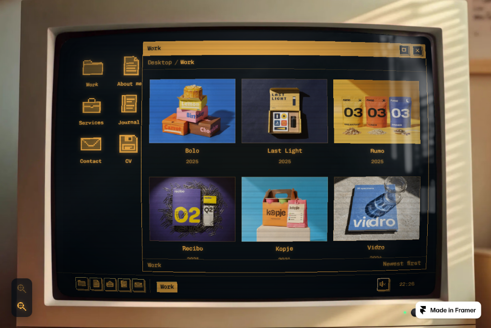
*Figure 12.1: Tablet viewport (768px) scaling CRT monitor to viewport bounds.*

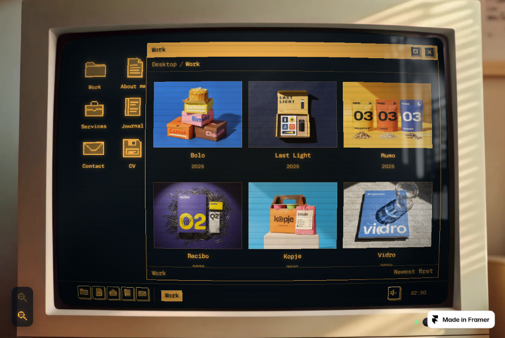
*Figure 12.2: Mobile viewport (390px) portrait layout.*

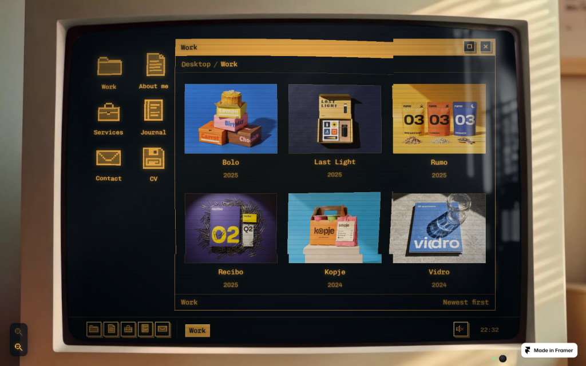
*Figure 12.3: Mobile Work window filled to mobile CRT frame.*

#### Responsive Adaptations
1. **Tablet Viewport (768px - 1024px):**
   * The 3D room/desk background elements are gracefully hidden.
   * The CRT monitor frame expands to 100% of the viewport width.
   * Maintains bezel, power button, and curved CRT corner styling.
   * Desktop icons remain in the left column with ample touch-friendly padding.
2. **Mobile Viewport (375px - 430px / Portrait):**
   * Layout transforms into a dedicated portrait orientation:
     * **Desktop Icons:** Reorganized from a vertical strip into a **3-column x 2-row grid** at the top of the screen.
     * **Hero Copy:** Re-centered below the icon grid with stacked responsive typography.
     * **Open Windows:** Expand to 100% width and height of the CRT mobile container, with title bar buttons optimized for touch targets.
     * **Bottom Dock:** Compacted to show quick-access icons and live digital clock.

---

## Technical Specifications Summary

| Feature | Implementation Details in Reference |
| :--- | :--- |
| **Primary Framework** | Framer (React 18 + SSR / SSG + Framer Motion) |
| **Phosphor Palette** | Bright Amber: `#F8A51D`, Medium: `#D48308`, Dim/Border: `#B66E04`, Black: `#000000` |
| **Bezel Palette** | Retro Computer Beige: `#D6CFC4`, Shadows: `#B5ADA1`, Plastic Texture |
| **Typography** | Retro pixel/bitmap monospace fonts (`Silkscreen`, `VT323`, system monospace fallback) |
| **Audio Format** | HTML5 Audio (`switch.mp3`, `beep.mp3`) |
| **Window State** | URL-based routing (`/`, `/work`, `/work/:id`, `/about`, `/services`, `/journal`, `/contact`) |
| **Responsive Breakpoints** | `1000px+` (Desk 3D), `768px-999px` (Tablet CRT Fullscreen), `<768px` (Mobile Portrait Grid) |

---

## Key Recommendations for Clone / Re-implementation

1. **State-Driven Window Manager:** Implement a URL-synchronized window manager (e.g. Next.js App Router or React Router) where routes map to window states.
2. **Canvas / CSS CRT Layer:** Decouple the CRT screen shader (scanlines, vignette, bloom) into a reusable wrapper component so any content rendered inside gains the retro look automatically.
3. **Sound System:** Use Web Audio API or HTML5 Audio with user interaction checks to prevent autoplay restrictions, storing mute state in `localStorage`.
4. **Touch-First Responsive Metaphor:** On mobile, transform the desktop icon column into the 3x2 grid as discovered on the reference to provide effortless tapping without horizontal scrolling.

---
*Inspection completed and documented by Antigravity Automation.*
