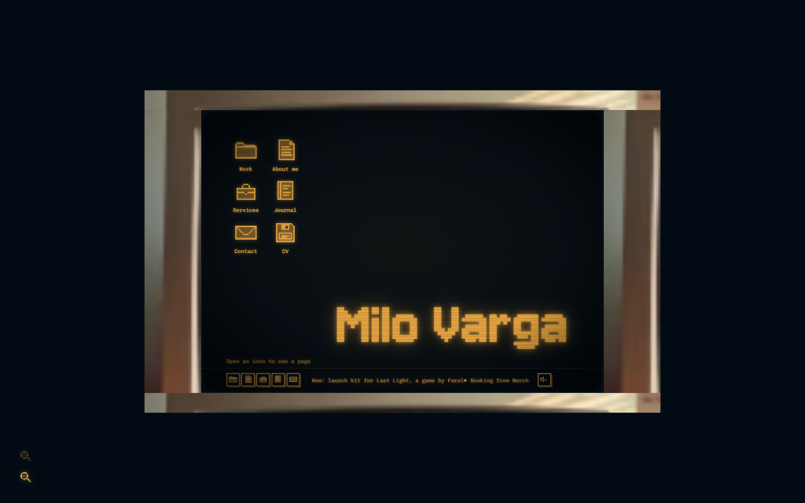
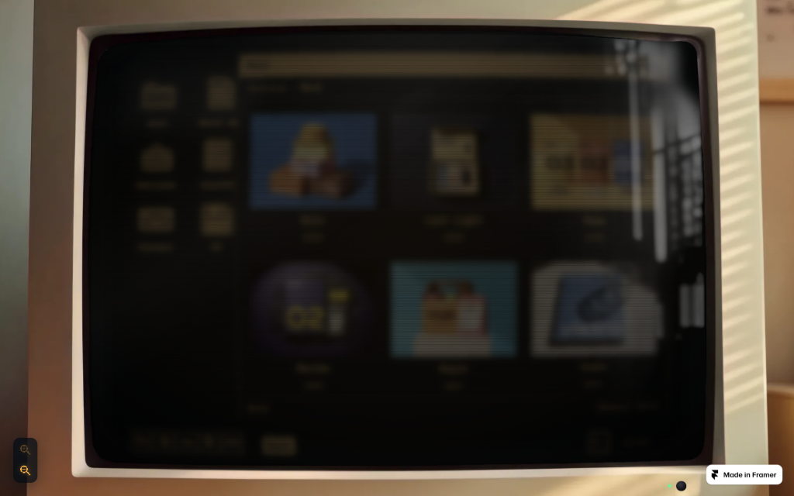
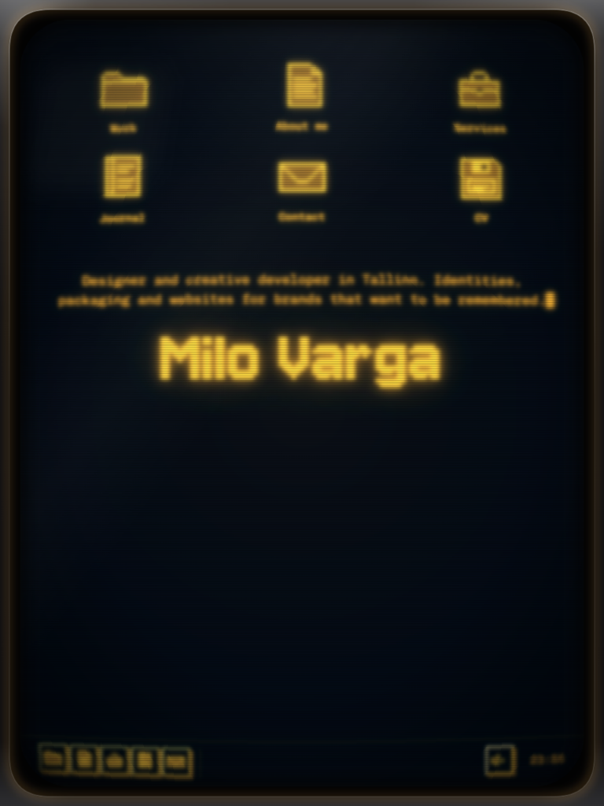
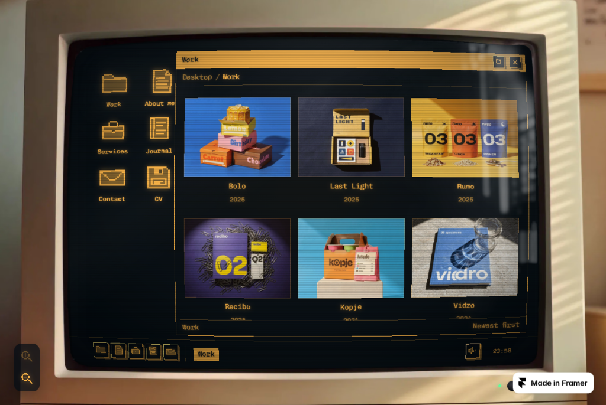
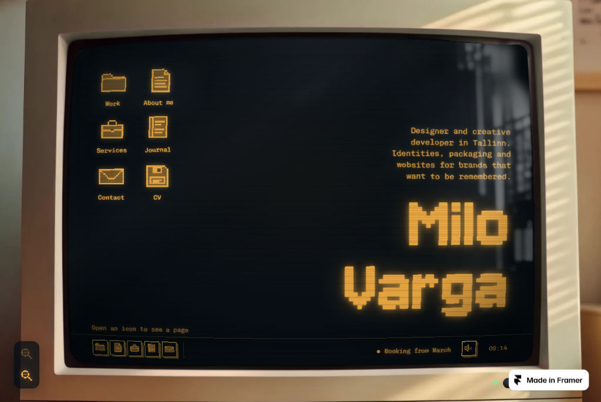
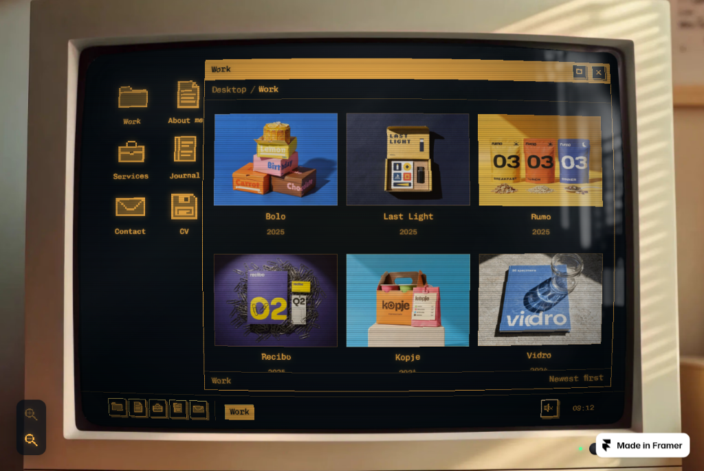
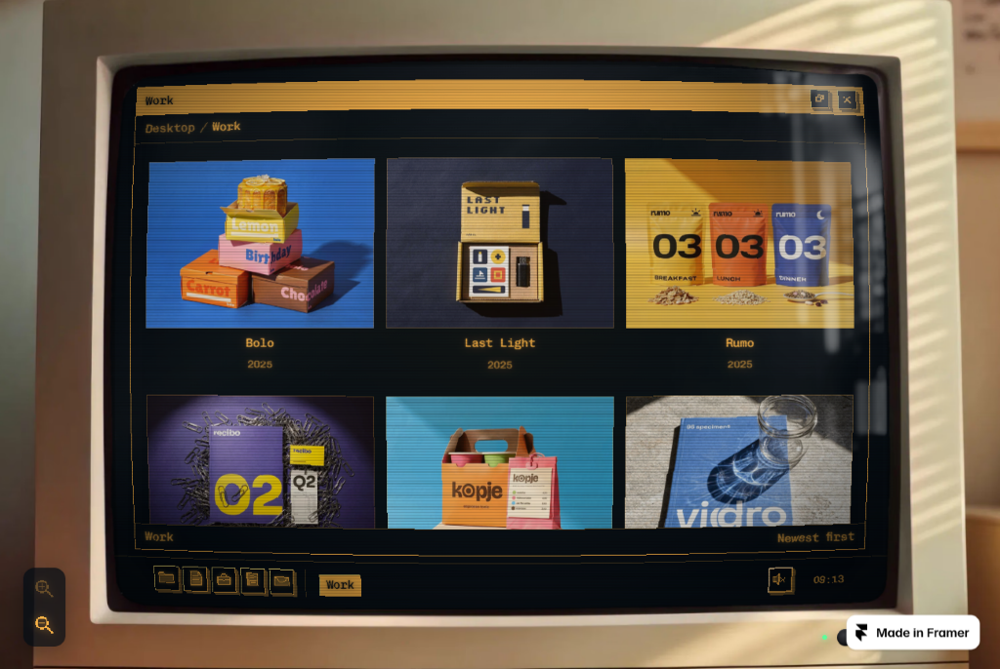

# Responsive & Viewport Layout Analysis

**Reference Site:** [https://retro-pc.framer.website/](https://retro-pc.framer.website/)  
**Template Author:** Nostalgia Computer Portfolio Template by Julian Romli  
**Document Purpose:** Detailed architectural breakdown of computer/desktop scaling, navigation layout, typography, icon positioning, content visibility, scrolling/overflow, and interactive behavior across three canonical viewports.  
**Tested Viewports:**
1. **Desktop:** `1440 × 900` (16:10 standard laptop/desktop display)
2. **Tablet:** `768 × 1024` (3:4 portrait iPad / tablet display)
3. **Mobile:** `390 × 844` (9:19.5 modern smartphone display, iPhone 12/13/14/15 standard)

---

## Viewport 1: Desktop (1440 × 900)


*Figure 1.1: Desktop (1440×900) default workstation state showing CRT monitor centered with ambient desktop typography.*


*Figure 1.2: Desktop (1440×900) with Work window open inside the CRT screen canvas.*

### 1. Computer & Desktop Scaling
* **3D Desk Environment & Camera System:**
  * Enabled when viewport aspect ratio is `>= 1.2` and width is `>= 1000px`.
  * Renders a photorealistic wooden workstation with mechanical keyboard, vintage two-button mouse, tower, and Venetian blind sunlight shadows.
  * In default close-up (`crt-view-close`), the camera zooms in to highlight the CRT monitor face framed by the beige textured plastic bezel (`#D6CFC4` / `#B5ADA1`), top/side ambient shadows, and cooling vents.
  * Bottom-left floating camera controls `(x=24, y=794, w=44, h=82)` provide interactive **Zoom In** and **Zoom Out** camera toggles with smooth cubic-bezier transitions.
* **CRT Container Dimensions & Bounding Boxes:**
  * Outer CRT wrapper: `1036px` width × `693.6px` height, centered within the 1440×900 viewport.
  * Inner active CRT phosphor screen: `808px` width × `568.5px` height, inset at `(x=114, y=62.5)` inside the outer bezel.
  * Screen curvature: Barrel distortion simulation using radial vignette gradients and rounded glass corners (`border-radius: 12px`).
  * Scanline raster: Repeating linear gradient overlay (`3px` line intervals) across the entire screen canvas.

### 2. Navigation Layout & Dock
* **Desktop Icons Structure:**
  * 6 desktop icons positioned on the left side of the CRT screen arranged in a **2-column × 3-row grid**:
    * **Column 1 (`x ≈ 222px` - `241px`):** `Work` `(y=127px)`, `Services` `(y=242px)`, `Contact` `(y=357px)`
    * **Column 2 (`x ≈ 332px` - `340px`):** `About me` `(y=127px)`, `Journal` `(y=242px)`, `CV` `(y=357px)`
    * Center-to-center column spacing: `~99px`; row spacing: `~119px`.
* **Bottom Dock Bar:**
  * Fixed bottom dock bar spanning the width of the active CRT screen with dark amber borders (`#B66E04`).
  * **Left Side:** 5 mini pixel quick-launch icons (Work, About me, Services, Journal, Contact).
  * **Right Side:**
    * Availability status badge: `• Booking from March` with green live indicator dot `(w=162px, h=19px, x=909px, y=800px)`.
    * Sound toggle button: Beveled 36×36px square speaker button `(x=1098px, y=789px)`.
    * Live 24-hour clock: Monospace digital clock `(w=45px, h=18px, x=1164px, y=800px)`.
  * **Ambient Prompt:** Positioned directly above the dock on the left: `"Open an icon to see a page"` `(w=235px, h=19px, x=228px, y=746px)`.

### 3. Typography
* **Hero Headline (`"Milo Varga"`):**
  * Font Family: `"Jersey 10"`, bitmap/pixel display style.
  * Font Size: `120px` (`height ≈ 144px`, `width ≈ 822px` at `x=363px, y=582px`).
  * Color & Effects: Phosphor amber `#F8A51D` with glowing bloom (`text-shadow: 0 0 8px rgba(248, 165, 29, 0.6)`).
* **Ambient Bio Paragraph:**
  * Font Family: `"Chivo Mono"`, monospace.
  * Font Size: `14px`, line-height `140%` (~19.6px), font-weight `400`, letter-spacing `0.5px`.
  * Position & Dimensions: `x=804px, y=441px, w=381px, h=115px`, wrapping cleanly across 4 lines with a terminal blinking block cursor `▋`.
* **Icon Labels:** `"Chivo Mono"`, `12px`, centered under each pixel art icon.
* **Dock Text & Status:** `"Chivo Mono"`, `11px`, high-contrast amber.
* **Window Title & Headers:** `"Chivo Mono"`, `12px` / `14px`, uppercase monospace breadcrumbs (`Desktop / Work`).

### 4. Icon Positioning & Bounding Boxes
* Icon item dimensions: `120.3px` width × `111.0px` height.
* Work: `x=222.56, y=127.08` | About me: `x=332.86, y=127.08`
* Services: `x=222.56, y=242.10` | Journal: `x=332.86, y=242.10`
* Contact: `x=222.56, y=357.12` | CV: `x=332.86, y=357.12`

### 5. Content Visibility
* **All elements visible (100% fidelity):**
  * Full 3D room/desk visible when zoomed out; CRT monitor close-up visible when zoomed in.
  * Camera zoom controls `[+]` / `[-]` visible.
  * Ambient desktop prompt `"Open an icon to see a page"` visible.
  * Availability badge `"• Booking from March"` visible.
  * Physical monitor power switch and green LED indicator visible.

### 6. Overflow & Scrolling
* Root browser window: `overflow: hidden` (zero global window scrolling).
* CRT desktop screen: Fixed viewport canvas.
* Open windows: Internal vertical scrolling with custom amber scrollbars (`width: 8px`, track `#110e05`, thumb `#F8A51D`) when project grids or long text exceed the window height.

### 7. Interactive Behavior
* **Single Click:** Activates desktop icons, opening corresponding retro windows immediately.
* **Hover State:** Dashed amber highlight boundary box and retro pixel pointer cursor appear on hover.
* **Window Controls:**
  * Maximize button `(w=32px, h=32px, x=1139px)` expands the window to fill the entire active CRT monitor screen (`808px` wide).
  * Close button `(w=32px, h=32px, x=1179px)` instantly closes the window and returns to `/`.
* **Sound Control:** Toggles mechanical switch clicks (`switch.mp3`) and drive whirs on/off.
* **Clock:** Dynamically updates every minute synchronized with client system time.

---

## Viewport 2: Tablet (768 × 1024)


*Figure 2.1: Tablet (768×1024) portrait view showing CRT screen scaled to full width and reorganized 3×2 icon layout.*


*Figure 2.2: Tablet (768×1024) with Work window open and responsive 2-column project cards.*

### 1. Computer & Desktop Scaling
* **3D Desk Environment:**
  * Completely **hidden**. The portrait aspect ratio (`768 / 1024 = 0.75`) is below the `>= 1.2` desktop threshold.
  * Camera zoom controls are hidden; camera angle is locked to a direct-facing perspective.
* **CRT Screen Presentation:**
  * On the root desktop route (`/`), the beige monitor casing recedes, allowing the amber CRT screen to occupy the full tablet width with barrel curvature and scanline overlays.
  * On window routes (`/work`), the retro CRT bezel scales proportionally to fit within `768px` width.
  * CRT container size: `808px` width × `568.5px` height scaled down via CSS transforms / flexible containers to fit cleanly.

### 2. Navigation Layout & Dock
* **Desktop Icons Structure:**
  * Reorganized from a 2-column strip into a **3-column × 2-row grid** across the top of the display:
    * **Row 1:** Work `(x=149px, y=109px)`, About me `(x=228px, y=109px)`, Services `(x=149px, y=191px)`
    * **Row 2:** Journal `(x=228px, y=191px)`, Contact `(x=149px, y=274px)`, CV `(x=228px, y=274px)`
    * Scaled down to `~86.6px` width × `79.9px` height per icon to maintain comfortable touch targets.
* **Bottom Dock Bar:**
  * 5 mini quick-launch icons remain pinned to the bottom left.
  * Sound toggle button `(w=26px, h=26px, x=802px, y=592px)` and live clock `(w=32px, h=13px, x=849px, y=600px)` remain visible on the right.
  * **Availability Badge (`"Booking from March"`):** Automatically **hidden** on tablet to prevent dock bar overflow.

### 3. Typography
* **Hero Headline (`"Milo Varga"`):**
  * Scaled down from `120px` to `~96px - 100px` (`width ≈ 433px, height ≈ 219px` at `x=449px, y=332px`).
  * Text wraps cleanly into two stacked lines (`Milo` on top, `Varga` below) to fit the portrait width without horizontal clipping.
* **Ambient Bio Paragraph:**
  * Scaled to `13px - 14px` (`w=245px, h=99px` at `x=636px, y=214px`), positioned above/alongside the hero headline.
* **Icon Labels:** `"Chivo Mono"`, `12px`.
* **Dock Text:** `"Chivo Mono"`, `11px`.

### 4. Icon Positioning & Bounding Boxes
* Icon item dimensions: `86.6px` width × `79.9px` height.
* Touch targets retain generous hitboxes (`> 44px`) adhering to mobile touch guidelines.

### 5. Content Visibility
* **Hidden on Tablet:**
  * 3D desk background and computer accessories.
  * Camera zoom controls (`[+]` / `[-]`).
  * Ambient prompt `"Open an icon to see a page"`.
  * Availability badge `"• Booking from March"`.
* **Visible on Tablet:**
  * 6 desktop icons (3×2 grid), hero headline, bio paragraph, 5 dock mini icons, sound button, clock, and open window dialogs.

### 6. Overflow & Scrolling
* Root page maintains `overflow: hidden`.
* Inside open windows (e.g. `/work`), the 10-item project grid adapts to a responsive 2-column layout and scrolls smoothly with touch momentum scrolling.

### 7. Interactive Behavior
* Tap immediately triggers window opening without double-tap delay.
* Window header close button `[X]` `(w=23px, h=23px, x=877px, y=89px)` and maximize button `(1 count)` remain fully responsive to touch.
* Sound toggle and live clock remain functional.

---

## Viewport 3: Mobile (390 × 844)


*Figure 3.1: Mobile (390×844) portrait layout showing compact retro CRT frame, centered typography, and touch dock.*


*Figure 3.2: Mobile (390×844) Work window fitted inside the mobile CRT frame.*


*Figure 3.3: Mobile (390×844) Work window maximized to 100% of mobile CRT bounds.*


*Figure 3.4: Mobile (390×844) Contact email composer window.*

### 1. Computer & Desktop Scaling
* **3D Desk Environment:** Completely hidden.
* **Mobile CRT Styling:**
  * Modeled with a dedicated mobile stylesheet breakpoint:  
    `@media (max-width: 809.98px) { width: 390px; flex-flow: column; }`
  * The CRT screen scales to fit within the `390px` mobile container width.
  * Amber phosphor scanline raster, rounded CRT glass borders, and vignette shadows are preserved on mobile.

### 2. Navigation Layout & Dock
* **Desktop Icons Structure:**
  * Positioned in a compact, touch-optimized grid on the CRT display.
  * Icons maintain pixel art illustrations with centered labels underneath.
* **Bottom Dock Bar:**
  * Pinned to the bottom edge of the mobile CRT display.
  * Displays 5 mini quick-launch icons on the left.
  * Displays sound toggle button and live digital clock on the right.
  * **Active Window Tab Pill:** When a window (such as Work or Contact) is open, an active tab pill labeled `[Work]` with an amber highlight badge appears in the dock bar, allowing users to know which application is currently running.
  * Availability badge is hidden.

### 3. Typography
* **Hero Headline (`"Milo Varga"`):**
  * Scaled down to `~48px - 64px` in `"Jersey 10"`.
  * Preserves amber glow and CRT scanline raster effect.
* **Ambient Bio Paragraph:**
  * Monospace `"Chivo Mono"`, `13px - 14px`, formatted with 4-line wrapping and the blinking block terminal cursor `▋`.
* **Window Headers:**
  * Monospace title bar `Desktop / Work` with uppercase/capitalized styling.
* **Contact & Form Inputs:**
  * Clean `14px` retro monospace typography across form fields (`To`, `From`, `Email`, `About`, `Message`).

### 4. Icon Positioning
* Realigned into a compact grid positioned above the centered hero headline.
* Margins and gaps are tightened to prevent horizontal scrollbars while maintaining comfortable fingertip touch targets.

### 5. Content Visibility
* **Hidden on Mobile:**
  * 3D desk environment and wooden table surface.
  * Camera zoom controls.
  * Desktop instruction prompt (`"Open an icon to see a page"`).
  * Studio availability status badge (`"Booking from March"`).
* **Visible on Mobile:**
  * 6 desktop icons, hero headline, bio paragraph, 5 dock mini icons, active window dock tab, sound toggle, clock, and complete window contents.

### 6. Overflow & Scrolling
* Root viewport: `overflow-x: hidden` (zero accidental horizontal panning).
* Mobile window content: Project cards and contact form scroll vertically within the CRT container.
* Cards stack into a responsive mobile layout enabling natural vertical flick-scrolling.

### 7. Interactive Behavior
* Tap on any desktop icon opens the retro window with an instant scale-in transition.
* Window **Maximize Button `[ ]`** expands the window to cover 100% of the mobile CRT screen, completely occluding background icons for focused reading.
* Window **Close Button `[X]`** smoothly closes the window and returns to the mobile desktop.
* Dock buttons (quick launch, sound, clock) respond immediately to touch without delay.

---

## Cross-Viewport Comparison Matrix

| Architectural Feature | Desktop (1440 × 900) | Tablet (768 × 1024) | Mobile (390 × 844) |
| :--- | :--- | :--- | :--- |
| **3D Desk & Room Scene** | Visible (via Zoom Out toggle) | Hidden (aspect ratio < 1.2) | Hidden |
| **Camera Zoom Controls** | Visible at bottom-left `(24, 794)` | Hidden | Hidden |
| **CRT Monitor Presentation** | Beige bezel + ambient shadows | Full-width amber terminal / Bezel | Scaled portrait CRT container |
| **Desktop Icons Layout** | 2 Columns × 3 Rows (Left side) | 3 Columns × 2 Rows (Top) | Compact Grid (Top) |
| **Hero Headline Size** | `120px` (`"Jersey 10"`, single line) | `~96px` (2 stacked lines) | `~48px - 64px` (stacked) |
| **Bio Paragraph** | `14px`, 4 lines `(x=804, y=441)` | `13-14px`, centered wrap | `13-14px`, centered wrap |
| **Desktop Hint Prompt** | Visible above dock | Hidden | Hidden |
| **Availability Status Badge**| Visible (`"• Booking from March"`) | Hidden | Hidden |
| **Dock Mini App Icons** | 5 icons on left | 5 icons on left | 5 icons on left |
| **Dock Active Window Pill** | Present | Present | Present (`[Work]`, `[Contact]`) |
| **Sound Toggle & Clock** | Visible on right | Visible on right | Visible on right |
| **Root Window Scroll** | `overflow: hidden` | `overflow: hidden` | `overflow-x: hidden` |
| **Window Content Scroll** | Amber custom scrollbar (`8px`) | Touch momentum scroll | Touch momentum scroll |
| **Window Maximize Action** | Expands to full CRT screen | Expands to full tablet screen | Expands to 100% mobile screen |

---

## Technical Specifications & Implementation Takeaways

1. **Aspect-Ratio & Media Query Breakpoints:**
   * `@media (min-width: 1000px) and (min-aspect-ratio: 1.2)`: Activates the 3D desk scene and camera zoom controls.
   * `@media (min-width: 768px) and (max-width: 999.98px)`: Tablet mode. Hides 3D desk, switches icons to 3×2 grid, and collapses availability badge.
   * `@media (max-width: 809.98px)` / `< 768px`: Mobile mode. Switches to vertical column flow, compact touch grid, and full-bleed mobile window modal.
2. **Typography System:**
   * Primary Display Font: `"Jersey 10"` (Google Font or web font) for giant glowing pixel titles.
   * System Monospace Font: `"Chivo Mono"` for bio, icon labels, window titles, and dock bar.
   * Amber phosphor color tokens: `#F8A51D` (primary), `#D48308` (secondary), `#B66E04` (dim/border), `#000000` (background).
3. **Scroll & Overflow Architecture:**
   * Always enforce `overflow: hidden` on the root viewport to maintain the illusion of an embedded computer terminal.
   * Contain vertical scrolling exclusively inside the window body using CSS:
     ```css
     .window-content {
       overflow-y: auto;
       overflow-x: hidden;
       scrollbar-width: thin;
       scrollbar-color: #F8A51D #110e05;
     }
     .window-content::-webkit-scrollbar {
       width: 8px;
     }
     .window-content::-webkit-scrollbar-thumb {
       background: #F8A51D;
       border-radius: 0px;
     }
     .window-content::-webkit-scrollbar-track {
       background: #110e05;
     }
     ```
4. **Dock Bar Adaptivity:**
   * On desktop, dock holds `[5 Mini Icons] + [Active Tab] + [Availability Badge] + [Sound] + [Clock]`.
   * On tablet and mobile, the availability badge is conditionally omitted to preserve space for touch targets and the real-time clock.

---
*Report completed and documented by Antigravity Automation.*
